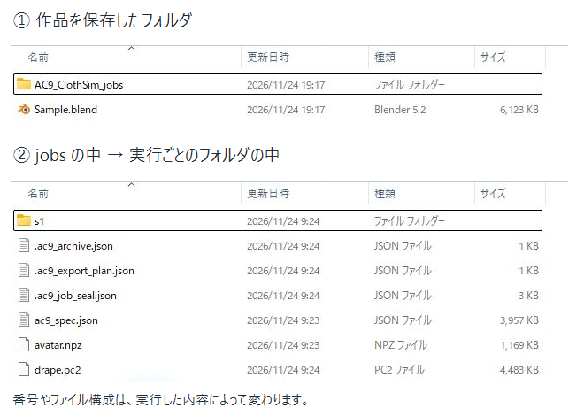
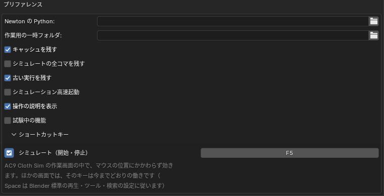
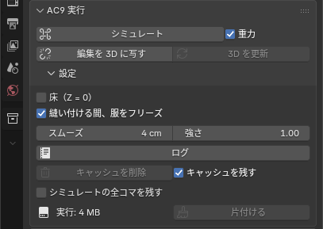
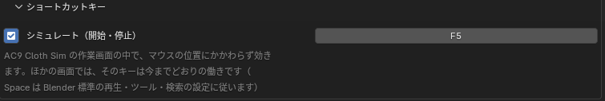

# Before you start

After installing, choose where to save your work and how much simulation progress to keep. Then continue to [Your first garment](first-garment.md). If Blender is new to you, see [Blender basics](blender-basics.md).

## Ask an AI about using the add-on {#ask-ai}

1. Copy **LLM/README.md** from the **installed add-on**. Use the documentation that came with the same version.
2. Attach it to your AI. For button-by-button instructions, also attach `procedures.md` from the same folder.
3. Include the add-on version, what you want to do, and the current screen state.

The documentation is installed with the main add-on. You do not need to keep the downloaded ZIP or its extracted folder. For example, the default Windows user extension repository for Blender 5.2 may contain it here:

```text
%APPDATA%\Blender Foundation\Blender\5.2\extensions\user_default\ac9_cloth_sim\LLM
```

Paste the folder path into File Explorer's address bar. Copy the documents to your own working folder; do not move or edit the installed files. This is an example: Blender versions, repository names and custom locations differ. If missing, check the repository path in Blender's **Preferences > Get Extensions**, and look inside the main `ac9_cloth_sim` add-on, not Runtime.

For example, ask: “Using this version's guide, how should I save my work if I only need the final garment shape?” This does not imply an AI service is built in, data is sent automatically, or your AI is authorized to operate Blender. Check its instructions against your version's screen.

## Save a separate copy before working {#save-first}

Save the project under another name as a **.blend** so the original remains separate. This is your project's location, not Blender's installation folder.



This is an actual project folder. **Sample.blend is the project file; AC9_ClothSim_jobs is a folder.** The lower part shows one run's numbered folder, containing playback files such as `drape.pc2`. You do not need to edit those files individually.

The pattern, placement, settings and saved garment shape are stored in the .blend at the time you save. To keep progress as well, also keep the adjacent result folder. Before the project has been saved, results use temporary storage; choosing the project location first makes the backup destination clear.

## Settings to check first {#settings}

Open **Edit > Preferences > Add-ons > AC9 Cloth Sim**. Run settings are under **AC9 Run > Settings** in the Properties editor's **Tool** tab.





| Setting | Effect | What to check |
|---|---|---|
| Simulation Working Directory | Working location during calculation; empty uses Blender/OS temporary storage | Separate from the project location; choose a working disk if needed |
| Fast Simulation Start | Starts the solver ready, retains its model and prepares the next run after editing; on by default | Waiting also uses GPU memory; consider turning it off if memory is insufficient |
| Keep Cache | Retains recorded progress; on by default | Turn off if you only need the last shape; the saved garment shape remains |
| Keep All Simulate Frames | Records beyond sewing; off by default | Requires Keep Cache; long runs have a recording limit |
| Keep Old Runs | Keeps previous result folders for a garment; off by default | Enable for comparisons; otherwise older runs are cleaned up while keeping the latest |
| Hotkeys | Changes or disables the simulation start/stop key in the AC9 work screen | F5 is the current default; check your own assignment |

The cache settings also appear in **AC9 Run > Settings**. Both places control the same preferences.

### F5 starts and stops; Space keeps Blender's action

In the AC9 work screen, **F5** starts and stops Simulate by default. **Space** keeps Blender's playback, tools or search action. If you changed the key or use a setting from an older version, check **Hotkeys** in the add-on preferences. Outside the AC9 work screen, F5 does not start this simulation. Timeline playback and calculating cloth are different operations.



## Separate the last shape from recorded progress {#shape-and-frames}

Keeping the last garment shape and playing back intermediate frames are different things. **Check that the garment's shape changes, not just the frame number.**

| State | Changing the timeline frame |
|---|---|
| Recorded progress is loaded | Displays shapes within the recorded range, including sewing |
| Progress was deleted with Delete Cache | Cannot retrieve that run's intermediate shapes; the last shape remains |

| What to keep | Required setting and data |
|---|---|
| Last shape | A .blend saved with the shape; progress is optional |
| Sewing progress | Keep Cache on; normal Simulate records sewing and a short period after it |
| Progress after sewing as well | Also turn Keep All Simulate Frames on; recording stops at its limit |

The current limit is **1,500 intermediate frames**. Calculation continues after it, and the last shape remains. Sewing-only playback jumps from the end of that interval to the last shape. If only the start and last shape were recorded, progress is discarded. Timeline frames and solver steps are not necessarily one-to-one. Read the recorded range in Result; see [Run](features/run.md#recording-progress) for details and Phase Sim conditions.

## Where data is saved {#storage}

| Data | Location | Purpose |
|---|---|---|
| Patterns, seams, placement, settings and saved garment shape | Inside the .blend | Reopen, edit and continue calculating |
| Recorded progress and result files | Adjacent `AC9_ClothSim_jobs` folder | Playback and inspection |
| Working data and prepared mesh | Simulation working directory | Calculation and preparing the next run |
| A recovery copy before results reach the project folder | Temporary recovery storage | Holds results until copying finishes; not a project backup |

Calculation writes to working storage and copies received results beside the project. An unsaved project has no adjacent destination yet. Resolve pending-copy or missing-destination messages before moving files. See the [folder example](#save-first).

## What deleting a cache changes {#cache}

| Kind | Deletion | What remains |
|---|---|---|
| Recorded progress | Delete Cache deletes playback frames and files; Undo does not restore the files | Pattern, settings and the last garment shape; the identical old progress cannot be recreated |
| Old run folders | Clean Up removes unneeded older results; current references are protected | Latest result and the .blend; deleted old progress cannot be restored |
| Prepared mesh | Separate from the progress-deletion button | Rebuilt when preparation needs it |
| GPU program cache | Not a routine deletion target; Delete Cache does not remove it | Regeneration takes preparation time |

Shared Python components such as Newton are not these caches. For removal, follow [Installation](install.md). [Run](features/run.md#recording-progress) explains Delete Cache and result status.

## Before deleting or moving {#before-moving}

- Decide whether you need the shape alone or recorded progress too.
- If you need progress, wait for copying to finish and back up the result folder. Saving the .blend under another name alone does not duplicate progress files.
- Deleted progress and old results cannot be restored as the same calculation.
- Check free space on the backup disk; size depends on the garment and recording range.

## Another PC and backups {#backup}

| Purpose | Take with you | Check |
|---|---|---|
| View the saved shape and continue | The .blend and externally referenced avatars, images and other assets | The destination needs a compatible add-on and calculation environment |
| Play recorded progress too | Also the adjacent `AC9_ClothSim_jobs` | Keep the folder relationship and test actual playback |
| Import the source again | Also the required BOM, FBX, DXF and other source files | Different from merely viewing an already imported pattern |

Moving folders does not guarantee that every reference is repaired. Seeing the last shape alone does not prove progress was copied successfully.

## The first calculation needs preparation {#first-run}

Installing calculation components, generating GPU programs for the first time and preparing a garment are separate processes. Starting after installation or an update may take time. Watch the status and do not repeatedly press the run button. See [settings](#settings) for ready-state options, and [Calculation flow](internals/simulation.md) for the internal process.
