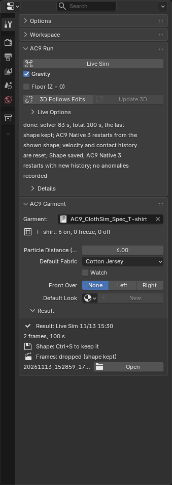
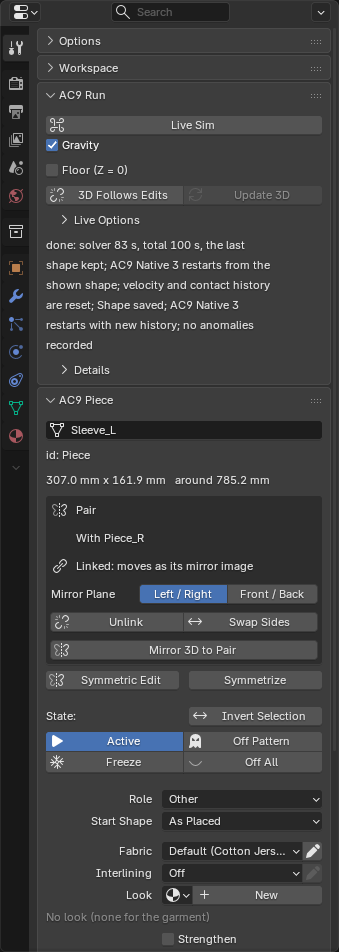
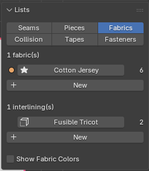

# Fabrics and Garment Settings

## AC9 Garment in the Tool tab

It appears in the Tool tab when nothing is selected.

- **Garment**: the garment you are working with.
- **Particle Distance (mm)**: the spacing of the points when the cloth is divided into fine triangles (in mm, from 2 to 30, default 6). The smaller it is, the finer the wrinkles that show up, but the slower it runs. 4 mm takes about twice as long as 6 mm.
- **Default Fabric**: the fabric used by pieces that don't have their own fabric. The default for a new garment is **Cotton Jersey**.
- **Watch**: the problem watcher (see below).
- **Default Look**: the default look of pieces (the material used for rendering).
- **Result**: the results box (see the "Run" section).

## AC9 Piece in the Tool tab

It appears in the Tool tab when you've selected a piece. If you select several, the fields show the value of one of the selected pieces; if the values differ, the field name turns red and shows "(mixed)", and changing it affects everything selected.

- The top field: the piece's name (for display; you can also set it with F2). Below it are the number, width x height and the outline length, and the garment group it belongs to.
- **Symmetric Edit**: editing one piece of a symmetric pair (a "left and right pair").
- **State**: the four states ("Piece States and Layering") and **Invert Selection**.
- **Role**: the role.
- **Fabric** and **Interlining**: the fabric and interlining. The pencil on the right opens a screen for fixing that fabric's or interlining's numbers (the same screen as **Edit...** in the **Fabrics** tab of **Lists**).
- **Look**: the appearance (Blender's material field). If empty, the garment's **Default Look** is used.
- **Thickness**: whether to show the dressed garment with thickness (appearance only).
- **Layer** (when Experimental Features is on, or when a piece has a layer): 0 to 9. Between pieces with different numbers, the higher one is kept outside the lower one. When things have settled, set it back to 0 (the arrow on the right does it for all pieces). It doesn't go back automatically.
- **Distance (mm)**: point spacing per piece (finer for only the small parts). The arrow on the left returns it to the garment's value.
- **Elastic**: the rate of shrinking along the piece's long axis (100 means no shrinking).
- **Closes Onto**: the partner piece it is fastened to with buttons ("Buttons (Fasteners)").
- Whether it has been placed ("Placed" or "Not placed yet") and the number of internal lines.
- Changes take effect from the next time you press **Live Sim** (for what takes effect when changed while it runs, see the "Live Sim" section of "Dress (run)").

## The fabrics and interlinings list (Fabrics)

The **Fabrics** tab in **Lists** shows that garment's fabrics. One of them is the default (marked with a star), and every piece always has exactly one fabric.

- One row is one fabric: the color, the name, and the number of pieces using it. Press a row and the pieces of that fabric are selected, and **AC9 Fabric** appears in the Tool tab. **New** at the bottom adds a new fabric with the same numbers as the default fabric.
- **AC9 Fabric**: the name, **Preset** (pick from the prepared fabrics), the numbers (weight, bending, thickness, stretch, shear, hysteresis), **Edit...** (fix the numbers), **Make Default**, **Select Pieces**, and **Delete** (the default fabric can't be deleted).
- The lower half is the interlining list; press a row to get **AC9 Interlining** (**Preset**, **Edit...**, **Select Pieces**, **Delete**). Fixing it affects every piece with that interlining. Add one with **New** and attach it with **Interlining** in **AC9 Piece**.
- **Show Fabric Colors** at the very bottom shows each fabric's color on the pattern.

## The problem watcher (Watch)

When it is on, it records problems that happen while the garment is being dressed (a piece drifting away, seams pulling against each other, a seam being sewn inside out) and paints the place of the first one in red on the garment. It doesn't stop the simulation.

- It is off by default. Turn it on before pressing **Live Sim**.
- Red marks a "candidate for a problem," and it can show up even on a good garment.
- The red is drawn by **Diagnose** > **Problems** under **Overlays** (on by default). If you can't see it, check the overlay eye button in the header and the "Problems" checkbox.

## Strengthen

Select pieces, open Properties → Tool → **AC9 Piece**, and enable **Strengthen**. **Strength Factor** defaults to 5 and ranges from 1 to 100. It multiplies stretch, shear, and bending stiffness equally; 1 leaves stiffness unchanged. Mass, thickness, and rest shape stay the same. Selected pieces and their pairs change together.

A purple tint marks strengthened patterns and 3D pieces; Freeze and Off state colors take priority. Toggle Strengthen or edit the factor during Live Sim: the worker applies it at the next frame that receives the change. Disabling it retains the chosen factor. The setting is saved in the spec and .blend and remains effective until disabled.

Interlining adds the mass and bending of a physical material and is separate from Strengthen. You choose whether to retain the strengthened shape or disable it and let the cloth relax. Large multipliers resist sewing and bending more strongly.

The tint is visible when Overlays → Piece Colors is enabled. If Strengthen changes during a Live run using End Taper, the next Live rebuilds from the shown shape. The visible shape and Strengthen settings are still saved.
