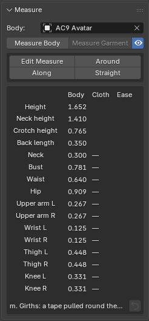

# Measure

What this panel is for: measuring the body, and seeing how much ease a dressed garment has and whether it matches the targets in a size chart.

## Measuring the body

- **Body**: the body to measure (the same field as in Placement).
- **Measure Body**: measures the body. Height, circumferences (one full loop around the bust, waist, hips, neck, arm, and leg), and back length. The places measured are drawn as lines around the body. It assumes the body is standing straight and facing -Y. The eye icon next to it shows or hides the lines.
- The table (**Body**, **Cloth**, **Ease**) has one item per row, in the scene's unit (**Units** on the Setup panel). **Cloth** is the garment's circumference at the same height (after **Measure Garment**). If the garment doesn't cover that spot, it shows "open". **Ease** is the ease. Press an item name and the place measured on the body lights up. The reset icon at the lower right of the table returns all lines to where they were first found.
- **Measure Garment**: measures the dressed garment at the same heights as the body's lines. When **Live Sim** finishes, it measures that result (the last frame) automatically.

## Measuring tools

The toolbox in the panel (**Edit Measure**, **Around**, **Along**, **Straight**) and the tools in the left column are the same.

- **Edit Measure**: slides a measured line up or down along the body. You can also move tapes you placed yourself. A line you point at glows white; drag and release to confirm, and right-click or Esc to put it back. Seams you ran along a tape follow it.
- **Tape Around**: point at the body and a ring going once around it shows up first (the length is in the bar above). Click to keep it. Tab changes the direction, and Ctrl+wheel tilts it forward and back 5° at a time (add Shift for 1°).
- **Tape Along**: click points on the body in order, and a tape is placed along the surface through those points (sleeve length, rise, and so on). Press Enter to keep it (Esc or right-click cancels). It holds both the length along the surface and the straight-line length.
- **Tape Straight**: the length of a tape pulled taut between two points on the body (bust point to bust point, over the shoulder, and so on). Over bumps it follows the body, and over hollows it spans through the air. The straight length through the body is kept too.
- Measured lines, tapes, and pattern lengths are all treated the same as "measurements". Click a line in 3D or press a row in the **Tapes** tab to select one, and **AC9 Measurement** in the Tool tab shows its name, type, length, target (**Target**), tilt (**Tape Around**), **Mirror** (copies it once to the opposite side), and **Delete**.

## Size Check

**Size Check** inside **Measure** lines up the garment's measurements (**Cloth**), the targets (**Target**), and the differences (**Diff**).

- Press an item name and a screen opens for entering the target measurement (a value from the size chart). Entering 0 clears it.
- **Measure Pattern**: click two points on the outline of a flat pattern and the length between the two points is kept as a row (the straight-line length, and for the same piece, also the length along the outline). Esc ends it. The × deletes a row.
