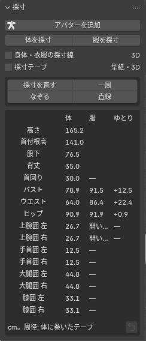

# Measure

What this panel is for: measuring the body, and seeing how much ease a dressed garment has and whether it matches the targets in a size chart.

Measurement labels in the viewport use `name: value` for body measurements, tapes, and pattern measurements (for example, `Tape1: 35.6`).

**Body & Garment Measurements** and **Measuring Tapes** independently show or hide their lines and labels. Hide body measurements while keeping your manual tapes visible; all measured values are kept. Body & Garment Measurements also controls the garment's matching girth lines, and Measuring Tapes also controls pattern measurements.

## Add Avatar

- Purpose: use the add-on's bundled avatar (CC0) when you don't have a body to dress.
- Steps: at the top of **Measure**, press **Add Avatar**. The collection "AC9 Avatar" (body, rig, eyes) is added to the current scene. It does not reopen the file, so everything else in the scene stays as it is.
- Expected result: the body is selected, and if **Body** in the **Placement** panel is empty, this body is set there. You can go on to **Detect Guides**.
- If you press it twice, a second avatar is added (with .001 after the name).
- The body follows its rig (AC9 Avatar Rig). To open the A pose wider or make a T pose, move the rig in Pose Mode before dressing (an avatar that moves while the garment is simulated, that is animation, is not supported yet).

- New avatars start unmeasured. Press **Measure Body** when you need dimensions and measurement lines. You can place and simulate garments without measuring first. Measurements on existing scene bodies are kept.

## Measuring the body

- **Body**: the body to measure (the same field as in Placement).
- **Measure Body**: measures the body. Height, circumferences (one full loop around the bust, waist, hips, neck, arm, and leg), and back length. The places measured are drawn as lines around the body. It assumes the body is standing straight and facing -Y. **Body & Garment Measurements** shows or hides its lines and labels.
- The table (**Body**, **Cloth**, **Ease**) has one item per row, in the scene's unit (**Units** on the Setup panel). **Cloth** is the garment's circumference at the same height (after **Measure Garment**). If the garment doesn't cover that spot, it shows "open". **Ease** is the ease. Press an item name and the place measured on the body lights up. The reset icon at the lower right of the table returns all lines to where they were first found.
- **Measure Garment**: measures the dressed garment at the same heights as the body's lines. When **Simulate** finishes, it measures that result (the last frame) automatically.

## Measuring tools

The toolbox in the panel (**Edit Measure**, **Around**, **Along**, **Straight**) and the tools in the left column are the same.

- **Edit Measure**: slides a measured line up or down along the body. You can also move tapes you placed yourself. A line you point at glows white; drag and release to confirm, and right-click or Esc to put it back. Seams you ran along a tape follow it.
- **Tape Around**: choose **Three Points** (default) or **One Point / Direction** in Tool Settings above the viewport. Three Points measures the section through three clicked body points. Position the third point to preview the complete ring and its length, then click to keep one tape. You can orbit to reach the back. Backspace or Ctrl+Z removes the last unfinished point; Esc or right-click cancels this tape. If the points are nearly collinear or belong to separate rings, choose another third point. The taut tape can bridge hollows, so the line need not touch every point on a concavity.
- **One Point / Direction** previews a ring under the pointer and keeps it with one click. Direction and tilt appear above the viewport. Tab changes direction, and Ctrl+wheel tilts by 5° (Shift: 1°). Ctrl+click the first point to start a new tape on an existing measurement line. Each completed tape is one Undo step, and Redo restores it.
- **Tape Along**: click points on the body in order, and a tape is placed along the surface through those points (sleeve length, rise, and so on). Press Enter to keep it (Esc or right-click cancels). It holds both the length along the surface and the straight-line length.
- **Tape Straight**: the length of a tape pulled taut between two points on the body (bust point to bust point, over the shoulder, and so on). Over bumps it follows the body, and over hollows it spans through the air. The straight length through the body is kept too.
- Measured lines, tapes, and pattern lengths are all treated as measurements. Click a 3D line or its **Tapes** row to select it. **AC9 Measurement** in the Tool tab shows its name, type, length, target, tilt (one-point girths only), **Mirror**, and **Delete**. Use **Edit Measure** to drag individual handles of a three-point tape. If reshaping the body makes its ring invalid, its old length and line are cleared; edit its points or measure again to recheck it.

## Size Check

**Size Check** inside **Measure** lines up the garment's measurements (**Cloth**), the targets (**Target**), and the differences (**Diff**).

- Press an item name and a screen opens for entering the target measurement (a value from the size chart). Entering 0 clears it.
- **Measure Pattern**: click two points on the outline of a flat pattern and the length between the two points is kept as a row (the straight-line length, and for the same piece, also the length along the outline). Esc ends it. The × deletes a row.
