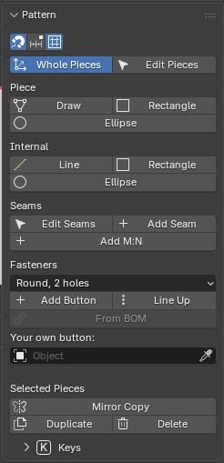

# Edit and draw patterns

What you do in this panel: fix the shape of a pattern, draw a new one, and make left and right match. By default, edits wait until the next **Simulate** or **Update 3D**. With **3D Follows Edits** on, they are reflected after each edit. Carrying the shape over does not itself settle the cloth through simulation.

## Panel layout

From the top: the snapping settings; **Whole Pieces** and **Edit Pieces** (the two tools for fixing patterns); **Piece** (**Draw**, **Rectangle**, **Ellipse**); **Internal** (**Line**, **Rectangle**, **Ellipse**); **Seams** (**Edit Seams**, **Add Seam**, **Add M:N**); **Fasteners** (buttons; see "Buttons (Fasteners)" below); a divider line; **Selected Pieces** (**Mirror Copy**, **Duplicate**, **Delete**); and at the very bottom a collapsed **Keys** (all the keys for **Whole Pieces** and **Edit Pieces**).

- The length unit is chosen in **Units** on the Setup panel.
- The three buttons at the top are snapping while dragging (magnet), snapping to the grid, and showing the grid.
- Name a piece in the top field of **AC9 Piece** on the Tool tab (or with F2).

## The two tools for fixing patterns: Whole Pieces and Edit Pieces

The tools for fixing patterns are split into two. **Whole Pieces moves a piece as a whole; Edit Pieces changes the shape of a piece (corners, edges, and the points of internal lines).** Pressing a button in the panel switches the left-hand tool to that tool. When you move the cursor over the pattern, whatever that tool can grab lights up.

**Whole Pieces** (pieces and internal lines as a whole)

In 2D, click to select first. A two-tone dashed frame surrounds the selection with 20 screen pixels of padding. Drag inside it to move the selection; drag from an unselected target or outside the frame to box select. G/R/S requires an existing selection. Shift adds and Ctrl subtracts with box selection, including when starting inside a frame.

While the selection stays the same, its frame rotates with the contents about the same pivot, including the next R. Esc cancels; Undo/Redo restores the matching frame. A changed selection or file load starts a new display frame. Its orientation is not written into the grainline or 3D placement.

While a selection frame exists, G/R/S transforms that selection even when the cursor is over another piece or empty space. Hovering alone never changes the target. Click to select a different target first.

| Action | What it does |
|---|---|
| Click | Selects a piece or an internal line. Shift+click adds or removes. |
| Drag | Inside the selection frame, moves the selection. Everywhere else, starts box selection. |
| Drag from empty space | A box appears and selects the pieces it encloses (also internal lines on top of other pieces). |
| G / R / S | Move / rotate around the center / scale the selected items. For G, X/Y sets the axis, a number sets mm, Shift holds 0/45/90°, and whole pieces line up with the other pieces (Ctrl: no snapping). For R, a number sets the angle and Shift snaps to 15° steps. For S, X/Y scales in one direction only and a number sets the factor. |
| Shift+D | Copies the selected pieces (not a mirror image, and not made into a left/right pair). The copies follow the mouse until you click. Before confirmation, right-click or Esc cancels the entire copy. After confirmation, one Undo removes it. |
| F2 | Names the piece (for display). |
| X or Delete | Deletes the selected items. |

**Edit Pieces** (corners, edges, and the points of internal lines)

| Action | What it does |
|---|---|
| Click | Selects a corner, one outline edge, or one internal-line span. Shift+click adds or removes (any number, across pieces). Clicking empty space clears the selection. |
| Click a face / Double-click | References the piece's attributes and corresponding 3D position; does not select the whole piece for movement. |
| Drag from empty space or from inside a piece | A box appears and selects the corners, internal nodes and spans it encloses. Shift adds, Ctrl removes. **Dragging inside a piece does not move the piece** (to move a piece as a whole, use **Whole Pieces**). |
| Drag | Moves corners, edges, curve handles, and internal nodes and individual spans. If you grab one of the selected corners, edges, or internal lines, everything selected moves together. While dragging, X/Y locks the axis, Shift locks to 0/45/90°, a number sets the length, and Ctrl turns snapping off. Right-click or Esc cancels. |
| G / R / S | Moves, rotates, or scales the selected corners, edges, and internal lines, using the center as the reference. |
| K | Adds a point to the edge or internal line under the cursor. |
| C | Turns a section of an edge or internal line into a curve, or back to a straight line. A curve gets two handles, and you can fix its shape by dragging. |
| N | Places a notch. You can slide a placed notch by dragging. |
| Right-click | Everything for what is under the cursor. Besides the keys above: **Add Dart** on an outline edge, **Move Dart** on a dart, **Parallel Line** on an outline edge (a dialog asks the distance and how many first). |
| Shift+D | Copies the selected pieces (or the piece under the cursor); the copies follow the mouse until you click. |
| X or Delete | Deletes the corner, intermediate internal node, or notch under the cursor. Deleting a single internal span is unavailable; select the complete line with Whole Pieces to delete it. |

- Snapping (on by default, Ctrl turns it off): when you move something, the distance (mm) to the outline and internal lines of the same piece appears, and it snaps to the center, equal spacing, and equal distance. When you move a whole piece, it aligns with the corners of other pieces.
- Dimensions: lengths appear on the edges and lines under the cursor, and the selected items show their length and the distance to their surroundings. **Numeric Input...** in the Tool tab moves the selected line or edge by a number: X and Y from where it is, or the distance to its surroundings. On a whole piece or a closed internal shape (right-click), it also has **Width** and **Height**: type the size, and it scales about its middle. Seam numbers appear only on the edge or line under the cursor.
- The tool's options row shows only the keys that work on the item under the cursor. All the keys are in **Keys** at the bottom of the **Pattern** panel.
- How to undo: Ctrl+Z.
- Limit: the pattern piece objects are locked, so Blender's G/R/S does not move them. To move a piece, use **Whole Pieces**.

Internal lines use the same deep blue in 2D and 3D. Edit Pieces shows authored outline nodes as filled dots, internal nodes as rings, and coincident nodes as a ring around a dot, before hovering.

Outline corners and their connected internal vertices move together. Right-click **Separate Vertex and Move**, hover to highlight the actual line, then choose one vertex to separate. Choices avoid the toolbar and sidebar. Esc cancels; the wheel switches candidates.

While drawing or editing an internal vertex, snap its position to another internal vertex or edge. This never connects the lines: later deformation of the target does not carry the snapped vertex. Internal-to-internal XY and distance alignment remain disabled. Explicitly select several lines to move, rotate, or scale them together. Hand-drawn polylines retain editable vertices beyond twelve points.

The same rule applies to old and new documents. Stored internal connection metadata does not change the loaded geometry and is not used for internal-to-internal following. Explicit snapping to outline corners or outline-edge interiors still reconnects supported endpoints. Moving an outline corner onto a separated internal vertex also reconnects it. Merely placing a separated endpoint nearby does not reconnect it; following changes made only to an outline curve handle remains outside this behavior.

2D seam decorations appear with Add Seam, Add M:N and Edit Seams. **Show Seams with Other Tools** in Overlays adds a reference display with other tools. It does not grant seam-editing actions or change 3D seam visibility.

## Draw Piece, Internal Line, and shapes

- **Draw Piece**: draws a new piece. Click the corners in order, then click the first corner again (or press Enter) to close it. Numbers set the edge length, Shift snaps to 15° steps, and Backspace goes back one step.
- **Rectangle Piece** and **Ellipse Piece**: draw a rectangular or elliptical piece by dragging or clicking two points. Shift gives a square or circle, and Alt draws from the center. To set the size by numbers, right-click the piece afterwards (with **Whole Pieces**) and use **Numeric Input...**.
- **Internal Line**: draws an internal line inside a piece (dart legs, pocket positions, fold lines, and so on). Click points one after another and press Enter to finish. If you draw 3 or more points and then click the first point, it becomes a closed shape (you cannot make a shape that crosses itself). Shift snaps to 15° steps (it keeps the angle even on the outline).
- **Internal Rectangle** and **Internal Ellipse**: draw a shaped internal line inside an existing piece. An ellipse is made of 4 curve sections, and you can fix its shape by dragging the points.
- Later, with **Edit Pieces**, you can add points (K), move them, delete them (X), and turn them into curves (C) on a drawn internal line.
- For a closed shape: **Convert to Hole** is in the Tool tab and the right-click menu; the two Clone items are in the right-click menu.
  - **Convert to Hole**: makes the inside of the shape a hole (the cloth is removed). Press it again to fill it (**Fill Hole**). Shapes that touch or cross the outline, overlap other holes, or have a fold or elastic attached cannot be made into a hole. Shapes in a left/right pair and on the opposite side of the center line change together.
  - **Clone as Pattern**: makes a new piece with the same shape as the figure (for example, making a pocket from the position where you drew it). The fabric is the same as the original piece, it has no seams, and it is unplaced in 3D. Move the pointer into the pattern view and click to place the copy. The figure remains in the original piece.
  - **Clone as Pattern (+Sew)**: makes it the same way, and also sews an edge of the new piece to a section of the figure. If the original piece is placed, the new piece also attaches on top of it in 3D.
- **Duplicate** in **Selected Pieces**: copies the selected pieces. Move the pointer into the pattern view and click to place the copies. Seams between the copied pieces are copied too. Copies are independent and unplaced in 3D, so place them with **Place**.
- Duplicate, Mirror Copy, Clone as Pattern and Clone as Pattern (+Sew) use the same click placement from buttons, context menus and Shift+D. Multiple copies move as one group, with the center of the copy corresponding to the active source piece at the pointer. Before the click, Esc or right click cancels the entire copy. After confirmation, one Undo removes the complete copy operation. Positioning on the pattern is separate from 3D placement.
- **Delete** in **Selected Pieces**: deletes the selected pieces. Their seams, placement, and fold lines are deleted along with them.

See [Folds](fold-roles.md) for internal-line fold settings and the conditions for changes during Simulate.

## Left/right pairs

Symmetric pieces are connected as a "left/right pair", and fixing one side also fixes the other as a mirror image.

- **Mirror Copy**: makes mirrored copies of all selected pieces. Click in the pattern view to position them and create each left/right pair. The seams of the selected pieces are mirrored too. If the original piece is placed, the copy is also placed at the mirrored position in 3D (buttons are not copied). **Mirror Plane** in the Tool tab's **AC9 Piece** > **Pair** picks **Left / Right** (the default) or **Front / Back**: Front / Back lays the copy upside down; in 3D the copy of a piece laid flat is mirrored about the garment's center (the "AC9 Center" empty; moving one side moves the other the opposite way), and that of a piece on the body is mirrored across the torso's center. It can be changed later in the Pair section of Tool tab > "AC9 Piece".
- **Symmetric Edit** (a button in **AC9 Piece** on the Tool tab that stays pressed once pressed): for a left/right symmetric single piece, such as a front body cut on the fold, moving a corner, an edge, or a curve handle on one side moves the opposite side as a mirror. Internal lines, folds, darts, slash and spread, seams, and cutting lines also follow on the opposite side of the center line. When it is no longer symmetric, a red "(broken)" appears and it has no effect.
- **Symmetrize** (to the right of **Symmetric Edit**): makes a piece left/right symmetric again about the center line. Choose the half that stays: the right-click menu has **Symmetrize: Keep Left** and **Symmetrize: Keep Right**, the Tool tab button a list of the two. Pressing it turns **Symmetric Edit** on.
- If a red "○ left / right pair(s) no longer mirror images" appears in the panel, the left/right pairs have drifted apart. You can still dress them as they are, but left and right are calculated separately. To make them match, delete one of the two and **Mirror Copy** the other.

## Reflecting an edited pattern on the dressed garment

When pattern edits reach 3D depends on **3D Follows Edits**. Off by default, it leaves the adjusted and dressed shapes unchanged until **Update 3D** or the next **Simulate**. When on, each edit is reflected. Carrying the shape over alone does not settle the cloth. Pressing **Simulate** continues the calculation from the current shape of the garment, and the whole garment settles into the edited pattern (see the "Run" section). If the shape cannot be carried over (the cloth flips over, the area becomes 0), it stops and shows the reason.

- **3D Follows Edits** (in **AC9 Run** on the Tool tab, below the run buttons): off by default. While it is off, pattern edits go only into the pattern, and the dressed garment and the adjusted shape wait as they are until the next run (you can keep editing the pattern without waiting for 3D). Press it to carry each edit to 3D as described above (each edit then takes a moment).
- If there are edits waiting, **Update 3D** next to it turns red and "3D not updated" appears in the tool's options row. Press **Update 3D**, press **3D Follows Edits** again, or run the next **Simulate**, and they are all carried to 3D together (no physics calculation).

## Notches, darts, and slash and spread

- Add a dart in **Edit Pieces**: right-click an outline edge and choose **Add Dart**. The mouth runs along the outline, and the apex goes straight inward. The seam that sews the legs together is created at the same time.
- When you select a dart's seam in **Seams**, the dart's angle and leg length appear below it. **Move** moves the selected dart to the outline point you click (the outline in between rotates around the apex, and the angle does not change). **Fold** shows the outline of the shape with the dart closed as a dotted line. If the outline would have a kink when sewn, **True Mouth** appears, and pressing it makes the mouth a shape that connects smoothly when sewn.
- When you open an internal line with **Slash and Spread**, you can choose flare (opens like a fan around one end of the line) or gathers (opens in parallel, perpendicular to the line). A dialog asks the amount, the way it opens, the hinge end and the side that moves (A / B) first.

## Buttons (Fasteners)

A button is not a seam. It pulls the button and the buttonhole together only during the simulation to fasten them. Remove it and run **Simulate**, and it opens.

- Partner: select a piece and click the partner piece with the eyedropper of **Closes Onto** in **AC9 Piece**, and the buttonhole attaches to the partner. A button on a piece with no partner is decorative.
- **Fasteners** in the **Pattern** panel: choose a style, then **Add Button** (one per click, Esc to finish), **Line Up** (lines them up along an internal line; a dialog asks the count and spacing first), **From BOM** (places them at the button-attaching seams in the BOM), the **Your own button** field (a button mesh you made, clicked with the eyedropper at the right of the field or picked by name, is added as a style and becomes the current one; model it with its origin at the middle of its back, +Z out of the cloth, in meters).
- The list is in the **Fasteners** tab of **Lists**. The lock on a row fastens or unfastens one. When you select one, **AC9 Button** appears on the Tool tab (**Move Button**, **Set Hole**, **No Hole**, **Hole Auto**, **Fastened** / **Unfastened**, **Remove**, **Set Style**).

## Extending an outline

In **Edit Pieces**, select outline edges and right-click an edge to choose **Extend Outline...**. Enter the X and Y displacement. Curved and disconnected edges translate by the same vector, and their original paths remain as internal lines.

- **Move seams to new outline** starts off for each operation. Off keeps sewing at the original material positions and leaves the new outline unsewn. On moves sewing to the new outline and may include the added side edges.
- Pink lines preview the sewing paths. Existing internal lines stay in place. If the extension would intersect itself or otherwise be invalid, correct the values before applying it.
- The document stays unchanged until confirmation. Cancel leaves it untouched; one Undo reverses a confirmed extension.

The window starts with **Width from outline**. Enter the width to add fabric outside each selected edge.

- Choose **X/Y displacement** to extend every selected run in the same direction. Positive X is right; positive Y is up.
- The whole operation is rejected if it removes original material, leaves an original path outside the interior, or creates intersecting or overlapping boundary edges.

## Navigate while entering values

**Extend Outline...**, **Numeric Input...**, **Parallel Line**, **Add Dart**, **Slash and Spread** and **Match Length** open a floating input window in the pattern viewport. Panning, orbiting and zooming preserve the values and light-blue preview; the pattern changes only when you apply. Drag the title to move the window.

Use **Apply** to confirm, or **Cancel** or the title's X to discard. Enter and Esc also work over the canvas. Inside a number field, Enter commits only the field and Esc restores its previous value. Copy/paste, text selection, Tab between fields, and horizontal value dragging (Shift for precision) are supported. Length fields accept units, arithmetic and parentheses, such as `1cm + 2mm`; function calls are not supported. Scroll inside the window when its fields do not fit.

## Extend by width from the outline

Choose **Width from outline** to extend each selected edge outward by a perpendicular width, without choosing an axis. Adjacent sloped edges meet at the intersection of their parallel offsets. Disconnected selections and the full outline are supported; the latter retains the original as a closed internal line.

Sharp corners keep their pointed shape, so a tip can travel farther than the entered width. New curved boundaries use a finely sampled polyline; the retained internal line preserves the original curve controls. Use the existing C operation to fit an editable Bezier curve to the new boundary if needed.

Under **Corner treatment**, choose **Each edge** to extend separate bands without filling the outer corners. Three selected edges of a rectangle produce three bands attached to the original piece. Smoothly joined edges do not gain a gap. **Connect corners** is the default.

**Each edge** retains one independent internal line per original outline edge: three edges produce three lines, and all four edges produce four open lines. Set fold angles separately for each line. Curve samples do not create extra lines. Previously saved internal lines are not split automatically.

With sewing transfer off, original material positions are retained. With it on, existing edge fractions are retained on the new boundary. A sewn interval crossing a corner in **Each edge** follows the new outline, including the notch sides. Widths that erase or reverse a segment, or produce boundary intersections, are rejected without changing the document.
