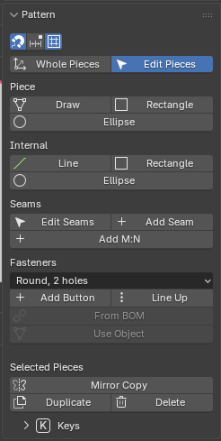

# Edit and draw patterns

What you do in this panel: fix the shape of a pattern, draw a new one, and make left and right match. If there is a dressed garment, the edited shape is carried onto it right away (shape only, no physics calculation).

## Panel layout

From the top: the snapping settings; **Whole Pieces** and **Edit Pieces** (the two tools for fixing patterns); **Piece** (**Draw**, **Rectangle**, **Ellipse**); **Internal** (**Line**, **Rectangle**, **Ellipse**); **Seams** (**Edit Seams**, **Add Seam**, **Add M:N**); **Fasteners** (buttons; see "Buttons (Fasteners)" below); a divider line; **Selected Pieces** (**Mirror Copy**, **Duplicate**, **Delete**); and at the very bottom a collapsed **Keys** (all the keys for **Whole Pieces** and **Edit Pieces**).

- The length unit is chosen in **Units** on the Setup panel.
- The three buttons at the top are snapping while dragging (magnet), snapping to the grid, and showing the grid.
- Name a piece in the top field of **AC9 Piece** on the Tool tab (or with F2).

## The two tools for fixing patterns: Whole Pieces and Edit Pieces

The tools for fixing patterns are split into two. **Whole Pieces moves a piece as a whole; Edit Pieces changes the shape of a piece (corners, edges, and the points of internal lines).** Pressing a button in the panel switches the left-hand tool to that tool. When you move the cursor over the pattern, whatever that tool can grab lights up.

**Whole Pieces** (pieces and internal lines as a whole)

| Action | What it does |
|---|---|
| Click | Selects a piece or an internal line. Shift+click adds or removes. |
| Drag | Moves the piece or internal line you grabbed. If you grab one of the selected items, everything selected moves together. |
| Drag from empty space | A box appears and selects the pieces it encloses (also internal lines on top of other pieces). |
| G / R / S | Move / rotate around the center / scale the selected items. For G, X/Y sets the axis, a number sets mm, Shift holds 0/45/90°, and whole pieces line up with the other pieces (Ctrl: no snapping). For R, a number sets the angle and Shift snaps to 15° steps. For S, X/Y scales in one direction only and a number sets the factor. |
| Shift+D | Copies the selected pieces (not a mirror image, and not made into a left/right pair). The copies follow the mouse until you click; right-click leaves them just beside the originals. |
| F2 | Names the piece (for display). |
| X or Delete | Deletes the selected items. |

**Edit Pieces** (corners, edges, and the points of internal lines)

| Action | What it does |
|---|---|
| Click | Selects a corner, an outline edge, or an internal line. Shift+click adds or removes (any number, across pieces). Clicking empty space clears the selection. |
| Double-click | Selects the whole piece, whatever is under the cursor (internal line, notch, seam). |
| Drag from empty space or from inside a piece | A box appears and selects the corners and internal lines it encloses. Shift adds, Ctrl removes. **Dragging inside a piece does not move the piece** (to move a piece as a whole, use **Whole Pieces**). |
| Drag | Moves corners, edges, curve handles, and internal lines (ends, midpoints, or the whole line). If you grab one of the selected corners, edges, or internal lines, everything selected moves together. While dragging, X/Y locks the axis, Shift locks to 0/45/90°, a number sets the length, and Ctrl turns snapping off. Right-click or Esc cancels. |
| G / R / S | Moves, rotates, or scales the selected corners, edges, and internal lines, using the center as the reference. |
| K | Adds a point to the edge or internal line under the cursor. |
| C | Turns a section of an edge or internal line into a curve, or back to a straight line. A curve gets two handles, and you can fix its shape by dragging. |
| N | Places a notch. You can slide a placed notch by dragging. |
| Right-click | Everything for what is under the cursor. Besides the keys above: **Add Dart** on an outline edge, **Move Dart** on a dart, **Parallel Line** on an outline edge or an internal line (a dialog asks the distance and how many first; on a line also which side, both sides, and whether to run to the outline), and on an internal line drawn from outline to outline, **Slash and Spread** (flare or gathers) and **Cut Along Line** (cuts the piece into 2; points the line passed through become corners). |
| Shift+D | Copies the selected pieces (or the piece under the cursor); the copies follow the mouse until you click. |
| X or Delete | Deletes the corner, internal line point, internal line, or notch under the cursor. |
| F9 | Fixes the numbers of the last operation (dart, slash and spread, parallel line distance, length, and so on). |

- Snapping (on by default, Ctrl turns it off): when you move something, the distance (mm) to the outline and internal lines of the same piece appears, and it snaps to the center, equal spacing, and equal distance. When you move a whole piece, it aligns with the corners of other pieces.
- Dimensions: lengths appear on the edges and lines under the cursor, and the selected items show their length and the distance to their surroundings. **Move by Number...** in the Tool tab moves the selected line or edge by a number: X and Y from where it is, or the distance to its surroundings. Seam numbers appear only on the edge or line under the cursor.
- The tool's options row shows only the keys that work on the item under the cursor. All the keys are in **Keys** at the bottom of the **Pattern** panel.
- How to undo: Ctrl+Z.
- Limit: the pattern piece objects are locked, so Blender's G/R/S does not move them. To move a piece, use **Whole Pieces**.

## Draw Piece, Internal Line, and shapes

- **Draw Piece**: draws a new piece. Click the corners in order, then click the first corner again (or press Enter) to close it. Numbers set the edge length, Shift snaps to 15° steps, and Backspace goes back one step.
- **Rectangle Piece** and **Ellipse Piece**: draw a rectangular or elliptical piece by dragging or clicking two points. Shift gives a square or circle, and Alt draws from the center. W Tab H Enter enters numeric values.
- **Internal Line**: draws an internal line inside a piece (dart legs, pocket positions, fold lines, and so on). Click points one after another and press Enter to finish. If you draw 3 or more points and then click the first point, it becomes a closed shape (you cannot make a shape that crosses itself). Shift snaps to 15° steps (it keeps the angle even on the outline).
- **Internal Rectangle** and **Internal Ellipse**: draw a shaped internal line inside an existing piece. An ellipse is made of 4 curve sections, and you can fix its shape by dragging the points.
- Later, with **Edit Pieces**, you can add points (K), move them, delete them (X), and turn them into curves (C) on a drawn internal line.
- For a closed shape: **Convert to Hole** is in the Tool tab and the right-click menu; the two Clone items are in the right-click menu.
  - **Convert to Hole**: makes the inside of the shape a hole (the cloth is removed). Press it again to fill it (**Fill Hole**). Shapes that touch or cross the outline, overlap other holes, or have a fold or elastic attached cannot be made into a hole. Shapes in a left/right pair and on the opposite side of the center line change together.
  - **Clone as Pattern**: makes a new piece with the same shape as the figure (for example, making a pocket from the position where you drew it). The fabric is the same as the original piece, it has no seams, it is in the unplaced state, and it appears just to the right of the original piece. The figure remains in the original piece.
  - **Clone as Pattern (+Sew)**: makes it the same way, and also sews an edge of the new piece to a section of the figure. If the original piece is placed, the new piece also attaches on top of it in 3D.
- **Duplicate** in **Selected Pieces**: copies the selected pieces just beside the originals. Seams between the copied pieces are copied too. The copies are unplaced, so place them with **Place**.
- **Delete** in **Selected Pieces**: deletes the selected pieces. Their seams, placement, and fold lines are deleted along with them.

## Left/right pairs

Symmetric pieces are connected as a "left/right pair", and fixing one side also fixes the other as a mirror image.

- **Mirror Copy**: makes a mirror image of all the selected pieces next to them and turns each into a left/right pair. The seams of the selected pieces are mirrored too. If the original piece is placed, the copy is also placed at the mirrored position in 3D (buttons are not copied). In F9 (the Redo panel) after it, **Mirror Plane** picks **Left / Right** (the default) or **Front / Back**: Front / Back lays the copy upside down; in 3D the copy of a piece laid flat appears where it is, mirrored (moving one front or back moves the other the opposite way), and that of a piece on the body is mirrored across the torso's center. It can be changed later in the Pair box of Tool tab > "AC9 Piece".
- **Symmetric Edit** (a button in **AC9 Piece** on the Tool tab that stays pressed once pressed): for a left/right symmetric single piece, such as a front body cut on the fold, moving a corner, an edge, or a curve handle on one side moves the opposite side as a mirror. Internal lines, folds, darts, slash and spread, seams, and cutting lines also follow on the opposite side of the center line. When it is no longer symmetric, a red "(broken)" appears and it has no effect.
- **Symmetrize** (to the right of **Symmetric Edit**): makes a piece left/right symmetric again about the center line. It keeps the left half and rebuilds the right half as a mirror (you can switch to keeping the right half with F9). Pressing it turns **Symmetric Edit** on.
- If a red "○ left / right pair(s) no longer mirror images" appears in the panel, the left/right pairs have drifted apart. You can still dress them as they are, but left and right are calculated separately. To make them match, delete one of the two and **Mirror Copy** the other.

## Reflecting an edited pattern on the dressed garment

When you edit a pattern, the edited shape is carried onto the current garment right away. But it is only carried over; the cloth has not settled. Pressing **Live Sim** continues the calculation from the current shape of the garment, and the whole garment settles into the edited pattern (see the "Run" section). If the shape cannot be carried over (the cloth flips over, the area becomes 0), it stops and shows the reason.

- **3D Follows Edits** (in **AC9 Run** on the Tool tab, below the run buttons): off by default. While it is off, pattern edits go only into the pattern, and the dressed garment and the placed shape wait as they are until the next run (you can keep editing the pattern without waiting for 3D). Press it to carry each edit to 3D as described above (each edit then takes a moment).
- If there are edits waiting, **Update 3D** next to it turns red and "3D not updated" appears in the tool's options row. Press **Update 3D**, press **3D Follows Edits** again, or run the next **Live Sim**, and they are all carried to 3D together (no physics calculation).

## Notches, darts, and slash and spread

- Add a dart in **Edit Pieces**: right-click an outline edge and choose **Add Dart**. The mouth runs along the outline, and the apex goes straight inward. The seam that sews the legs together is created at the same time.
- When you select a dart's seam in **Seams**, the dart's angle and leg length appear below it. **Move** moves the selected dart to the outline point you click (the outline in between rotates around the apex, and the angle does not change). **Fold** shows the outline of the shape with the dart closed as a dotted line. If the outline would have a kink when sewn, **True Mouth** appears, and pressing it makes the mouth a shape that connects smoothly when sewn.
- When you open an internal line with **Slash and Spread**, you can choose flare (opens like a fan around one end of the line) or gathers (opens in parallel, perpendicular to the line). A dialog asks the amount, the way it opens, the hinge end and the side that moves (A / B) first; F9 fixes them right after too.

## Buttons (Fasteners)

A button is not a seam. It pulls the button and the buttonhole together only during the simulation to fasten them. Remove it and run **Live Sim**, and it opens.

- Partner: select a piece and click the partner piece with the eyedropper of **Closes Onto** in **AC9 Piece**, and the buttonhole attaches to the partner. A button on a piece with no partner is decorative.
- **Fasteners** in the **Pattern** panel: choose a style, then **Add Button** (one per click, Esc to finish), **Line Up** (lines them up along an internal line; set the count and spacing in F9), **From BOM** (places them at the button-attaching seams in the BOM), **Use Object** (makes the selected mesh a style).
- The list is in the **Fasteners** tab of **Lists**. The lock on a row fastens or unfastens one. When you select one, **AC9 Button** appears on the Tool tab (**Move Button**, **Set Hole**, **No Hole**, **Hole Auto**, **Fastened** / **Unfastened**, **Remove**, **Set Style**).
