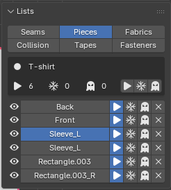

# Piece States and Layering

Each piece has four states (in the **Pieces** tab of **Lists**, or in **State** of **AC9 Piece** when you've selected a piece).

| State | Icon | Moves | Other cloth collides with it | Seams |
|---|---|---|---|---|
| **Active** | Play | Yes | Yes | Yes |
| **Freeze** | Snowflake | No (stays where it is) | Yes | Yes |
| **Inactive** | Ghost | No (stays where it is) | No (passes through) | Yes (the seams pull) |
| **Off** | Cross (×) | Not part of the mesh | — | No (the seams go away with it) |

- **Freeze** and **Inactive** hold the piece still in every step, including the sewing steps.
- The state buttons switch a left and right pair together (a mirrored pair, and a pair you made with **Pair**). To change just one side, Ctrl+click. A piece brought back from **Off** is lined up with the mirrored shape of the side that stayed.
- **Invert Selection** in the **State** row reselects the other pieces of this garment (the steps for "garment groups").
- Pieces set to **Off** show only as a count in the list. To bring them back, select the gray piece with **Edit Pieces** and set it to **Active**.
- The garment row in the **Pieces** tab: the filled circle marks the current garment, `10 on 2 fz 1 off` is the count per state, and the three icons on the right switch them all at once. A piece row is the name (press it to select) and four state buttons. A red row is a piece whose object alone was deleted with Blender's X, and you can bring it back with **Restore N Deleted Object(s)**.

## Layering

- Switch garments with **Garment** and run **Simulate**, and other garments that have results automatically become "immovable obstacles". The order is: dress the inner one, then switch **Garment** to the outer one and run **Simulate**.
- What becomes an obstacle is the other garment's last shape. Pieces you set to **Inactive** / **Off** in the other garment are removed from the obstacles.
- When you simulate another garment, the earlier garments' history (the timeline frames) is dropped and only the last shape stays (the Result field becomes `Frames: dropped (shape kept)`).
- In the **Collision** tab, you can make things that have no pattern (props, or garments that are ordinary meshes) into obstacles. Click the object in a 3D view with the eyedropper at the right of the **Add** field, or pick it by name in the field, and it is added (the eyedropper works whatever tool is on). To add several at once, select them and press **Add Selected**. Press **Remove** to stop.
- An object added there is picked by a click with **Whole Pieces** in the 3D view, and moves with the gizmo or G / R (the Work Screen's 3D view has no other tool that selects objects). Objects not added are not picked by Whole Pieces.
- Right now, only the current garment moves in the simulation.
