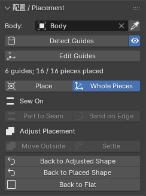
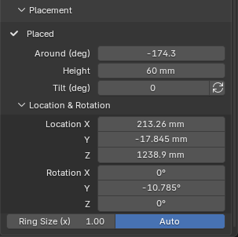
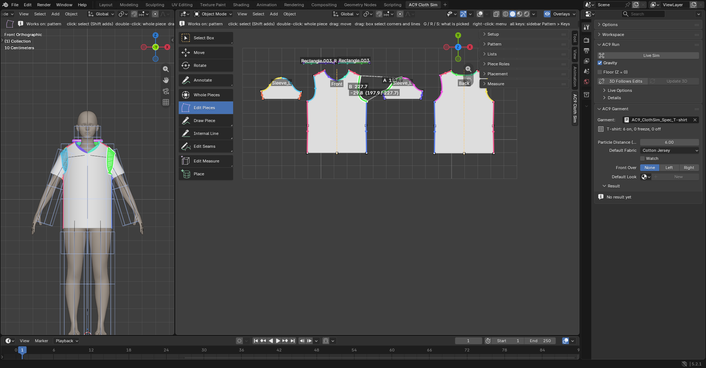

# Placing around the body

What you do in this panel: specify the body and decide where each piece goes around it. Items without a body, such as bags, can be laid flat without choosing a body (see "Laying flat" below).

## Body, Detect Guides, and Edit Guides

- **Body**: Choose the avatar's body mesh: click it in a 3D view with the eyedropper at the right of the field, or pick it by name (with a body already in it, the eyedropper next to the × picks another). The garment is placed around it and drapes while colliding with this body.
- **Detect Guides**: Finds reference positions for placing pieces from the shape of the body. It fits cylinders (guides) over the torso, neck, arms, and legs. The avatar is assumed to stand upright and face -Y (otherwise you'll see "upright, facing -Y?"). The eye icon next to the button toggles whether the guides are shown on screen.
- **Edit Guides**: Adjust the cylinders by hand. When you press it, each cylinder becomes its own object, and you adjust them with G (move), R (tilt), and S (thickness; scaling only along the axis direction changes the length). The **L/R together** button appears only while you are editing; when it is on, moving one arm or leg guide makes the other follow to the mirrored position across the body's center. Press **Done** when you finish.
- When guides are found, you'll see `○ guides; 20 / 20 pieces placed` (number of guides, number of pieces placed / number of pieces that are on).

## Place and Back to Flat

- **Place** (a tool in the tool column on the left; the button in the panel switches to this tool):
  1. Click a piece to select it (Shift to add or take it out). A click only selects: it never places anything. A click on nothing deselects (Ctrl+Z brings the selection back).
  2. Move the cursor over a cylinder and that cylinder glows yellow.
  3. Press on a cylinder (also over the body or the dressed garment) and drag: the selected pieces are placed there (green outline), slide around and along the cylinder as you move, and are set where you release. Pieces already placed are placed again too; Ctrl+Z puts them back. Pieces being worn on the dressed garment are not placed again: a line in the status bar says so (use **Back to Placed** first). If no piece is selected, you'll see "Place: click pieces first …". (Drag a piece that is already placed and it slides round its cylinder by the amount you move, without jumping, wherever you hold it. Pieces of the dressed garment are moved with **G** / **R** or **Whole Pieces**. To change only the angle or only the height, or to tilt the piece, use Around (angle around the body), Height, and Tilt (tilt angle; at 90° the upper side goes out horizontally, and at 180° the piece is upside down, so the outer edge of a collar faces the neck side; the ↻ next to it adds +180°) in the Tool tab under "AC9 Piece".) Esc or right-click cancels.
  4. To select several pieces with a box, use **Whole Pieces**: a drag from nothing in the 3D view selects the pieces in the box, the dressed garment's one by one (Shift: add, Ctrl: take out).
  - If you drag a mirrored piece in 3D, the side you touched first becomes the one you operate on. That piece is placed on the cylinder you moved it to, and only its linked partner is placed on the opposite side.
  - If you have selected several pieces, they are placed side by side, keeping their arrangement from the pattern.
  - Dragging from where there is no cylinder lays the pieces flat (see "Laying flat" below). A drag that starts on the pattern places once it reaches a cylinder, a surface or the ground.
  - When you release, the shape the simulation will actually start from is shown. A band (such as a collar rib) is a ring of its own length, and it is widened and shown in red only where it has to go around the body. A piece that would start while overlapping something also turns red, and the reason is shown.
- **Back to Flat**: Lays the selected pieces and their linked mirrored pieces flat **where they are in 3D, keeping their place and turn**. The shape bent round a cylinder (or the garment) is unrolled into the plane under the piece's center; the center does not move. Hand moves and edits made on the placed shape are discarded. When nothing is selected, after a confirmation, every placed piece. A dressed piece goes back to a placed piece in its flat shape. To take pieces out of 3D, set their state to **Off**.
- Placement rules: a piece is placed by only bending it along one cylinder, or flat; it is not stretched to follow the bumps of the body. Nothing moves on its own from where you placed it (pushing overlaps outward, lifting a band, and so on happen only when you press one of the tools below yourself).

**Ring Size (x)** and **Auto** in **AC9 Piece** are shown for every piece, regardless of its role. Place the piece on a curved guide to edit them; they are disabled for unplaced or flat pieces. A manual value sets ring placement from the piece's own length. **Auto** removes the manual value and returns to automatic placement. The same placement used for collar stands is available for cuffs and other pieces; it does not set a role for them.

## Laying flat (items without a body, bags)

- Dragging with **Place** from where there is no cylinder lays the selected pieces flat.
  - On a face of the body, a Collision object or another mesh: the piece faces along the face's normal, 2 mm off it. The piece's top is the world up (Z) laid on the face.
  - On nothing: on the ground (Z = 0), face up.
  - Where a flat piece meets a bumpy face it may go through it; this is not fixed for you. Look at it and lift it with G.
  - Press and drag a flat piece to slide it over the face (or the ground) under the cursor.
  - On the ground the pieces' center holds on X = 0 (the pair's mirror plane: the torso's center when there is a body) and on Y = 0 when it comes near, with a line and a white dot. A left / right pair holds on Y = 0 only. Hold Ctrl for no snapping (the torso's center front / back too).
  - **Orientation (deg)** in the Tool tab's "AC9 Piece": how far the piece is turned on the face it lies on. 0 = the pattern's top up the face (on the ground: toward +Y), 90 = turned counter-clockwise. The ↻ beside it adds 90. Where it lies stays; a pair follows as a mirror image.
  - A pair follows as a mirror image once placed (moving one moves the other). Its state and buttons are in the Pair section of "AC9 Piece" (see "Pairs" below). A front / back pair snaps to X = 0 only, not Y = 0.
  - Its location and rotation can be typed in the Tool tab under "AC9 Piece", **Location & Rotation** (once its placed shape is made).
- With pieces laid flat, **Live Sim** runs without a body.
- **Floor (Z = 0)**: the switch under Gravity in Run. On, it puts a floor at Z = 0 the cloth lands on (nothing is added to the scene). With no body, Collision object or floor, a run sews without gravity and stops there, and says so.
- What keeps the shape is mostly the fabric's stiffness. For bags, the fabrics **Canvas**, **Leather** and **Synthetic Leather** suit (Canvas's bending is an estimate).

## Tools for tidying the placed shape (no physics calculation)

Select the pieces first, then press any of these. They are tools for tidying the starting shape before the simulation.

- **Part to Seam**: Reflects the fold settings, and puts the sewing points of the selected pieces **on top of their sewing points on the targets you choose for this operation**. After that, it keeps the sewing points as they are, moves the piece out of the body, places it 2 mm on its own side of its partner, and restores the edge lengths (the same as "Settle"). The partner can be in its placed shape or its dressed shape. The shape may stretch. Stretching is shown by the colors of "Overlays > Stretch" and the one-line result; places that go into the body or through other cloth are shown in red. It refuses only when a triangle would collapse (a shape the simulation cannot start from). If moving the points on top would make the stretch exceed red (1.5 times), for example when the partners are placed far apart, it does not put them on top; it keeps the shape and moves it near the chosen targets, and tells you about the gap in one line. That seam is closed by the simulation. Press the button, then click a target. Shift-click adds or removes targets, A chooses all targets, Enter applies, and Esc cancels. This scope lasts for this operation only; other enabled seams remain enabled for the next simulation. If you want to float the piece further outward, press **Move Outside** separately. Hand placement, vertex edits, and folds from before the move are kept separately, so repeating the operation does not overwrite the prepared shape. If you change Fold Angle, press it again to redo the move from the new fold.
- **Band on Edge**: Lays a thin band (such as a neck rib) along the chosen targets' sewn edge and extends its width from that edge. Choose targets the same way as Part to Seam. Both tools show the moving pieces and any following pair, and keep the original selection and active object while you pick targets.
- **Move Outside**: Keeps the current shape of the selected pieces and moves them to the outer side of nearby overlapping cloth. It works for both the piece itself and its partner, whether in the placed shape or the shape after simulation. No sewing is required. It moves the piece as much as needed to be 8 mm away from the partner, and if it is already apart, it moves it a further 8 mm. After the correction, you can simulate again from that shape. If the outer side can't be determined, for example at a fold-back, or if the piece passes through another layer or the body, it shows the reason and keeps the shape.
- **Settle**: Tidies without a physics calculation (moves the piece out of the body and restores edge lengths). Places that remain are shown in red.
- For some pieces of a dressed garment, press **Back to Placed** first and then use these (you'll see "Back to Placed it first").

## Fixing the placed shape by hand: Whole Pieces and Back to Guide

- **Whole Pieces** in the 3D view: click a piece to select it and move it with the gizmo, G or R (W switches the gizmo between move and rotate).
  - Before dressing: A placed shape is one object per piece. You can also fix it in Edit Mode, and **Live Sim** starts from that shape.
  - After dressing: A handle is attached to that piece of the dressed garment (see "Operations after dressing" below).
  - The placed shapes are made when you place pieces, and again at once when the guides are found again (with their hand moves). A piece placed but without its shape says "No placed shapes: Place the pieces again".
- **Back to Guide**: Discards the hand edits of the selected pieces (all pieces if none is selected; a confirmation appears) and returns them to the placement on the guides (the cylinders around the body). For a piece of a dressed garment, first return it to its placed shape (go through Back to Placed) and then do this.
- After a simulation, **Back to Placed** restores its starting shape, including fitting with **Part to Seam** and subsequent hand adjustments. Before any simulation, it restores the prepared shape from before **Part to Seam**. **Back to Guide** discards hand edits and returns to the guide. **Back to Flat** makes the piece flat where it is in 3D space, keeping its position and orientation.
- If an old file does not have the shape from before the move, or if the pattern's mesh or pairs changed after the move, it shows the reason instead of guessing at a restoration. Undo the change, or place again with "Back to Guide".
- When you select one placed shape, the movement from the guide (Move and Turn) is shown. To move it by numbers, use **Location & Rotation** in the Tool tab's AC9 Piece.
- A linked pair moves together: the partner follows as its mirror image. To move one side only, unlink it in the Pair section below.

## Pairs (the Pair section in Tool tab > AC9 Piece)

The Tool tab's "AC9 Piece" shows, from the top: the piece's name and size, **State** and **Display** (always shown), then sections you can fold: **Fabric & Look**, **Simulation**, **Pair**, **This Piece's Symmetry** and **Placement**.

The **Pair** section shows the partner and, in three parts, the pattern, the placement in 3D and the simulated result (the right-click menus keep their buttons).

- "With ○○": the partner. Under **Pattern**: "Shapes linked" for a pair drawn with **Mirror Copy** (editing one edits the other), "Shapes drawn apart" for a pair made with **Pair** (two pieces drawn separately, only placed as a pair).
- **Mirror Plane** (under **3D Placement**): **Left / Right** or **Front / Back**, for both kinds of pair. With Front / Back a Mirror Copy's mirrored piece turns upside down in the pattern (edits then follow as the up-down mirror). A Pair's pattern stays as drawn: the other piece is placed the right way up however it was drawn (upside down, or as a left / right mirror image), and a line says so when it was drawn the other way. Seams mirrored automatically use the same plane. Use Front / Back for things paired front and back, such as a bag's sides.
- **Mirror center**: a pair on the body mirrors about the body's center. A pair laid flat mirrors about the garment's center, an empty named "AC9 Center: (garment)". The first pair laid flat makes it (at the middle of the two; with only one side placed, at that piece for front / back and at the body's center for left / right), and every pair laid flat in the garment, left / right and front / back, mirrors about it. Click the empty's mark with **Whole Pieces** in the 3D view to pick it alone and move it with the gizmo or **G**. **Select Center** adds it to the selection: move it with **G** and the other side of each pair goes the opposite way; select it with the pieces to move the whole garment. Its location can also be typed under the button. It only moves: its rotation and scale are locked.
- A pair from an older file that mirrors about its own plane shows that plane in red with **Align to Center**, which moves the other side to its mirror image about the center. Opening the file moves nothing. A pair laid flat after it was paired, with no center yet, shows "Mirror Center: the body's center" with the same button (or press its **Mirror Plane**): it makes the center at the middle of the two sides.
- **Unlink**: unlinks a Mirror Copy pair so the two sides are placed separately (the pattern stays mirrored). **Link** restores it. An unlinked pair shows **Mirror Placement**, which copies one side's place and hand move to the other once.
- **Unpair** undoes a pair made with **Pair**. Its hand moves do not follow each other: copy one side's with **Mirror Placement**.
- "No pair": no partner. Select the two pieces you want to pair and press **Pair**. The mirror plane is **Mirror Plane** in the Tool tab's **AC9 Piece** > **Pair**.
- **Swap Sides**: swaps the sides of a placed pair (hand movement and folds stay on the location side, and the shape is rebuilt the same way as with **Place**).
- **Mirror 3D to Pair** (under **Simulation Result**): copies one side's simulated shape to the other. It is shown only when both sides of the pair are on the simulated garment.
- **Symmetric Edit** and **Symmetrize** (one piece's two halves kept symmetric) are not pair settings: they are in **This Piece's Symmetry**.

## Operations after dressing

After dressing, you work on the one dressed garment.

- When you click a piece of the dressed garment with the **Whole Pieces**, **Place** or **Edit Pieces** tool, a handle (an arrow Empty) appears at the center of that piece and it is selected. Shift+click adds more.
- A piece newly placed after dressing appears in its placed shape (it is sewn on by the next **Live Sim**).
- If you move the handle with G or R, that piece follows inside the dressed garment. Fix any places where it sinks in, and then run **Live Sim**. If you move a piece far while it is sewn, it is pulled back at the start of **Live Sim**.
- If you press **Back to Placed** with the handle selected, that piece returns to its placed shape.
- A spot where you clicked the dressed garment or a placed piece also appears as a red dot at the same position on the pattern (it follows even when you move through frames). The other way works too: click a pattern piece and a red dot appears at the same position on the dressed garment (on the placed piece for a piece not dressed yet). It helps on patterns whose left and right, or front and back, have the same shape.
- A click that only selects is not kept in the undo history. Ctrl+Z undoes the move or placement you did before it.
