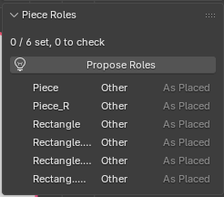

# Piece Roles and What Gets Decided Automatically

A piece's role (front body, placket, collar stand, sleeve, cuff, and so on) is more than a name tag. Once you give a piece a role, **the sewing order, how it is placed, its starting shape, and the front closure** are decided automatically to match the role. Put the other way around, every automatic behavior that treats a piece specially starts from its role. Nothing quietly treats a piece specially based on how its shape looks.

For how to assign roles (the panel and buttons), see "[Piece Roles and Folds](fold-roles.md)". This page sums up what changes once a role is assigned.

## What a role decides

| What the role decides | Which roles | Where it takes effect |
|---|---|---|
| Sewing order (which step it is sewn in) | All (body -> collar -> sleeves -> accessories) | **Phase Sim** only (experimental) |
| Placed as a ring of its own length | Waistband, cuff, hem facing, collar stand, collar, collar rib | The placed shape (Live Sim starts from here) |
| Placed side by side around the arm | Sleeve, sleeve panel | The placed shape |
| Default of **Start Shape** | Collar rib = **On Edge**, others = **As Placed** | The placed shape (On Edge is placed as a ring; Live Sim pulls it onto the sewn edge by its seams) |
| Front closure (the placket overlap) | When there are two plackets that are sewn to each other | A step of Phase Sim (experimental; the front closure is kept open until the others are sewn) |
| Collar stand (the reference for the collar's length) | Collar stand | The collar step of Phase Sim (experimental) |

A piece with no role ("Other") gets its step from the guide it was placed on, as before, and is placed the same way as other pieces.

### What a role does not decide

- **Which side of the overlap is on top** (over-lap and under-lap). A person decides this with the garment's **Front Over**, a seam's **Over**, or a buttonhole. There is no default.
- **Anything where you chose the start shape or ring size yourself.** If you change **Start Shape** or **Ring Size** on the AC9 Piece yourself, it stays as you set it even if you change the role.

## What takes effect in Live Sim

- **Live Sim** has a single step and sews all seams of all pieces together from the start. **The sewing order has no effect.** Even so, Live Sim starts from the placed shape, so **a role does affect Live Sim**, through the band rings, the arrangement around the arm, and the placement carried to the seams.
- **Phase Sim**, an experimental feature, sews in steps, and a role affects the sewing order as well.
- An On Edge piece is placed as a ring; Live Sim pulls it onto the sewn edge by its seams. If you want to lay it on first, press **Band on Edge** in the Placement panel and then press Live Sim.

## What "Propose Roles" looks at

**Propose Roles** decides roles by adding up the following clues. It doesn't use AI. The same pattern gives the same result every time.

1. **How the seams connect and their shape (the most important)**
   - A ring that sits side by side along vertical seams and goes around the torso -> body
   - A left and right pair of rings, each sewn to the body -> sleeve (the largest ring is the sleeve; the others are sleeve panels)
   - A left and right pair sewn along the crotch curve -> leg
   - A long horizontal band sewn on top of the torso ring -> waistband
   - Small, with few partners it is sewn to -> accessory
   - A small piece whose sewn partners are all in the sleeve (or collar) group -> that group (placket, cuff, and so on)
2. **The placement points in the source data** (the BOM's Neck, Wrist, Body_Front, and so on)
3. **Words in the piece names and fabric names**
4. **The guide it was placed on** (neck, arm, leg, torso). It only nudges which group (body, collar, sleeve, leg) a piece belongs to, and doesn't decide the role within the group (front or back, collar stand or collar).

Pieces with low confidence (under 0.4) get a "please check" mark. Roles you decided yourself (a human mark) are not overwritten by a proposal.

### You don't have to place everything first

If seams are in, clue 1 decides roles even before placing. The placed guide is the fourth clue, so you don't have to place every piece first.

For a pattern with no seams (a freshly loaded DXF or SVG, for example), clue 1 doesn't work and only names and placement points are left to go on. Proposing after you add seams is much more accurate.

## Recommended order

1. Load the pattern and check the seams (add any that are missing).
2. Press **Propose Roles** and review the pieces with a "please check" mark.
3. Place (**Place**).
4. Live Sim.

Roles are read when the placed shape is made. **If you change a role after placing, place that piece again.** That way the placed shape you see on screen and the shape the calculation starts from match. A start shape that carries a piece to its seam is applied at the moment of placing, so it doesn't take effect unless you place again.

## How this relates to automation

The more carefully you assign roles, the more of the path from placing to sewing you can leave to the add-on. When more role-based decisions are added later, they too will start from the role, not from guessing based on a piece's shape. A proposal is "a draft that a person checks and accepts," and the "please check" mark is there for that.
