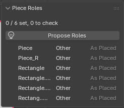

# Piece Roles (Experimental)

This page is for **Experimental Features**. You do not need to assign roles to use normal **Simulate**. **Phase Sim** and the role controls appear only when Experimental Features is enabled in the add-on preferences.

## Assign roles

- **Piece Roles** in the sidebar shows the garment kind, the number of assigned roles and the number to check.
- **Propose Roles** uses seam connections, pattern shapes, arrangement points and names. It does not overwrite roles you assigned yourself. Review entries marked for checking.
- To assign one yourself, select a piece and choose **Role** in **AC9 Piece** on the Tool tab. Its mirror partner receives the same role.

## Phase Sim

**Phase Sim** uses roles such as body, collar, sleeve and attachment to sew in stages. It stops automatically after the stages finish. See the experimental section of [Run](run.md).

Normal **Simulate** does not use the role-based sewing order. Use current **AC9 Piece** settings such as **Ends** to control placement. See [Folds](fold-roles.md) for fold angles, and [Piece States and Layering](pieces.md) for motion and collision.

## Files from earlier versions

Older files may retain rings, placed shapes or start-shape settings created using roles. Turning Experimental Features off does not erase saved settings or shapes. Check the current placement and fields such as Ends, and place only the pieces that need it again.

Changing a role and rebuilding the current shape are different operations. Roles are not a required step for normal dressing, and planned automatic dressing is not a current operation.
