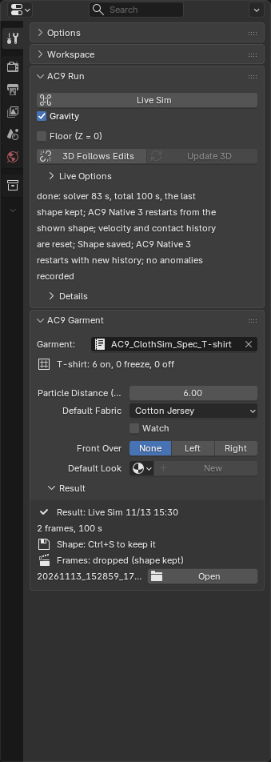
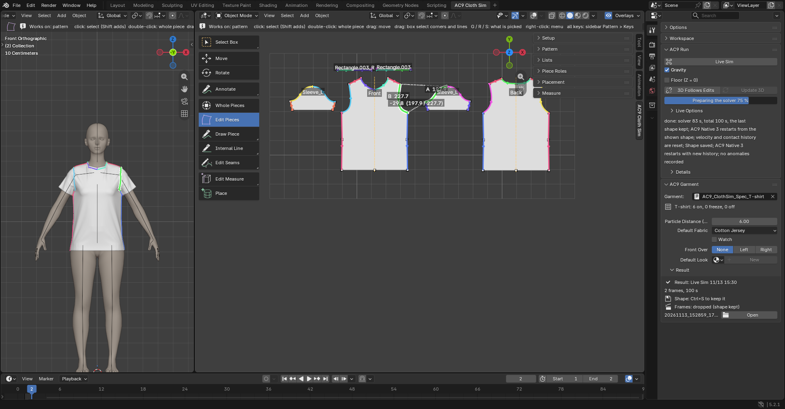

# Dress (run)

The run buttons are grouped in **AC9 Run** at the top of the Tool tab. From the top: **Live Sim** with the **Gravity** checkbox below it, **Floor (Z = 0)**, **3D Follows Edits** and **Update 3D** ("Reflecting pattern edits on the dressed garment"), and **Fix by Hand**. The Smooth and Strength settings of the live brush are inside the collapsed **Live Options**, and **Delete Cache** and **Keep Cache** are inside the collapsed **Details**. **Back to Placed**, which returns to the placed shape, is in the **Placement** panel together with the other "back" buttons. **Live Sim** is both how you dress the garment and how you settle it after fixing.

## Live Sim

- Purpose: sew and dress. Settle again, continuing from an edited pattern or a shape you fixed by hand. Pinch and fix the cloth by hand.
- Prerequisite: a Body is selected and guides exist from **Detect Guides** (otherwise the button is grayed out). Only pieces already placed in 3D are calculated. Unplaced pieces and the seams connected to them are left out of that run. The pattern on/off settings do not change. Pieces laid flat run even without a body.
- Steps: press **Live Sim**. The first time you dress, it pulls the seams together from the placed shape and lets the cloth hang. Once dressed, it continues from the shape on screen (pieces set to **Freeze** stay as they are). If you have edited the pattern, the edits are first carried onto the garment before it runs.
- How to stop: it does not stop by itself. When the garment has settled, press the button again (it has changed to **Stop**) or press **Esc**. The shape where it stopped is the result. There is no frame limit. The frames along the way are not kept; only the final shape remains.
- **Gravity**: on by default. You can switch it while it runs. When you want to close the seams first (to sew a collar or sleeves on before they fall), turn gravity off and run, then turn gravity on once the seams have closed.
- **Floor (Z = 0)**: when on, the cloth rests on a floor at height 0 (nothing is added to the scene). Decide this before you run.
- While it runs, you can pinch and pull the cloth with **Ctrl + left drag** (radius 2 cm). If cloth has pushed through other cloth, press **Alt** during the drag and the cloth you hold passes through other cloth (only while you hold it). If you start grabbing while holding Alt, you grab only the single piece under the mouse.
- **Ctrl + Shift + left drag** is the **Smooth** brush. It holds down the floating cloth inside the brush circle and carries it in the direction you drag. Wrinkles are carried along and leave through the hem or loose areas (the cloth length stays the same; this differs from Sculpt's Smooth, which erases wrinkles in place). Where a piece inside the circle has pushed through itself and flipped over, it is returned to its original orientation as you stroke (areas near fold lines, such as overlapping box pleats, are overlapped on purpose, so they are left alone. Fix crossings with a different piece using Ctrl + Alt pass-through). You can change the radius and strength with **Smooth** and **Strength** in **Live Options**. Pieces set to **Freeze** and pieces set to **Off** cannot be grabbed (if you try, it tells you so).
- Things that take effect while it runs: fold angles, **On**/**Off** of seams, **Freeze**, a piece's **Elastic**, and **Gravity**. The values remain after you stop. Everything else takes effect the next time you press it.
- Expected result: while it runs, the garment moves on screen and the status appears below the button. When you stop it, "done: …" appears.
- Limits: after you press it, wait a little before the cloth starts to move (it depends on the computer). Pinch the cloth after it starts moving. If it does not start, `… did not start: <reason>` stays in the status display.

## Experimental Features

When you turn on **Experimental Features** in the add-on preferences (Edit -> Preferences -> Add-ons -> AC9 Cloth Sim), features that are still being tried appear. It is off by default, and this manual is written for the screen with it off.

- **Phase Sim**: sews step by step and stops by itself once all the set steps are done. The frames of the progress stay on the timeline.
- **Local Sim**: moves only the selected pieces. The other pieces are treated like **Off All**, and gravity is off by default.
- The **Native 3** switch (on by default; for a garment it does not accept, it runs with the normal calculation and tells you in one line).
- How the seams pull together, and a piece's **Layer**.

## Back to Placed (Placement panel)

- Returns to the placed shape (the amount you moved by hand is kept). It does not run a simulation. To dress again, press **Live Sim** after **Back to Placed**.
- If you select pieces and then press it, at that moment only those pieces in the dressed garment (both sides of a left/right pair) return to the placed shape. The panel shows "Next: 2 piece(s) from placed". The next **Live Sim** sews those pieces in from their current shape and continues the others from the result. You may also move the returned pieces with the handle before pressing **Live Sim**.
- If you press it with nothing selected, it discards the result for the whole garment and returns to the placed shape (a confirmation appears). The next **Live Sim** dresses from the start.
- How to undo: Ctrl+Z undoes it (the job folder remains).

## Fix by Hand

- **Press this before fixing in Sculpt or Edit Mode.** It makes the frame shown on screen the garment's actual shape and goes straight into Sculpt Mode (the small button on the right goes to Edit Mode). After you fix it, press **Live Sim** and it continues from the shape you fixed.
- When to use it: when a collar flipped over in the simulation, cloth sank into the body, or cloth got tangled, and fixing by hand is faster. Choose the frame you want to fix on the timeline.
- Pressing it stops the playback of the progress (Ctrl+Z undoes it).
- It appears only while the progress is playing. When it is not playing, such as after **Live Sim**, the garment's shape is the mesh itself, so you can sculpt without pressing it.
- If you forget to press it and enter Sculpt or Edit Mode while it is playing, a red message appears in the viewport and this button also turns red (while it is playing, hand edits do not show in the shape).
- Even the shape you fixed gradually moves, in the continued simulation, toward the shape that the seams, the body, and the fabric forces settle into. If you want to keep the hand-fixed shape, stop the continued run early.

## Delete Cache and Keep Cache

- **Delete Cache**: deletes the progress frames and their files. The garment keeps its current shape and you can continue from it. Deleted frames cannot be restored.
- **Keep Cache** (add-on preference): when turned off, only the last shape is kept each time and the progress frames are deleted.

## Result and status display

When you stop the simulation, **Result** in **AC9 Garment** on the Tool tab shows what the result is (if you stopped it, `(stopped)`), the date and time, the frame count, and the time taken.

- `Shape: Ctrl+S to keep it` is a sign that the result shape has not yet been saved in the .blend (after saving it becomes `Shape: saved in the blend`). For a file that has never been saved, `Shape: file never saved`.
- `Frames: on the timeline` is a sign that the progress can be played back. After **Fix by Hand**, it is `Frames: off (shape kept)`; after the frames were deleted (after **Live Sim**, **Delete Cache**, and so on), it is `Frames: dropped (shape kept)`.
- The last line is the job folder name; open it with **Open**. If it cannot be found (for example, you passed along only the .blend), `Result: folder gone` and `Shape stays in garment` appear. The shape remains in the garment and you can continue from it.
- Opening **Details** below the status display shows the last few lines of the log, **Log** (the whole previous log), and **To AC9 Cloth Retopo**. If something looks wrong, please include the contents of **Log**.
