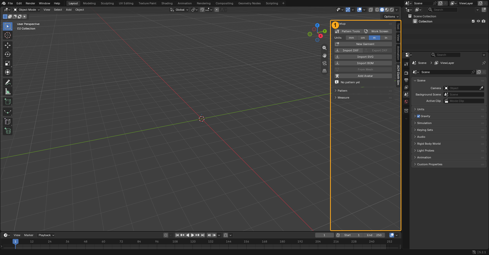
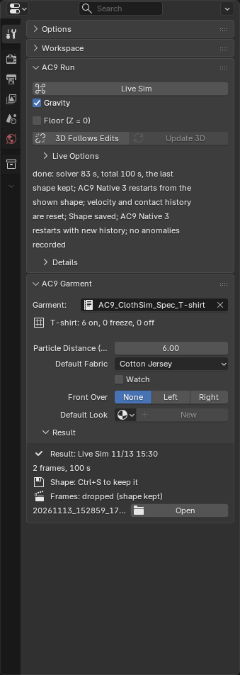
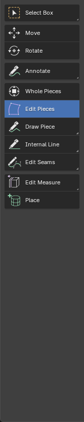
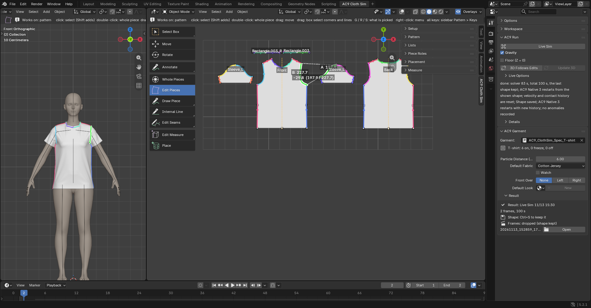

# Screen Layout

The controls are split across three places.

## The sidebar (the N panel in the 3D Viewport, the AC9 Cloth Sim tab)

These panels line up from the top.

- **Setup**: loading and exporting patterns, switching the work screen, and switching garments.
- **Pattern**: the tools for fixing and drawing patterns and attaching seams, and the buttons for the button tools (**Fasteners**).
- **Lists**: where you view and pick from lists. There are six tabs (**Seams**, **Pieces**, **Fabrics**, **Collision**, **Tapes**, **Fasteners**). Lists are only for viewing and picking; the settings for what you pick appear in the Tool tab. In every list, click a row name to pick one, and Shift+click to add or remove.
- **Piece Roles** (normally closed): the pieces' roles.
- **Placement**: the body and guides, and the placing tools.
- **Measure** (normally closed): measuring. It contains **Size Check**.
- **Overlays** opens from the eye button in the header of the 3D Viewport (upper right) and the list to its right.

## The Tool tab of the Properties editor

The settings for whatever you picked appear in the Tool tab of the Properties editor at the lower right. Which panels appear changes depending on what you touched last.

- **AC9 Run**: always at the very top. The run buttons (**Live Sim** and **Gravity**, **Floor (Z = 0)**, **Fix by Hand**), whether pattern fixes are carried over to 3D (**3D Follows Edits** and **Update 3D**), and the progress.
- **AC9 Garment**: when nothing is selected. Garment settings, fabrics, and results.
- **AC9 Piece**: when you've selected a piece. Name, state, role, fabric, interlining, look, thickness, point spacing, and so on.
- **AC9 Seam**: when you've picked a seam from the list or the pattern. Below it are **Lengths & Notches** and **Blend**.
- **AC9 Internal Line**: when you've clicked an internal line on the pattern.
- **AC9 Edges**: when you've clicked an outline edge on the pattern (the lengths and the total).
- **AC9 Fabric** and **AC9 Interlining**: when you've pressed a fabric or interlining row in the **Fabrics** tab of **Lists**.
- **AC9 Button**: when you've picked a button in the **Fasteners** tab of **Lists**.
- **AC9 Measurement**: when you've picked a measurement line or tape.

Blender's standard Options or Workspace panels may appear first. Collapse them and they take one line each.

## The tool column on the left (the toolbar)

AC9's tools line up at the end of the Object Mode tool column. Long-press to show the other tools in the same family (▾).

`Whole Pieces ｜ Edit Pieces ｜ Draw Piece ▾ Rectangle Piece ▾ Ellipse Piece ｜ Internal Line ▾ Internal Rectangle ▾ Internal Ellipse ｜ Edit Seams ▾ Add Seam ▾ Add Seam (M:N) ── Edit Measure ▾ Tape Around ▾ Tape Along ▾ Tape Straight ｜ Place`

- The pattern tools before the divider appear only when **Pattern Tools** in the **Setup** panel is on. When you load or draw a pattern, it turns on automatically, once per file (if you turn it off yourself, it stays off). It also turns on automatically when you press a tool button in another panel.
- When you hold a tool, the tool options row shows "Works on: …" (what the tool works on) and that tool's keys. With **Edit Pieces**, only the keys that work on what is under the cursor are shown (all the keys are in **Keys** at the bottom of the **Pattern** panel). If you put the cursor over something the tool can't work on, a yellow hint appears next to the cursor.
- A tool changes what it does depending on what you click (a pattern, the body, a dressed garment, and so on).
- In the pattern view in the middle of the **Work Screen**, the tool column shows only AC9's tools and Blender's Select, Move, Rotate, and Annotate (the other tools are just hidden; their keys still work).
- **Right-click**: in the middle of an operation, it cancels. When nothing is happening, it opens a menu for what is under the cursor (for **Whole Pieces**, **Edit Pieces**, **Edit Seams**, **Place**, **Edit Measure**, and on a dressed garment). The thing you right-click is selected first, and the menu items do the same as the keys and buttons.
- For the sidebar's tool buttons, pressing the one that is already pressed returns you to **Select Box** (Blender's ordinary selection).
- While you hold an AC9 tool, **X** and **Delete** remove the corner, notch, or internal line end under the cursor. If there isn't one, they remove the selected internal line, seam, or measurement. Pieces are removed after a confirmation. The objects themselves are not deleted.

## The Work Screen

Press **Work Screen** in the **Setup** panel and a workspace for working (named AC9 Cloth Sim) appears. It has 3D on the left, the pattern in the middle (a top-down orthographic view with the rotation locked), and the Tool tab of Properties on the right (there is no Outliner or Timeline). From the second time on, it just switches to the same screen and doesn't add another. A work screen made by an earlier version of the add-on is replaced with a new one when you press it. Pattern fixing is done in this middle 3D Viewport.

