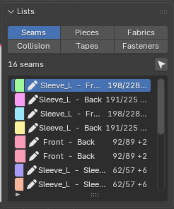

# Seams

What this panel is for: checking, adding, and fixing which edges get sewn to which. Seams are created when you load a pattern, but they can be wrong, so you review them here.

In 3D, a seam is shown as the sewing edges on both sides plus lines connecting their correspondence. Between a piece being placed and a piece that has been simulated, the lines connect whatever shapes are currently displayed. The lines follow when you move pieces or edit vertices. Connections to pieces hidden from the screen are not shown.

## What a seam is

One seam is a specification that sews "this section of piece A's outline (or internal line)" to "this section of piece B." A section is stored as edges of the outline plus fractions, so rebuilding the mesh doesn't break a seam. One side is called side A and the other side B.

## The list

The **Seams** tab in **Lists** shows one seam per row. From the left: a colored square for the seam, the name (label), `length of side A / length of side B` (mm), and the difference (mm) if there is one. The icon on the left is a warning (please check), a pencil (added by you), a chain (read from the BOM), or an empty square (off, not sewn).

- The top row shows "○ seams, ○ to check". BOM seams are kept per garment group and don't change when you turn pieces on or off (fixing the group rebuilds them, and seams you added or confirmed are kept).
- The arrow button at the top right of the list narrows it to the seams of the selected pieces (off by default).
- When you select a seam, **AC9 Seam** appears in the Tool tab at the lower right. Seams are also color-coded on the pattern (orange for ones to check, gray for off).

## The seam editing tool (Edit Seams)

Hold it from **Edit Seams** in the **Pattern** panel (or from the tool column on the left). Use it on the pattern.

- Click to select a seam. Click the same spot again to get the next overlapping seam. Click somewhere that isn't a seam to clear the selection.
- Shift+click adds or removes a seam (Shift+click on a name in the list does the same). While two or more are selected, the Tool tab shows only the count plus **On**/**Off** and **Delete**, which apply to everything selected. Double-click selects the whole piece.
- While you hold **Edit Seams**, the internal lines of all pieces also appear thin (a guide for lining up the ends of seams).
- Drag the end (white dot) of a selected seam to change its section. It moves along outlines and internal lines and snaps to corners, notches, and the ends of other seams (Ctrl turns snapping off).
- The two ends of the selected seam are joined with a dotted line, and the lengths of both sides and their difference are shown.
- **M**: moves the side under the cursor to another place (click the destination; **F** flips the direction). A moved spot counts as newly sewn on the next **Simulate**.
- **N**: places a notch and its partner. **Ctrl+N** places just one side. **X** or **Delete**: deletes the selected seam.
- To undo: Ctrl+Z.

## Add Seam and Add Seam (M:N)

- Select **One Edge** or **Two Points** in the **Tool Header** at the top of the viewport. The Tool tab on the right shows attributes of the selected item.
- **One Edge**: click the highlighted edge. Outlines and internal rectangles use the same operation. **Two Points**: click the start and end anywhere on the line. The selection mode stays the same for sides A and B.
- With the magnet on, points snap to corners and notches. Holding Ctrl temporarily inverts snapping while still picking the line. Internal rectangles offer all four corners. If an old line has no identifiable edges, the tool asks you to use Two Points instead of silently selecting the whole loop.
- **Add Seam**: select side A, then side B from the matching end. Check their lengths and difference, then press Enter or click again to confirm. **F** changes the direction around a loop. Backspace undoes one edge selection or point input; Esc or right-click cancels. No seam is stored before confirmation. Added seams are named "U1", "U2", and so on.
- **Add Seam (M:N)** (called **Add M:N** in the **Pattern** panel): uses the same selection and snapping rules. Add the required edges or sections on side A, finish each section, then press Enter to move to side B. Add the sections on B and press Enter to confirm. Both sides are divided by the fraction of their joined length and stored as a group of one-to-one seams.

## Settings for the selected seam (AC9 Seam)

- At the top are the seam's name and the reason it needs checking (in red). If there is a duplicate sewing the same two edges, a warning appears.
- The piece name for each of A and B (the name with the number in parentheses, if it has a name), the section, and the length. Labels for A and B also appear on the pattern.
- **A**/**B** under **Fit the length of**: fits the length of the side you pressed to the other side (easing). If the end of the section is a corner, the corner moves along the edge; if it is in the middle of an edge, the end slides.
- **A**/**B** under **Flip the direction of**: reverses the direction of that side. Use it when the seam would be sewn twisted.
- **Off** or **On**: don't sew / sew that seam.
- **Confirm**: marks it as checked (the warning goes away). Only appears on seams that have a warning.
- **Delete**: deletes the seam.
- **Fold Angle** and **Direction**: the angle the two pieces keep across the seam (0 means none), and whether it is a **Mountain** or a **Valley** fold, seen from the face of the piece that turns. When you change them, the adjusted shape folds right away. Choose the piece that turns with **Turns**. Seams that continue in a straight line get the same angle. When it can't fold, the reason appears.

See the [fold timing table](fold-roles.md#when-settings-apply) for how angle, direction and Turns affect the adjusted shape and a running simulation.

- **Pull**: how the seam pulls the pieces together. **Straight**, or **Round** (passes around a body part; pick the part with **Part**).

## Seam lengths and notches (Lengths & Notches)

For the selected seam, this shows the lengths of side A and side B, the ease (the length difference, in mm and %), and the number of notches. Notches without a partner show in red. For each section divided by notches, a table shows the A/B lengths, that section's ease, and the running total up to there.

- **From the other end**: counts from the opposite end.
- **A**/**B** under **Lay the notches of**: places the notches of the side you pressed at the same fractional positions as the other side (ease is divided among the sections).
- **Notches from BOM**: loads the BOM's notches onto the pattern (existing notches stay). Only appears for garments read from a BOM.

## Smooth connection at the ends of a seam (Blend)

When you line up two pieces along a seam, the outline can bend (form a corner) at the end of the seam. In the **Blend** section, check the kink (in degrees) at both ends of the seam (From and To). Press **Blend** and the outline for 30 mm from that end is bent half-and-half on the two pieces so they connect smoothly (left and right pairs too). Where there is no corner, or there is a reason it can't be fixed, the reason appears instead of the button.
