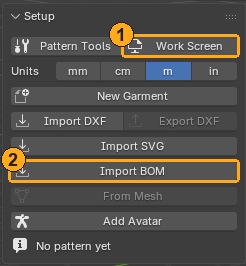

# Setup (loading a pattern)

What you do in this panel: bring a pattern into Blender, split garments apart and choose the pieces to use, and open the work screen.

## Units

- **Units** (**mm**, **cm**, **m**, **in**): the unit every length is shown in: the labels on the pattern, the measurement tables, and the fields such as a dart's width or a line's distance. You can type a length in any of these fields with its unit (for example `5cm`), and a number typed while dragging is read in this unit. Only **Particle Distance (mm)** stays in mm.
- This only changes how lengths are shown. The pattern's sizes do not change.
- **New Garment** and the imports switch a new scene to mm.

## Import BOM

- Purpose: Load a pattern from a `BOM.xml` written by 3D garment software.
- Prerequisite: You have a `BOM.xml` file.
- Steps: Press **Import BOM** and choose a `BOM.xml`. The 3D garment, placement, and saved placed shapes of the current BOM are discarded. The body, other garments, and calculation results on disk are not deleted. If it fails, the original state is kept.
- Expected result: The pattern is laid out flat on the floor. The seams contained in the BOM are also loaded and appear in the **Seams** list. The screen shows "○ pieces, ○ seams".
- When one BOM contains several garments, the pieces are split into groups per garment at import, and the partners of seams are decided within each group (a piece is never sewn to a piece of another garment). Groups whose classification is uncertain are shown in orange.
- Hole shapes in the BOM (such as the diamond of a dart) are cut out of the piece (there is no cloth there).
- False seams that sew a piece to itself using a shared line are not imported. Seams that close the two ends of a band into a ring are kept.

## Update BOM Seams

Use this when you want to re-read the seams while keeping the dressed shape. Press **Update BOM Seams** under the **Garment** field. It updates the seams and automatic classification from the BOM that was loaded.

- Kept: the dressed shape, placement, piece On/Off and Freeze, fabrics, roles, folds, and manually made seams, garment classification, and names.
- It updates only when the shapes and references of all pieces match. A parallel shift of the BOM's 2D layout is tolerated, and the current pattern arrangement is kept.
- If the IDs of pieces, shapes, edges, or internal lines changed, or if a seam that you set by hand or that has references would disappear, nothing is changed and the reason is shown.
- To settle the updated seams, run Live Sim next.
- With a fresh import, other versions of settings that shared the old 3D are also retired under the name "previous". Even if you choose an old version, the old placement and results do not come back.

## Import DXF and Export DXF

- **Import DXF**: Loads a pattern in DXF-AAMA format as a new garment. The outline, corners (turn points), internal lines, notches, and piece names come in.
  - Seams are not included in DXF, so a loaded garment has no seams. Sew them together with **Edit Seams** and **Add Seam**.
  - Not loaded (the counts appear in the report after loading): grainlines, inner cutouts (such as dart holes), and other sizes (for a graded DXF, only the base size).
  - For now this only loads as a new garment. There is no way to swap in the pieces of the current garment while keeping its seams.
- **Export DXF**: Writes the pattern in DXF-AAMA. The outline, corners, internal lines, notches, and piece names are included. Seams are not written to DXF; they stay on the AC9 side. If you read back a DXF written by AC9, the piece names, edge numbers, and notch numbers come back unchanged.

## Import SVG

- **Import SVG**: Loads a pattern drawn in a drawing app, or an SVG written by a pattern generator, as a new garment. The outline, corners, internal lines, notches, and piece names come in.
  - Pieces are separated by the drawn lines, not by layers. A closed line that is not inside any other line is one piece, and the lines and marks inside it belong to that piece. The piece name is the name of the layer or group that contains only that one piece; if there is none, it is the text inside the piece.
  - If there is a cutting line that surrounds the finished line at the width of a seam allowance (roughly 2 to 40 mm), the finished line becomes the outline and the cutting line is not loaded. For a piece that has only one closed line, that line is read as the finished line.
  - Notches are short lines of 15 mm or less that touch the outline or the cutting line, small circles on the outline, and symbols with "notch" in their name.
  - Not loaded (the counts appear in the report after loading): lines with arrowheads (such as grainlines), small marks such as buttons and holes, construction lines, and lines that do not belong to any piece.
  - Units: if the width and height have mm, cm, in, or pt, they are used as they are. For px or no units, the file is treated as 1 unit = 1 pt if it came from a drawing app that draws in points, and as 1/96 inch otherwise. If that is wrong, choose again with "Units" on the screen where you pick the file. The report shows "1 unit = ○ mm".
  - Seams are not included in SVG, so sew them together with **Edit Seams** and **Add Seam**.

## From Mesh

- Purpose: When you modeled a garment directly in Blender (a garment without a BOM), turn it into a sewable pattern and seams so you can simulate it.
- Prerequisites:
  - Make the garment mesh from a single sheet of faces with no thickness, and leave the cuffs and hem open. For modifiers, the visible shape is used as it is.
  - Put **UV seams** where you want to split the pattern (sides, shoulders, and so on) and unwrap. One UV island becomes one pattern piece, and an edge where two islands touch becomes a seam.
  - Choose the body in **Body** of the **Placement** panel beforehand (the button cannot be pressed if no body is chosen).
  - Make the garment mesh active (an object separate from the body).
- Steps: Select the garment mesh and press **From Mesh**.
- Expected result: Flat patterns are laid out on the floor and a dressed garment `AC9_Garment_<name>` is created, starting dressed on the body in the shape you modeled. The original mesh is hidden. The screen shows "○ pieces, ○ seams" and the number of points that are inside the body. The places that are inside are painted red.
- Then press **Live Sim** and the cloth drapes and settles.
- Limitations: This is the "as built" state; the cloth has not settled. If the UVs have not been unwrapped, it stops with an error saying there are no UVs.

## Add Avatar

- Purpose: use the add-on's bundled avatar (CC0) when you don't have a body to dress.
- Steps: press **Add Avatar**. The collection "AC9 Avatar" (body, rig, eyes) is added to the current scene. It does not reopen the file, so everything else in the scene stays as it is.
- Expected result: the body is selected, and if **Body** in the **Placement** panel is empty, this body is set there. You can go on to **Detect Guides**.
- If you press it twice, a second avatar is added (with .001 after the name).
- The body follows its rig (AC9 Avatar Rig). To open the A pose wider or make a T pose, move the rig in Pose Mode before dressing (an avatar that moves while the garment is simulated, that is animation, is not supported yet).

## New Garment

Starts a new garment with no pieces at all. Then draw with **Draw Piece**.

## The Garment field and the pieces to use

- **Garment**: The field for choosing the garment (pattern data) you are working with. When you switch it, the panel display changes to that garment's pattern, seam list, placement, and so on. For layered garments, you switch one garment at a time here.
- `<garment name>: 13 / 20 pieces on` is the number of pieces that are used (on) and the total number.
- **All On**: Turns all pieces on (the function name is All Pieces).
- Only pieces that are on are sewn in the simulation. Pieces that are off are shown gray and translucent.
- **Reload Spec**: Re-reads the pattern data (text JSON) and rebuilds the pattern on screen. Press it when you edited the JSON by hand. If the JSON is broken, the panel shows "The spec text is not valid JSON" and where the problem is.

## Garment groups (when one BOM contains several garments)

When there are two or more groups, they are listed one group per line under the **Garment** field. Each line shows the group's name and `(number on / number of pieces)`, and you can rename it with the pencil on the right. An orange line is a group that was split from the placement, so it is not certain. Pieces that are alone are gathered into one line, "Pieces alone (○)".

Steps to turn on only the one garment you want to use:

1. Press the line of the group you want to use (the pieces of that group are selected; Shift adds).
2. With the pieces selected, press **Active** under **State** in **AC9 Piece** on the Tool tab.
3. In the **State** row, press **Invert Selection** to invert the selection, then press **Off All**.

To re-read the seams, use "Update BOM Seams". Only when you need to correct the classification by hand, you can select pieces and use "Garment from Selection" in F3. It is not in the regular panel.

## Display

- **Overlays** (the eye button and the list): Toggles what the add-on draws on screen. The list contains **Seam Lines**, **Seam Lengths**, **Notches**, **Piece Colors**, **Fabric Colors**, **Piece Names**, **Guides**, **Measurements**, and, under **Diagnose**, **Problems** (shows problems the add-on found in red; on by default) and **Stretch** (colors the stretch from the pattern: no color up to 1.05 times, yellow at 1.2 times, red at 1.5 times, and blue for shrinking). There is also **Thickness** (adds cloth thickness to the dressed garment for looks only; it is not used by the simulation) and the side the thickness is added to (**Inside**, **Center**, **Outside**).
