# Your first garment

Starting from nothing, you draw the pattern of a T-shirt yourself and dress it on the bundled avatar.
Button names are the ones shown in the English interface. If you are new to Blender, please read [Blender basics](blender-basics.md) first.

<!-- video: Your first garment (1-2 minutes per chapter) -->

You make 6 pattern pieces.

| Piece | How |
|---|---|
| Front | Draw a rectangle and move its corners into shape |
| Back | Duplicate the front and fix the neckline |
| Sleeves (left and right) | Draw one, then make a left/right pair with Mirror Copy |
| Neck ribs (left and right) | Draw a thin rectangle, then Mirror Copy |

## What you need

- Blender 5.2 with AC9 Cloth Sim installed (see [Installation](install.md)). You need no body and no pattern: the body is the bundled avatar (CC0).

To start from your own body (avatar), or from a pattern made in other software (`BOM.xml`, DXF, SVG, a garment mesh), see "Other ways to start" at the end.

## 1. Open the work screen

1. Start Blender and, with the new file as it is, **first save it under a name** (**Ctrl+Shift+S**). The simulation's progress is kept in a folder created next to the saved .blend.
2. Press **N** in the 3D viewport to show the sidebar, and open the "AC9 Cloth Sim" tab ("Work Screen" in [Blender basics](blender-basics.md)).
3. In the **Setup** panel, press **Work Screen**. You get a screen with the 3D view on the left, the pattern in the middle, and the Tool tab on the right.

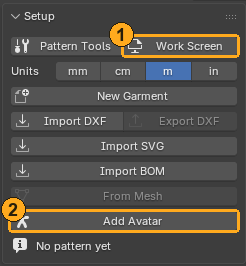

## 2. Load the avatar and measure it

1. In **Setup**, press **Add Avatar**. The avatar appears in the 3D view on the left and is also set in the **Body** field.
2. In the **Measure** panel of the sidebar, press **Measure Body**. The bust, waist, hip, neck, arm and other measurements appear in a table, and the measured places are drawn as lines around the body.

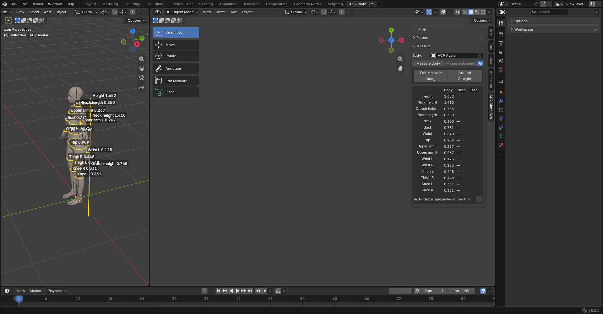

Use these measurements as a guide for the size of the pattern you draw. For example, the width of the front is about "1/4 of the bust + ease". You can change the unit of length with **Units** in **Setup**.

## 3. Make the front from a rectangle

1. In **Setup**, press **New Garment**. You get a garment with no pieces.
2. In the **Pattern** panel, press **Rectangle** in the **Piece** row and drag in the pattern view in the middle to draw a rectangle. To set its size in numbers, start drawing, type the width and press **Tab**, then type the height and press **Enter**.
3. Press **Edit Pieces** and drag the corners into shape.
   - Press **K** on an edge to add a point there (the shoulder tip, the underarm and so on).
   - Press **C** on an edge to make that edge a curve. Drag its handles to round the neckline and the armhole.
   - While you drag, the length and the distances to the surroundings appear in mm. Type a number and it stops at that length.
4. Name it. Select the piece and press **F2**, or type "Front" or the like in the top field of **AC9 Piece** on the Tool tab.

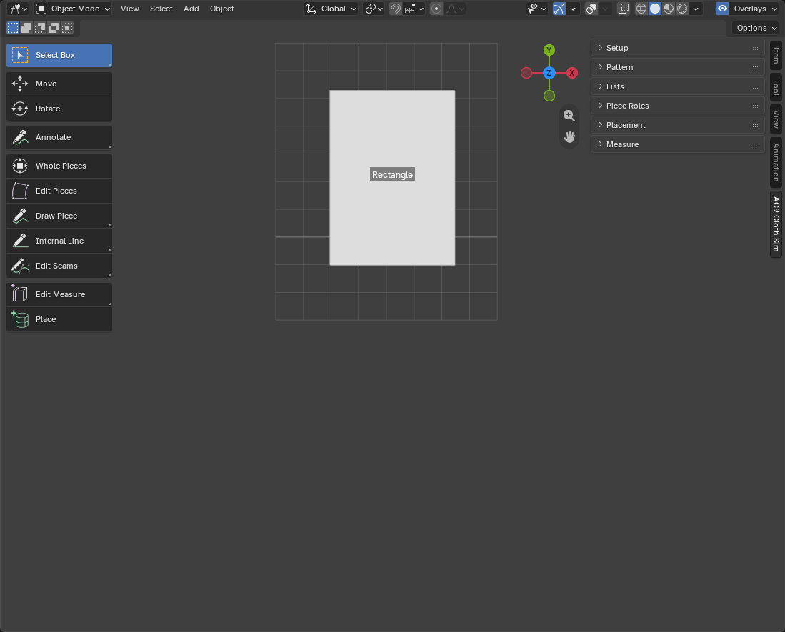
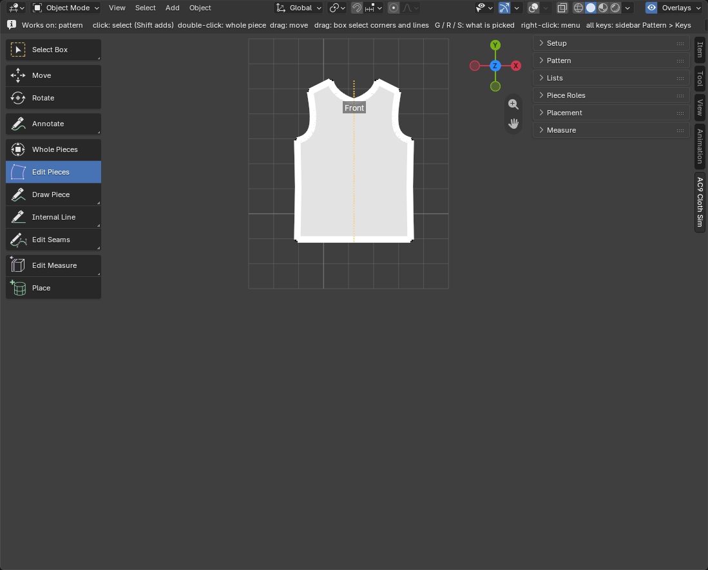

For a symmetric piece, turn on **Symmetric Edit** on the Tool tab: moving a corner on one side moves the other side as its mirror (see [Edit and draw patterns](features/pattern.md)).

## 4. Make the back by duplicating

1. Select the front and press **Duplicate** in **Selected Pieces** (**Shift+D** does the same). The copy follows the mouse; click beside the front to put it down.
2. With **Edit Pieces**, make the neckline shallower (the back neckline is shallower than the front).
3. Name it "Back".

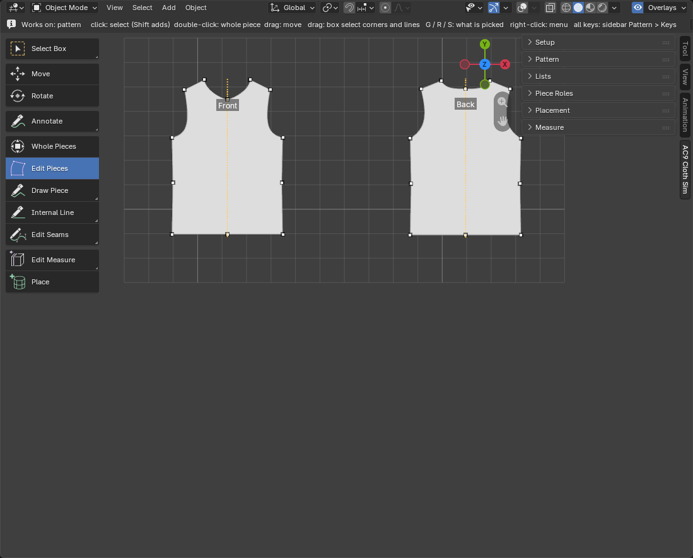

## 5. Make the sleeves as a left/right pair

1. Press **Draw** in the **Piece** row and click the corners of one sleeve in order. Click the first corner again (or press **Enter**) to close it.
2. With **Edit Pieces**, press **C** on the sleeve cap's edge to round it.
3. Select the sleeve and press **Mirror Copy** in **Selected Pieces**. You get the mirrored other sleeve, and the two become a left/right pair. When you fix one of a pair, the other follows as its mirror.
4. Make the neck ribs the same way. Draw a thin rectangle (about half of the neckline's length, 1–2 cm wide) and make it two with **Mirror Copy**. Each one covers one side of the neckline, from the center front to the center back.

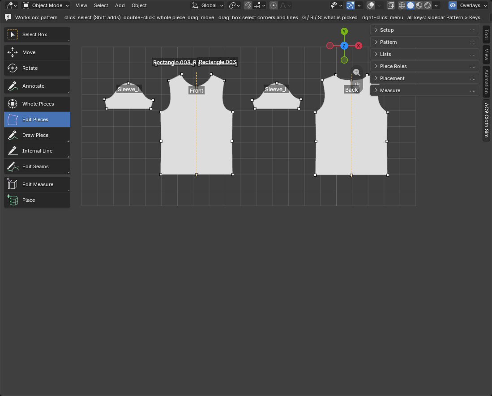

## 6. Add the seams

1. Press **Add Seam** in the **Pattern** panel.
2. Click the start and end points on the outline of one piece, then the start and end points on the other piece (**both from the same end**). If you click in the middle of an edge, it takes that whole edge. With 4 points, the length of both sides and the difference appear; review them and press **Enter** to add. If a section was taken in the reverse direction, press **F** to reverse it.
3. Sew these places:
   - the shoulders and the sides of the front and the back
   - the underarm seam of each sleeve (making the sleeve a tube)
   - the sleeves to the armholes of the body
   - the ribs to the neckline (front and back), and the two ribs to each other (center front and center back)
4. A seam between pieces of left/right pairs, like the underarm seam, goes into the other side as its mirror when you sew one side. A seam to a single piece, like the body, you sew on both sides.

The seams are listed one per row in the **Seams** tab of **Lists** in the sidebar. You see the length of both sides (A and B) and, if there is a difference, the difference (mm).

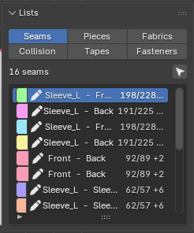

For a detailed explanation of how to add seams, see [Seams](features/seams.md).

## 7. Make placement guides

1. In the **Placement** panel of the sidebar, check that the avatar is in the **Body** field.
2. Press **Detect Guides**. Cylinders (guides) that serve as placement guides for the pieces are created around the torso, neck, arms and legs. If the cylinders are off, you can fix them with **Edit Guides**.

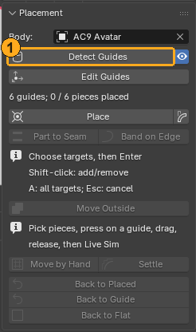

## 8. Place the pieces around the body

1. In the **Placement** panel, press **Place** to pick up the tool.
2. Click a piece in the pattern view to select it (**Shift** adds). For a left/right pair, when you place one, its partner follows to the mirrored position.
3. In the 3D viewport on the left, move the cursor over the cylinder where you want to place it (the cylinder glows yellow).
4. Press on the cylinder and the piece is placed there. If you **hold and move**, it slides around and along the cylinder. It is set where you release (if you press and drag a piece that is already placed, it does not jump, and moves only by the amount you move. To change only the angle, only the height, or to tilt the piece, use Around (angle around), Height, and Tilt (tilt angle; at 90° the upper side is horizontal and outward, at 180° it is upside down = the outline of the collar faces the neck side; the ↻ next to it adds +180°) in "AC9 Piece" on the Tool tab).
5. Repeat until all the pieces are placed. The panel shows "○ / ○ pieces placed" (number placed / number to use).

Which piece goes on which cylinder:

| Piece | Cylinder | Where |
|---|---|---|
| Front | Torso | the front of the body |
| Back | Torso | the back of the body |
| Sleeves | Arms | one on each arm, the sleeve cap toward the shoulder |
| Collar, neck ribs | Neck | around the neck |
| Skirt, pants | Torso, legs | below the waist |

- To place on the back, turn the view in the 3D viewport on the left so you see the back of the body (drag with the middle button; without one, see [Blender basics](blender-basics.md)).
- If you mix up front and back, or left and right, the calculation still runs. If the garment is worn oddly, place it again.

The shape you see when you release is the shape the simulation starts from. Pieces that turn red are pieces that are inside the body or overlap other pieces (the reason is shown). You can start as is, but it starts more cleanly if you place them again or use the tidying tools in the **Placement** panel.

To place a piece again, select it and place it again with **Place**. **Back to Flat** lays it flat where it is.

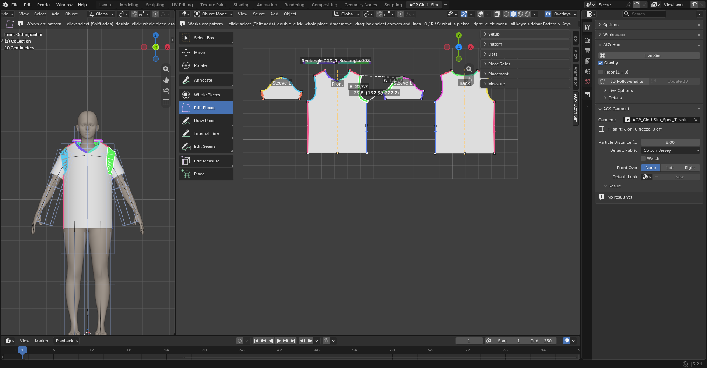

## 9. Dress (Live Sim)

1. Press **Live Sim** at the top of the Tool tab on the right (**AC9 Run**).
2. At first it is preparing the calculation, so wait a little ("Preparing the simulation (N s elapsed)" appears in the 3D view; the first time you dress, it takes a little longer). **During this time the cloth does not move, but it has not stopped. Wait without pressing the button again** (pressing it again stops it).
3. When the calculation starts, the seams are pulled together and closed, and the garment settles onto the body.
4. **It does not stop by itself.** When the garment has settled and stopped moving, press the button (it has changed to **Stop**) again or press **Esc**. The shape where you stopped is the result.

- If a collar or sleeve falls before it is sewn on, uncheck **Gravity** and run, then check it once the seams have closed (you can switch it while it runs).
- The time the calculation takes depends on the size of the garment and the computer.

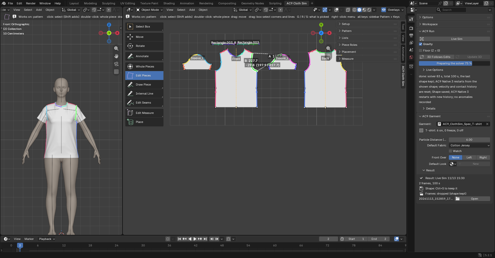

## 10. Look at the result

- With nothing selected, look at the Tool tab and the result (Result) appears in **AC9 Garment**.
- Red fill means "possible problem". It does not necessarily mean it is bad.
- Even with the same settings, the result changes slightly every time you calculate. Do not judge good or bad from one run; run it a few times and look.
- Signs it went well: the sleeves are on the arms, the neckline goes around the neck, and the cloth does not sink into the body.

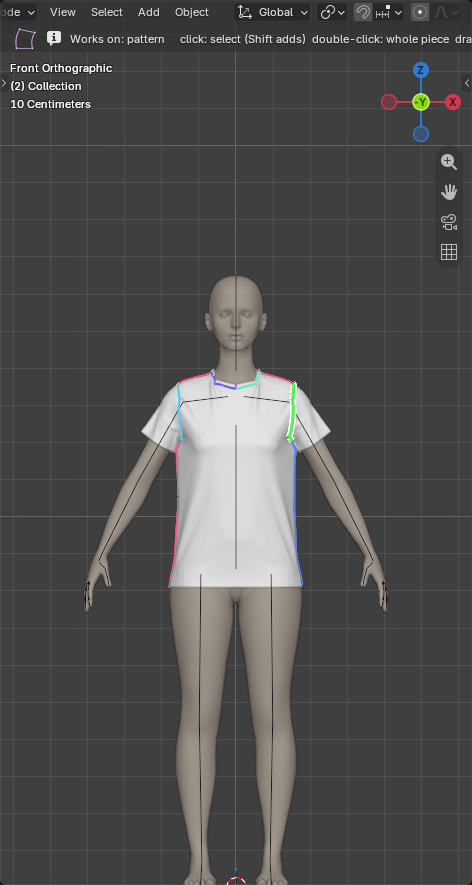

**From the second time on, it continues calculating from the garment's current shape.**

## 11. Fix it and dress again

- **Fix the pattern**: drag corners and edges with **Edit Pieces** in the **Pattern** panel. The dressed garment does not change right away. When you then press **Live Sim**, the edited shape is carried onto the dressed garment first, and it calculates **continuing from the current shape** and settles into the edited pattern. To see the 3D shape after every edit, press **3D Follows Edits** in **AC9 Run** on the Tool tab.
- **Pinch and fix the cloth by hand**: while the cloth is moving in **Live Sim**, pinch and pull the cloth with **Ctrl + left drag**. If cloth has pushed through other cloth, press **Alt** during the drag and the cloth you hold passes through other cloth. Press **Esc** and the shape where you stopped remains.
- **Dress again from the start**: with nothing selected, press **Back to Placed** in the **Placement** panel (a confirmation appears), then press **Live Sim**.

## 12. Save

Save with **Ctrl+S**. The final shape of the dressed garment is saved inside the .blend, and the progress frames are saved in the folder next to the .blend.

## What to do next

- Layering clothes: switch to another garment in the **Garment** field and press **Live Sim**, and the garment you have finished dressing becomes an immovable obstacle. Dress from the inner garment outward.
- Change the fabric: when you select a piece, you can choose the fabric in **AC9 Piece** on the Tool tab.
- Send to Cloth Retopo: with **To AC9 Cloth Retopo** in Details of **AC9 Run** on the Tool tab, you make the dressed garment the Guide of [AC9 Cloth Retopo](https://github.com/openfashion-labs/ac9_cloth_retopo).

## Other ways to start

- Your own body (avatar): open the .blend with the body, save it, and choose the body mesh in **Body** of **Placement**. The body stands straight with its front facing **−Y** (an A-pose or a T-pose is fine).
- A pattern from other software: **Import BOM**, **Import DXF**, **Import SVG**, **From Mesh**. All are described in [Setup](features/setup.md). Except for BOM, they contain no seams, so you add them as in "6. Add the seams" of this chapter.

If things do not work, see the [Troubleshooting](troubleshooting.md) page and "Troubleshooting" in each feature's description.
