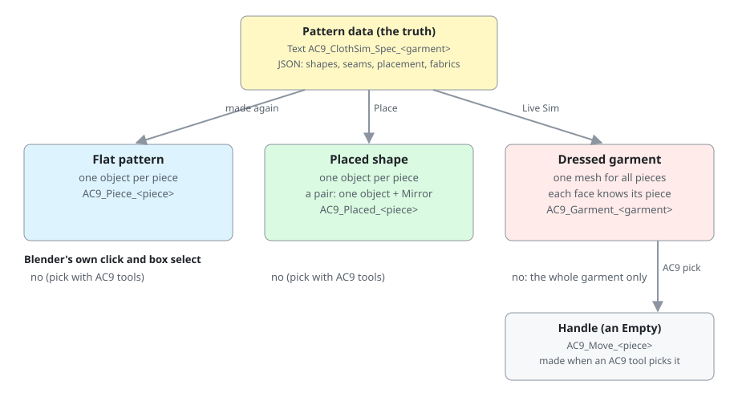

# Data Model

## Editing vertex connections

Internal lines do not connect through coordinate coincidence. Only outline attachments are evaluated by core/boundary_connection.py and boundary_nodes. Reading and display do not rewrite the JSON.
Legacy vertex_groups metadata is retained but inactive. Topology edits preserve its index identity, but runtime connections and movement do not read it. The retired implementation is archived outside the addon and is not registered, executed, or distributed.
Outline EIDs and false detach markers in boundary_nodes remain active. Separating the outline leaves the internal endpoints independent. When extension retains a former outline as an internal path, it does not join other internal lines to that path.

## One source of truth; what you see is made from it

A garment's information (the pieces' shapes, seams, placement, folds, piece roles, fabrics) is kept as JSON in a
Blender text, `AC9_ClothSim_Spec_<garment>`. This is the **source of truth**.

The pieces you see are **objects** made from it. One piece becomes three kinds of object, depending on how far the
work has gone.

| Stage | Object | What one object holds | Collection |
|---|---|---|---|
| Flat pattern | `AC9_Piece_<piece>` | one piece | `AC9_ClothSim_Pattern` |
| Adjusted Shape | `AC9_Placed_<piece>` | one piece; a left / right pair is one object with a Mirror modifier | `AC9_ClothSim_Placed` |
| Dressed garment | `AC9_Garment_<garment>` | **every piece of the garment**; each face knows which piece it belongs to | the results collection |

## What Blender's own tools can touch

The objects are split differently at each stage, so Blender's own selection and G / R work differently too.

| Stage | Blender's own click and box select | G (move) and R (rotate) | Where the change goes |
|---|---|---|---|
| Flat pattern | not selected (AC9 tools pick pieces) | Blender's own G / R do not move it (the object is locked). G / R pressed inside an AC9 tool move it by changing the pattern data | the pattern data |
| Adjusted Shape | not selected (as above) | the piece moves; the simulation starts from this shape | the placed object |
| Dressed garment | **picks only the whole garment** | the whole garment moves | — |

The flat pattern is locked so that an object cannot move while the pattern data stays where it was (it would look
moved, then jump back the next time it is made again). Inside the AC9 tools such as **Whole Pieces**, the G and R keys
run the AC9 operation, which moves the pattern data itself.

The dressed garment is one mesh for all pieces. To Blender it is a single "garment" object; Blender does not know
which part is a sleeve and which is the body. To pick one piece of the dressed garment you need an AC9 tool; see
[Selection and the Gizmo](selection.md). On the flat pattern and the adjusted shapes, too, pieces are picked with the
AC9 tools (Blender's own select tools do not select pieces' objects; the Outliner does).

### Why the flat pattern is not edited in Edit Mode

The flat pattern objects are a picture made from the pattern data. Moving their vertices in Edit Mode does not change
the pattern data, and the next time they are made again they go back to the pattern data's shape. Use **Edit Pieces**
to change a shape; it rewrites the pattern data itself.

The adjusted shape is different: you may move its vertices in Edit Mode, or move it with G / R. The simulation starts
from the adjusted shape on screen at the time.

## Origins (where the gizmo sits)

Blender's move and rotate gizmo sits at the object's origin. The origin is in a different place at each stage.

| Stage | Origin |
|---|---|
| Flat pattern | the same point for every piece (where the pattern is laid out), not on the piece |
| Adjusted Shape | the middle of the piece; for a pair, the middle of the original side (not the mirrored side) |
| Dressed garment | the garment's origin. When an AC9 tool picks a piece, a "handle" appears in the middle of that piece |

Because a flat pattern object's origin is not on its piece, with a flat piece and a placed piece picked together the
gizmo can show up in the empty space between them. How to avoid it: [Selection and the Gizmo](selection.md).

## Left / right pairs

A symmetric pair is usually one placed object: the original side's mesh with a Mirror modifier, the other side being
the modifier's mirror image. Move one side and the other follows to the mirrored place.

Where the mirror plane is depends on how the pair is placed:

- a pair placed round the body: the body's center
- a pair laid flat (a bag, for example): the garment's own center Empty, `AC9 Center: <garment>`. Move it and the
  pair's mirror plane moves there

Some pairs, such as a pair set front to back, stay two objects; one then follows the other's mirrored place.

## What goes and what stays

- Flat pattern and placed objects can be made again from the pattern data. Deleting the object with Blender's X
  leaves the pattern data (restore it from the **Pieces** list).
- A placed piece moved by hand, and vertex edits to it, live in the placed object. **Back to Placed Shape** and **Back to
  Flat** throw them away and make it again.
- The dressed garment's last shape is the mesh of `AC9_Garment_<garment>` itself.
