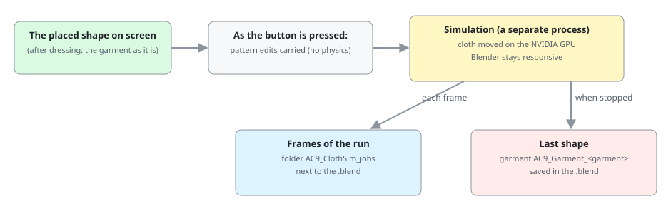

# Simulation and Saving

## As the button is pressed

1. **The starting shape.** The first run starts from the placed shapes seen on screen. After dressing, later runs go
   on from the garment as it is (while frames are played back, from the frame shown).
2. **Pattern edits are carried.** With **3D Follows Edits** off, editing the pattern does not change the placed
   shapes or the dressed garment at once. When the button is pressed, the edits are carried to them in one go,
   without physics (the shapes are only fitted).
3. **Getting ready.** The pieces are meshed (small triangles) and handed to the simulation together with the seams,
   the fabrics' stiffness and the body's shape.

## The simulation runs outside Blender

The cloth is simulated in a separate process (a Python started on its own) on the NVIDIA GPU, with the NVIDIA Newton
library.

- Blender stays responsive meanwhile; that is why the cloth can be held with Ctrl+drag during Live Sim.
- The first run on a PC (and the first after updating the add-on) builds the GPU programs, so it takes a while to
  start. Later runs start quickly.
- The same settings give a slightly different result each run. Do not judge from one run alone.

## What is kept where

| What | Where | Gone when |
|---|---|---|
| Pattern data (shapes, seams, placement, fabrics, settings) | in the .blend (text `AC9_ClothSim_Spec_<garment>`) | — |
| Placed shapes | in the .blend (`AC9_Placed_<piece>`) | placed again; **Back to Guide**, **Back to Flat** |
| The garment's last shape | in the .blend (the mesh of `AC9_Garment_<garment>`) | the next run (replaced); **Back to Placed** |
| Frames of the run | folder `AC9_ClothSim_jobs` next to the saved .blend | **Delete Cache**; dressing another garment |
| The simulation log | text `AC9_ClothSim_Log` | — |

- Run before saving the .blend and the frames go to a temporary folder and cannot be played back later. Save first.
- Hand only the .blend to another PC and the last shape, kept in the .blend, is still seen and can be gone on from.
  Only the frames cannot be played.

## Layered garments

A dressed garment is in the simulation of another garment as an obstacle that does not move; that is why garments
are dressed from the inside out. Dressing another garment drops the previous garment's frames and keeps only its last
shape.
