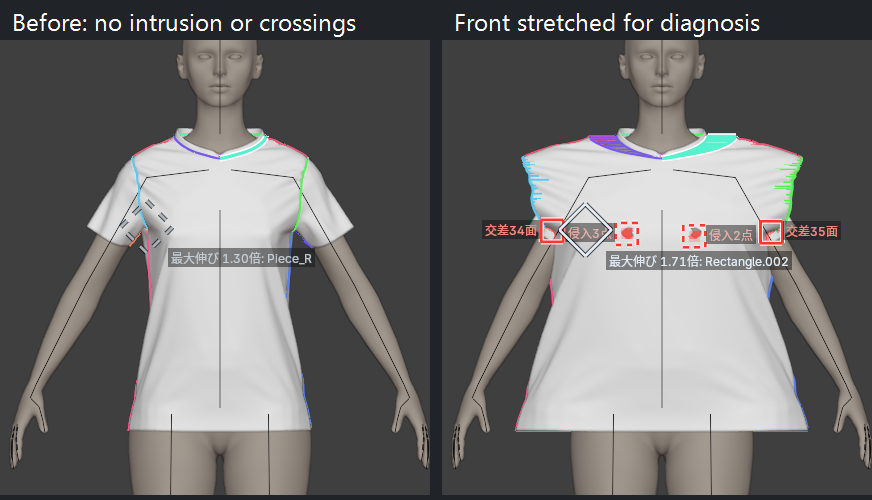

# Troubleshooting

## Look here first (common stumbling points)

| Problem | Cause and fix |
|---|---|
| I can't find the run buttons (such as **Simulate**) | They are in the **Tool** tab of the Properties editor at the lower right, not in the sidebar. Check that Properties isn't on another tab such as Render. |
| Keyboard shortcuts don't work | Is a Japanese or other input method (IME) on? Is the cursor over the area you want to operate in? |
| The AC9 tools vanished from the tool column | Did you enter Edit Mode (return to Object Mode with **Tab**)? Is **Pattern Tools** in **Setup** turned off? |
| Pattern pieces don't move with **G** / **R** / **S** | The pieces are locked. Move them with the **Whole Pieces** tool. |
| A button is gray and can't be pressed | Put the cursor on the button and the reason it can't be pressed appears. |
| The pattern view in the middle doesn't rotate | The pattern view only looks from directly above and doesn't rotate. Rotate in the 3D Viewport on the left. |
| I can't rotate the view (no middle button) | Turn on "Emulate 3 Button Mouse" under "Edit" > "Preferences" > "Input", and you can rotate with **Alt** + left drag. |
| Pieces are invisible or faint | Gray translucent means a piece that is **Off**. A red outline and a warning mean a piece whose object alone was deleted with Blender's **X** (you can restore it from the **Pieces** tab of the list). If you hid it with **H**, use **Alt+H**. If the overlays at the upper right of the 3D Viewport are off, the lines and colors AC9 draws also disappear. |
| I can't grab the cloth in **Simulate** | The cloth doesn't move for a little while after you press it (it depends on the computer). Grab it after it starts moving. You can't grab pieces that are **Freeze** or Off. |
| The Result field shows `folder gone` | You moved or renamed the .blend after saving. The final shape remains, but the progress can't be played back. |
| After installing a new version, "cannot import name …" appears, or the screen differs from the description | Close Blender once and start it again. |

## Operations that can't be undone, and cautions

- **Back to Adjusted Shape** (with nothing selected): Removes the result of the whole garment. A confirmation appears. You can undo with Ctrl+Z.
- **Simulate**: It does not stop until you press **Stop** or **Esc**. Retained progress depends on [recording settings](features/run.md#recording-progress).
- **Delete Cache**: The progress frames you deleted can't be restored.
- **Simulate** (from the second time), **To AC9 Cloth Retopo**, and **Measure Garment**: While the progress is being played back, all of them use the frame shown on screen. Check the Timeline position before pressing.
- **Fix by Hand**: Playback of the progress stops. To go back, use Ctrl+Z.
- Use **Diagnose** for the current shape and diagnose again after editing. A pre-run Watch switch is not required.
- Save a test .blend under another name before using it, and don't overwrite it.
- In current-shape diagnosis, red marks confirmed issues such as crossings; yellow marks crossing candidates whose seams could not be verified. Read the target, counts and unchecked items too. Color alone does not determine quality. Past run records are separate.

Below is the same view before and after deliberately stretching the front panel for diagnosis. Match the red squares and maximum-stretch diamond to the pattern in the [diagnosis display examples](features/placement.md).

## When it doesn't work

| Symptom | What to check first | Next step |
|---|---|---|
| **Simulate** doesn't start and shows "Set the Newton Python in the add-on preferences" | The **Newton Python** setting in Preferences | Fix the setting and press again. |
| **Simulate** is gray | Is **Body** selected? Did you run **Detect Guides**? | Select the body and run **Detect Guides**. |
| "○ unplaced pieces are excluded from the calculation" appears | There are pieces not yet placed in 3D. | It can calculate with only the placed pieces. To include the unplaced pieces in the calculation, place them with **Place**. |
| **Detect Guides** shows "upright, facing -Y?" | The orientation and pose of the avatar | Use a body that stands upright and faces -Y. |
| The **From Mesh** button can't be pressed | Is a body selected in **Body**? Is the garment mesh in the **Mesh** field (or, with it empty, active)? | Select the body, and put the garment mesh in the **Mesh** field with the eyedropper. |
| **Fix by Hand** doesn't appear | Is the progress being played back? | When progress is not being played back, you can sculpt directly without pressing it. If there is no result, dress it with **Simulate**. |
| BOM seams are attached to the piece itself or to pieces of another garment | Several pieces share the BOM's numbers (a project gathering several garments, or parts brought in from other files). The garment group lines in **Setup** (orange means an uncertain split). | Export the garment as FBX with the BOM and read it with **Seams from 3D Drape (FBX)**. Without an FBX, delete or switch off the wrong seams in **Edit Seams** and sew with **Add Seam**. |
| BOM seams join the diagonal partner (left and right crossed) instead of the one opposite | Before export, was the piece flipped front-to-back in the 3D garment software? | Flip it back and export the BOM again. If you can't, delete the crossed seams in **Edit Seams** and sew them again with **Add Seam**. |
| **Part to Seam**, **Band on Edge**, and **Settle** are gray | Are pieces selected? Are they placed? Are they part of a dressed garment? | Place them and then press. For pieces of a dressed garment, press **Back to Adjusted Shape** first and then press. |
| Cloth stays passed through other cloth and doesn't come back | Are you in **Simulate**? | In **Simulate**, press **Alt** during a Ctrl+drag to let it pass through, and bring it back to the correct side. |
| No red marks | Check the target, counts, unchecked items and problem display after **Diagnose**. | Diagnose again if needed. No red alone is not a pass; see [Diagnosis](features/placement.md). |
| After fixing the pattern, an error such as "changed outside the drafting tools" appears | If you change the pattern data directly as JSON, it can't be carried to the garment. | Fix it with the pattern tools, or do **Back to Adjusted Shape** and dress again. |
| After swapping a seam, the cloth was pulled in | A swapped spot is treated as newly sewn. | This is normal. Run **Simulate** next. |
| The collar flips over, or the joints twist | The placement, and the fields of **AC9 Piece** (such as **Ends**) | Check the placement and those fields. To fix it by hand, press **Fix by Hand** and then sculpt. |
| The garment collapses from the start (falls to the waist) | Stop with **Esc** and check which phase it is | Check the direction of the seams (**Flip the direction of**) and the placement. |
| The result differs from run to run | It varies even with the same settings. | Don't decide from a single run; run it several times and look. |
| The shape of the result isn't saved | The `Shape:` line of **Result** in **AC9 Garment** | Save the .blend (Ctrl+S). |
| Pulling the inside of a piece with **Edit Pieces** doesn't move the piece | Moving a whole piece is a different tool. | Switch to **Whole Pieces**. |
| I fixed the pattern but the dressed garment or adjusted shape didn't change. **Update 3D** is red | **3D Follows Edits** in **AC9 Run** is off. | Press **Update 3D**, or press **3D Follows Edits** again. |
| I can't make a shape into a hole (**Convert to Hole** refuses) | Is the shape closed? Does it touch the outline? Does it overlap another hole? Does it have a fold or elastic? | Move the shape away from the outline, and remove any fold or elastic. |
| The wording on screen differs from this guide | The add-on has been loaded in an old state. | Restart Blender. |

## Copy diagnostics for a report

**Copy Diagnostics** is temporarily hidden. It is unavailable in **AC9 Run** → **Settings**, the **Help** menu, and **F3** search.

We are reviewing the information needed for diagnosis and how reports will be received. Until that is ready, this feature does not request reports or file submissions.

If a problem occurs, note what you did, what you expected, what actually happened, and any error shown on screen.

For missing progress playback, check [recording settings and range](features/run.md#recording-progress). Running Simulate alone does not determine whether progress was kept.

## Reporting a bug

In [Issues](https://github.com/openfashion-labs/ac9_cloth_sim/issues), include the add-on version, GPU name, steps to reproduce (buttons pressed), expected and actual behavior, and a screenshot with readable error text. Find the version by opening AC9 Cloth Sim under Preferences → Add-ons.

Without a numpad, use **Emulate Numpad** under Preferences → Input. Without a middle mouse button, use **Emulate 3 Button Mouse**.
