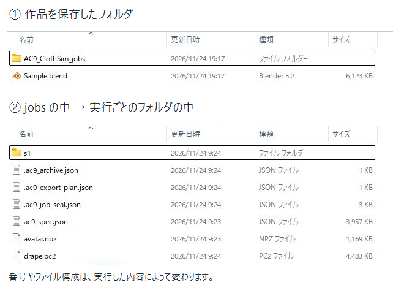
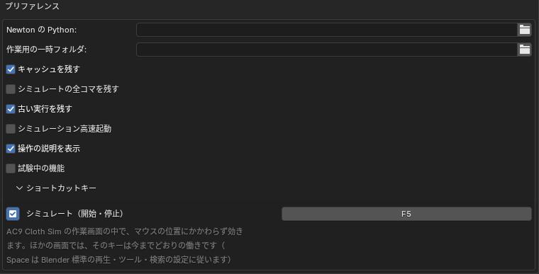
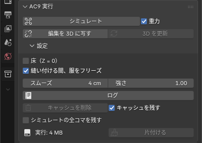
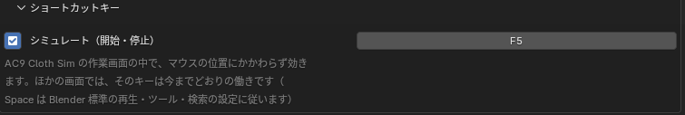

# 使い始める前に

インストールが済んだら、作品の保存先と、計算の経過をどこまで残すかを確認します。その後は「[はじめての1着](first-garment.md)」へ進んでください。Blenderの操作に慣れていない方は「[Blenderの基本](blender-basics.md)」も参照できます。

## AIに使い方を相談する {#ask-ai}

自分が使っているAIに、このアドオンの説明書を読ませて操作を相談できます。

1. **インストール済みの本体アドオン**にある **LLM → README.md** をコピーします。下の格納先の例を参照してください。別の版の説明書を混ぜないでください。
2. 自分のAIへそのファイルを添付します。ボタンを押す順序についての相談なら、同じフォルダの `procedures.md` も添付します。
3. アドオンの版、したいこと、今の画面の状態を添えて質問します。

説明書は本体アドオンと一緒にインストールされます。ダウンロードしたZIPや、その展開フォルダを残しておく必要はありません。

たとえばWindowsのBlender 5.2で、ユーザー既定のエクステンション保存先へ入れた場合は、エクスプローラーのアドレス欄に次のフォルダのパスを貼り付け、Enterを押すと開けます。

```text
%APPDATA%\Blender Foundation\Blender\5.2\extensions\user_default\ac9_cloth_sim\LLM
```

この中の `README.md` を、必要なら `procedures.md` と一緒に、自分の作業フォルダへコピーしてAIに添付します。インストール先のファイルは移動・編集しません。

`%APPDATA%` はWindowsのユーザー設定用フォルダです。**上は格納先の一例**です。Blenderの版、配布元、保存先の設定によって、`5.2` や `user_default` の部分は変わります。フォルダが見つからない場合は、上の場所に決め打ちせず、Blenderの「プリファレンス → エクステンションを入手」のリポジトリ設定で格納先を確認します。計算用部品のRuntimeではなく、`ac9_cloth_sim` 本体の `LLM` フォルダを探してください。

たとえば「この版の説明書を参考に、最後の服の形だけ残したい場合に、保存と経過データをどう扱えばよいか教えてください」と質問できます。

これは使い方を相談する入口です。AIサービスの内蔵や作品の自動送信はありません。説明書を渡すことと、AIにBlenderを操作させる権限を渡すことは別です。回答のボタン名と設定は、その版の画面で確かめてください。

## 作業前に作品を別名で保存する {#save-first}

試す作品は、原本と分けて **.blendを別名で保存**します。これはBlender本体のインストール先ではなく、これから作る作品の置き場所です。

下は実際の保存フォルダです。**Sample.blendが作品ファイル**、その隣の **AC9_ClothSim_jobsはフォルダ**です。経過を記録した実行の結果は、このフォルダの中に入ります。



エクスプローラーの実画面を切り出した例です。下段は `AC9_ClothSim_jobs` の中にある、長い番号の実行フォルダを開いたところです。`drape.pc2` など、記録した経過の再生に使うファイルがあります。ここでは場所の確認だけで、中のファイルを個別に編集する必要はありません。

型紙、置き方、設定、保存した服の形は **.blendの保存時点の内容**として作品に入ります。経過も持っていく場合は、作品ファイルと隣のフォルダを一緒に扱います。

まだ作品を保存していないときは、計算結果は一時領域に置かれます。最初に作業先を決めておくと、経過を持ち運ぶ場所とバックアップ対象が分かります。

## 最初に確認する設定 {#settings}

アドオンの設定は、Blenderの「編集 → プリファレンス → アドオン」で **AC9 Cloth Sim** を開くと見つかります。実行時の設定は、作業画面のツールタブにある「AC9実行」の「設定」を開きます。





既定値と各項目の作用は下の表で確認できます。現在の設定は自分の環境で確認してください。

| 設定 | 作用 | 最初に確認すること |
|---|---|---|
| 作業用の一時フォルダ（Simulation Working Directory） | 計算中に読み書きする場所。空欄ならBlender・OSの一時領域を使います | 作品の保存先とは別です。必要なら作業用ディスクを指定します |
| シミュレーション高速起動（Fast Simulation Start） | ソルバーを先に起動して待機させ、前回の計算モデルを保持し、編集後の次の計算を先に準備します。既定オン | 待機中もGPUメモリを使います。GPUメモリが足りない場合はオフを検討します |
| キャッシュを残す（Keep Cache） | 経過の再生用データを実行後も残します。既定オン | 最後の形だけが必要ならオフ。オフにしても保存した服の形は残ります |
| シミュレートの全コマを残す（Keep All Simulate Frames） | 縫い合わせる区間に加えて、その後の経過も記録します。既定オフ | 経過を後から確認したい場合にオン。「キャッシュを残す」も必要です。長い実行には記録上限があります |
| 古い実行を残す（Keep Old Runs） | 同じ服の過去の結果フォルダも残します。既定オフ | 複数回の結果を比較する場合にオン。オフでは各服の最新の結果を残して古いものを整理します |
| ショートカットキー（Hotkeys） | AC9の作業画面でシミュレートの開始・停止に使うキーを変更・無効化できます | 現在の既定はF5です。別のキーを使う場合は、この割り当てを確認します |

経過を残す設定は「AC9実行」の「設定」内にもあります。プリファレンスと同じ設定を操作します。

### 開始・停止はF5、SpaceはBlenderの操作

AC9の作業画面では、既定の **F5** でシミュレートを開始・停止します。**Space** はBlender側の再生・ツール・検索の設定を保ちます。以前の版や自分で変えた割り当てを使っている場合は、プリファレンスの「ショートカットキー」で現在のキーを確認してください。

AC9の作業画面の外では、F5を押してもこのシミュレートは始まりません。タイムラインの再生と、布を計算するシミュレートは別の操作です。



## 最後の形と、途中の経過を分ける {#shape-and-frames}

最後の服の形が残ることと、タイムラインで途中を再生できることは別です。

**確認するのはコマ番号だけでなく、コマを変えたときに服の形も変わるかです。**

| 状態 | タイムラインでコマを変えると |
|---|---|
| 記録した経過を読み込んでいる | 記録範囲内の各コマの形を表示できます。縫い合わせの途中へ戻って見ることもできます |
| 「キャッシュを削除」で経過を消した | その実行の途中の形は呼び出せません。服の最後の形は残ります |

タイムラインの数字だけは、経過がなくても変えられます。**数字が変わることと、記録した服の動きを再生できることは別**です。

| 残したいもの | 設定と必要なデータ |
|---|---|
| 最後の形 | 形を含めて保存した.blend。経過を残さない使い方もできます |
| 縫い合わせる間の経過 | 「キャッシュを残す」をオン。通常のシミュレートは、縫う区間とその直後を記録します |
| その後も含む経過 | 上に加えて「シミュレートの全コマを残す」をオン。記録上限に達すると以降のコマは記録されません |

途中の記録上限は現在1,500コマです。計算自体はその後も続けられ、最後の形は残ります。縫う区間だけの記録では、その区間の終わりから最後の形へ再生が飛びます。開始と最後だけの記録になった場合は経過を残しません。タイムライン上のコマとソルバーの全計算コマが一対一とは限りません。表示された記録範囲を確認してください。試験中の「フェーズシム」の説明は「[着せる（実行）](features/run.md)」にあります。

## 何がどこに保存されるか {#storage}

| データ | 場所 | 何のためか |
|---|---|---|
| 型紙・縫い目・置き方・設定・保存した服の形 | .blendの中 | 作品を開き、編集や計算を続けるため |
| 記録した経過などの結果ファイル | 保存した.blendの隣の `AC9_ClothSim_jobs` | 記録した実行を再生・調査するため |
| 計算中の作業データ・準備した網目 | 作業用の一時フォルダ | 計算を進め、次の開始を準備するため |
| 保存先へコピーする前の結果の控え | 一時領域の復旧用フォルダ | コピーが終わるまで結果を保つため。作品のバックアップの代わりにはしません |

フォルダの実画面は「[作業前に作品を別名で保存する](#save-first)」を参照してください。

計算中は作業用の場所へ書き、受け取った結果を作品の隣へコピーします。作品が未保存なら、隣の保存先はまだ決まりません。コピー中や保存先が見つからない表示がある場合は、その状態を解消してから移動してください。

## 「キャッシュ」を消すと何が変わるか {#cache}

| 種類 | 目的・場所 | 削除の操作と消えるもの | 残るもの・再生成 |
|---|---|---|---|
| 経過のコマ | 結果フォルダ内の再生用ファイル | 「キャッシュを削除」でコマと再生用ファイルを削除。取り消しでファイルは戻りません | 型紙・設定と服の最後の形。過去の同じ経過は再生成できません |
| 古い実行のフォルダ | 作品の隣や作業用領域の過去の結果 | 「片付ける」で不要になった古い結果を削除。現在参照中の結果などは保護されます | 最新の結果と.blend内の作品。消した過去の経過は戻りません |
| 準備用の網目 | 作業用領域 | 経過の削除ボタンとは別のデータです | 必要に応じて計算準備で作り直されます |
| GPU用プログラムのキャッシュ | GPU計算ライブラリが管理 | 日常の削除対象にしません。経過の削除ボタンでは消しません | 再生成には準備時間がかかります |

Newtonなどの共有Python部品は、この表のキャッシュではありません。部品の削除は「[インストール・更新・削除](install.md)」の手順を使います。

「キャッシュを削除」の詳しい操作と、結果表示の読み方は「[着せる（実行）](features/run.md#recording-progress)」が正本です。

## 削除・移動の前に {#before-moving}

- 残したいのが形だけか、記録した経過もかを決めます。
- 経過が必要なら、結果フォルダのコピーが完了していることを確認します。.blendを別名保存しただけでは、経過ファイルの複製にはなりません。
- 消した経過や古い実行のファイルは、元の計算と同じものに戻せません。
- フォルダの容量を確かめ、バックアップ先にも必要な空きがあるか確認します。服や記録範囲で容量は変わります。

## 別PCへ持っていく・バックアップする {#backup}

| 目的 | 持っていくもの | 確認すること |
|---|---|---|
| 保存した形を見る・そこから計算を続ける | .blendと、作品が別途参照する人体・画像などの外部素材 | 移動先にも対応するアドオンと計算環境が必要です |
| 記録した経過も再生する | 上に加えて、作品の隣の `AC9_ClothSim_jobs` | 同じフォルダ関係を保ってコピーし、移動先で実際に再生を確認します |
| 元データから読み直す | 上に加えて、読み直すためのBOM・FBX・DXFなど | 既に取り込んだ型紙を見るための保存とは目的が異なります |

フォルダを移すだけですべての参照が自動で直るとは限りません。最後の形が見えるだけで、経過のコピーも成功したとは判断しないでください。

## 初回計算には準備時間がある {#first-run}

計算用部品の導入、GPU用プログラムの初回生成、服の計算準備は別の処理です。初回や更新後は開始まで待つことがあります。処理中は状態表示を見て、同じボタンを繰り返し押さずに待ちます。

次の開始を速くする待機の設定は、上の「[最初に確認する設定](#settings)」にまとめています。内部の受け渡しは「[計算の流れ](internals/simulation.md)」を参照してください。
