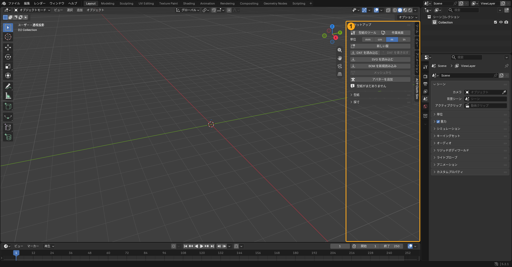
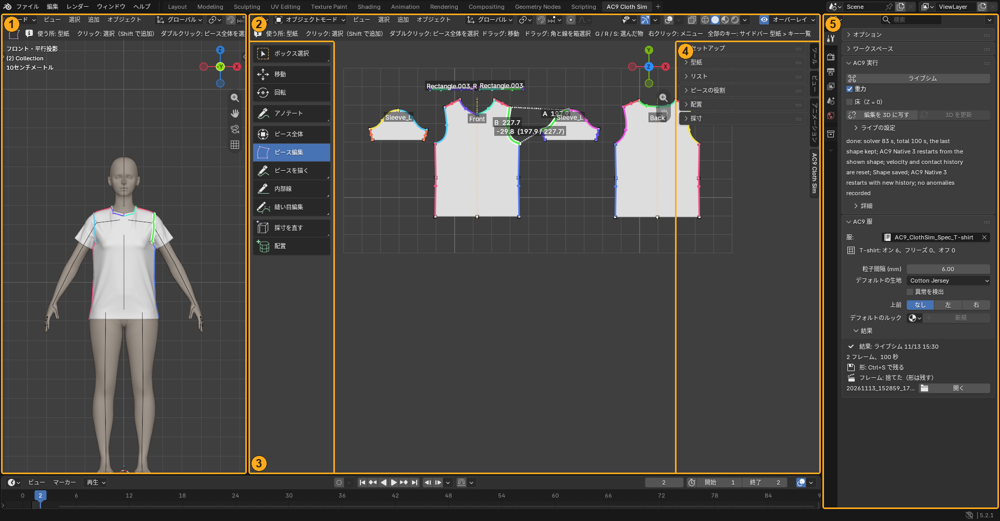

# Blender の基本

AC9 Cloth Sim を使うのに必要な、Blender の見方と操作だけをまとめます。Blender 全体については、[Blender の公式マニュアル](https://docs.blender.org/manual/ja/latest/)などを見てください。

Blender のメニューやボタンは、日本語表示では日本語で出ます。この章では、Blender 自体のメニュー名を英語で書き、分かるものは日本語を添えます。

<!-- video: Blender の基本（3〜5 分、素の Blender の既定の画面で撮る） -->

## 作業画面にたどり着くまで

### 1. 開いた直後の画面

Blender を起動して .blend を開くと、ふつうは「Layout」の画面になります。大きな **3D ビューポート**（体や服を立体で見る所）、右上に Outliner（シーンの物の一覧）、右下に Properties エディタ（設定の窓）、下にタイムライン（コマの帯）が並びます。

画面のいちばん上に並んでいるタブ（Layout、Modeling など）は「ワークスペース」で、画面の並べ方を切り替えます。

### 2. サイドバーを出して、AC9 Cloth Sim のタブを開く

1. マウスを 3D ビューポートの上に置き、**N** キーを押します。3D ビューポートの右端に **サイドバー** が出ます（もう一度 **N** で引っ込みます）。
2. サイドバーの右の端に、縦書きのタブ（アイテム、ツール、ビューなど）が並びます。その中の **「AC9 Cloth Sim」** を押します。
3. 「**セットアップ**」（Setup）・「型紙」・「リスト」・「配置」・「採寸」などのパネルが並びます。**見出しの ▸ を押すと、そのパネルが開きます。**

タブが無いときは、アドオンがオンになっているか（[インストール](install.md)）、マウスを 3D ビューポートの上に置いて **N** を押したかを確かめます。

### 3. 作業画面に切り替える

「**セットアップ**」（Setup）のパネルの「**作業画面**」（Work Screen）を押します。AC9 Cloth Sim 用のワークスペースができて、画面が次の並びに変わります。**この後の説明は、すべてこの作業画面で行います。** 元の画面に戻るときは、いちばん上のタブの「Layout」を押します。

| 番号 | 場所 | 何をする所か |
|---|---|---|
| 1 | **3D ビューポート**（左） | 体と服を立体で見る所。体のまわりにピースを置くのもここ |
| 2 | **型紙のビュー**（真ん中） | 真上から見た平らな型紙。**回転はできません** |
| 3 | **道具の列**（型紙のビューの左端。**T** で出し入れ） | 型紙を直す・縫い目を付ける・置く、などの「道具」を持ち替えます |
| 4 | **サイドバー**（型紙のビューの右端。**N** で出し入れ） | 「AC9 Cloth Sim」のタブ。読み込み・型紙・一覧・配置・採寸のパネル |
| 5 | **Properties エディタの Tool タブ**（右。ドライバーとレンチの形のタブ） | **実行のボタン**（「AC9 実行」（AC9 Run））と、選んだ物の設定 |

- **実行のボタン（「ライブシム」など）はサイドバーではなく、Tool タブにあります。** Properties エディタが別のタブ（Render や Object など）になっていると見つかりません。
- 作業画面には Outliner がありません。いちばん下にタイムラインがあります（「コマとタイムライン」）。

## 視点を動かす

| 操作 | マウス・キー |
|---|---|
| 回す | 中ボタン（ホイール）を押したままドラッグ |
| 平行に動かす | **Shift**＋中ボタンでドラッグ |
| 近づく・離れる | ホイールを回す |
| 正面・横・上から見る | テンキーの **1**／**3**／**7** |
| 選んだ物に寄る | テンキーの **.**（ピリオド） |
| 全体を見る | **Home** |
| いまのビューを画面いっぱいにする／戻す | **Ctrl＋Space** |

- 作業画面の真ん中の型紙のビューは回りません。回るのは左の 3D ビューポートだけです。
- 3D ビューポートの右上にある、色の付いた軸の丸（ナビゲーションギズモ）をドラッグしても回せます。軸の丸をクリックすると、その向きから見ます。

### 中ボタンやテンキーが無いとき（ノートパソコンなど）

「Edit」→「Preferences」（編集 → プリファレンス）の「Input」（入力）で、次の 2 つをオンにします。

- **Emulate 3 Button Mouse**: **Alt**＋左ドラッグが、中ボタンのドラッグの代わりになります。
- **Emulate Numpad**: キーボードの上の段の数字キーが、テンキーの代わりになります。

## 選ぶ

| 操作 | マウス・キー |
|---|---|
| 選ぶ | 左クリック |
| 足す・外す | **Shift**＋左クリック |
| 全部を選ぶ | **A** |
| 選択を外す | **Alt＋A** |

- 最後に選んだ物は「アクティブ」と呼ばれ、ほかの選んだ物より明るい色で表示されます。**Tool タブには、アクティブな物の設定が出ます。** 思った設定が出ないときは、何がアクティブかを確かめます。
- 押せない（灰色の）ボタンは、カーソルを置くと、押せない理由が出ます。

## 動かす・取り消す

| 操作 | キー |
|---|---|
| 動かす／回す／拡大縮小 | **G**／**R**／**S**。続けて **X**・**Y**・**Z** で軸を決め、数字で値を入れます |
| 確定する | 左クリックか **Enter** |
| 取り消す（操作の途中） | 右クリックか **Esc** |
| 元に戻す／やり直す | **Ctrl＋Z**／**Ctrl＋Shift＋Z** |
| 直前の操作の値を変える | **F9**（または画面の左下に出る小さなパネル） |
| 消す | **X** か 「**削除**」（Delete） |
| 名前から操作を探して実行 | **F3** |

**型紙のピースは、Blender の G／R／S では動きません。** ピースには鍵が掛かっています。ピースを丸ごと動かすのは「**ピース全体**」（Whole Pieces）、角や辺を直すのは「**ピース編集**」（Edit Pieces）の道具です。

右クリックには 2 つの意味があります。操作の途中なら取り消し、何もしていないときは、カーソルの下の物に使えるメニューが出ます（AC9 の道具を持っているとき）。

## オブジェクトモードと編集モード

Blender には「モード」があります。3D ビューポートの左上で切り替え、**Tab** キーでも行き来できます。

- **オブジェクトモード**: 物（オブジェクト）を丸ごと扱うモード。**AC9 Cloth Sim の操作は、このモードで行います。**
- **編集モード**: 1 つの物の頂点・辺・面を直接直すモード。

注意:

- **型紙を編集モードで直しても、型紙のデータには入りません。** 型紙は、型紙のデータ（服 1 着ぶんの情報）から作り直される表示です。直すのは AC9 の道具で行います。
- AC9 の道具はオブジェクトモードの道具の列にだけあります。**編集モードに入ると、AC9 の道具が見えなくなります。** 道具が消えたら、**Tab** でオブジェクトモードに戻ります。
- 編集モードを使うのは、着た服の形を手で直すとき（「**手で直す**」（Fix by Hand）の後）だけです。

## 隠す・見せる

- **H** で選んだ物を隠し、**Alt＋H** で全部を見せます。隠した物は消えたわけではありません。
- 型紙のピースを使わないときは、**H** で隠すのではなく、ピースの状態を「オフ」にします（[考え方](concepts.md)の「ピースの 4 つの状態」）。
- 3D ビューポートの右上の、重なった 2 つの丸のボタン（オーバーレイ）を切ると、AC9 Cloth Sim が画面に描く線や色も見えなくなります。

## コマとタイムライン

シミュレーションの経過は、コマ（フレーム）ごとのアニメーションとして残ります。

- **Space** で再生・停止します。
- **←**／**→** で 1 コマずつ、**Shift＋←**／**Shift＋→** で最初と最後のコマへ動きます。
- **画面に出ているコマが意味を持つ操作があります。** 2 回目以降の「ライブシム」（Live Sim）は、画面に出ているコマから続けます。Cloth Retopo へ渡すときや、服を採寸するときも、画面に出ているコマを使います。押す前に、最後のコマになっているかを確かめます。
- タイムライン（コマの帯）を出したいときは、エリアの左上のエディタの種類のメニューから「Timeline」を選びます。

## ファイルの保存

- **Ctrl＋S** で保存します。初めて保存するときは、保存先と名前を聞かれます。
- **シミュレーションの前に、一度保存してください。** 経過のコマは、保存した .blend の隣の `AC9_ClothSim_jobs` フォルダに作られます。保存していないと一時フォルダに作られ、あとで再生できなくなります。
- 着せた服の最後の形は、.blend の中に保存されます。.blend だけを別のパソコンに渡しても、最後の形は見えて、そこから続けられます（経過の再生だけはできません）。
- 保存した後に .blend を移動したり名前を変えたりすると、経過のフォルダが見つからなくなります（最後の形は残ります）。

## ファイルを選ぶ画面

「BOM を新規読み込み」などを押すと、Blender のファイルを選ぶ窓が開きます。

- 窓の上の欄にフォルダの場所が出ます。ここにフォルダのパスを貼り付けて **Enter** を押すと、そのフォルダへ移れます。左の列の「ドライブ」やよく使う場所からたどることもできます。
- フォルダはダブルクリックで中に入ります。上の欄の左の ↑（親のフォルダ）で戻ります。
- 選べるファイルだけが表示されます（BOM なら .xml）。ファイルを 1 回クリックして、右下の青いボタン（「BOM を新規読み込み」など、押したボタンと同じ名前）を押します。ファイルをダブルクリックしても同じです。
- やめるときは「キャンセル」か **Esc**。

<!-- screenshot: ファイルを選ぶ窓（人が撮る） -->

## アドオンの入れ方と言語

- アドオンの入れ方は、[README](https://github.com/openfashion-labs/ac9_cloth_sim#インストール) の「インストール」を見てください。新しい版を入れたら、Blender を起動し直します。
- 日本語で使うときは、「Edit」→「Preferences」の「Interface」で「Translation」を日本語にします。サイドバーのタブ名「AC9 Cloth Sim」と、一部の文字やエラーの文は英語のままです。

## つまずきやすいこと

- **日本語入力（IME）がオンだと、キーボードのショートカットが効きません。** キーが効かないときは、まず日本語入力をオフにします。
- キーは、カーソルが乗っているエリアに効きます。3D ビューポートの操作は、カーソルを 3D ビューポートの上に置いてから行います。
- 何かを押したら画面が変わって戻せない、と思ったら、まず **Ctrl＋Z** を試します。
