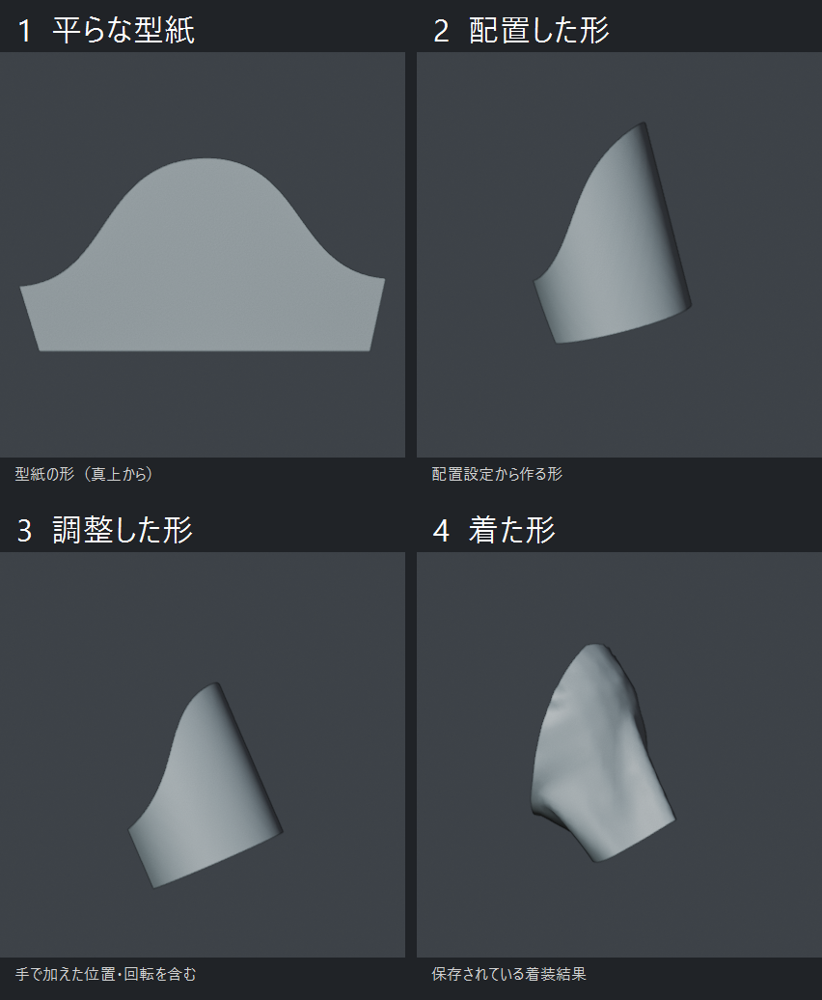
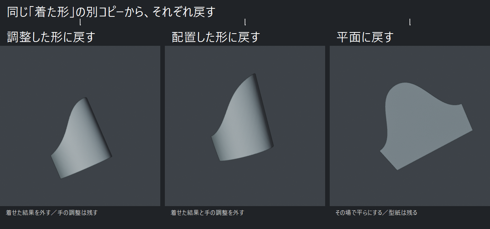

# 考え方

AC9 Cloth Sim で迷いやすいのは、ボタンの場所よりも「今どの形を見ていて、何を直しているのか」です。この章では、その考え方をまとめます。

## 型紙のデータが正（画面の型紙は表示）

服 1 着ぶんの情報（型紙の形、縫い目、置き場所、折り線、ピースの役割、生地）は、1 つの「型紙のデータ」にまとまっています（Blender のテキスト `AC9_ClothSim_Spec_<服の名前>`、中身は JSON）。

- 画面に並んでいる平らな型紙は、このデータから作り直される**表示**です。
- そのため、**型紙は Blender の普通の編集（編集モード、G/R/S）では直せません。** 直すときは AC9 のツールを使います。
  - ピースを丸ごと動かす・回す: 「**ピース全体**」（Whole Pieces）
  - 角・辺・内部線の点を直す: 「**ピース編集**」（Edit Pieces）
- 型紙を読み込む（Import BOM、Import DXF、From Mesh）たびに、型紙のデータが 1 つ（＝服が 1 着）増えます。パネルの表示は、「**服**」（Garment）の欄で選んでいる 1 着のものです。

<!-- figure: 図2 型紙データと、シーンにできるもの -->

### シーンにできるもの

| 名前 | 何か |
|---|---|
| コレクション `AC9_ClothSim_Pattern` | 平らな型紙。ピース 1 枚が 1 オブジェクト（`AC9_Piece_<ピース名>`） |
| `AC9_Garment_<服の名前>` | 着た状態の服。最後の形は、このオブジェクトの形そのもの |
| `AC9_Guide_<服の名前>` | Cloth Retopo に渡す服（「AC9 Cloth Retopo へ渡す」で作る） |
| テキスト `AC9_ClothSim_Log` | シミュレーションのログ |

## ピースの 4 つの形と、「戻す」3 つ

1 枚のピースの形を、次の 4 段階で呼び分けます。配置した直後で何も調整していなければ、「配置した形」と「調整した形」は同じ形です。

同じ袖1枚を抜き出した例です。型紙だけ真上から、立体の3枚は同じ視点・倍率で示しています。

| 形 | どこにあるか | 何をした後か |
|---|---|---|
| **平らな型紙** | 床の上（作業画面の真ん中のビュー） | 読み込んだ・描いた直後 |
| **配置した形** | ガイドの上、または平らな配置先 | 「配置」（Place）で作る基準の形。手で加えた移動・頂点編集を含まない |
| **調整した形** | 配置した場所から調整した位置・形 | 配置した形から、手動移動・頂点編集・折りなどで調整した形 |
| **着た服** | 体の上 | 「シミュレート」などで着せた後 |

前の形に戻すボタンは 3 つあり、どこまで戻すかが違います（「配置」（Placement）のパネルに、近い順に並んでいます）。

| ボタン | 戻る先 | 捨てるもの |
|---|---|---|
| 「**調整した形に戻す**」（Back to Adjusted Shape） | シミュレーション後は、開始時に残した調整した形。まだ結果がない場合は、縫い目へ寄せる前の調整した形 | 着せた結果。結果がない場合は縫い目へ寄せた影響も外す。手配置・頂点編集・折りは残す |
| 「**配置した形に戻す**」（Back to Placed Shape） | → 現在の配置設定から作る配置した形（平置きも含む） | 着せた結果と、手で動かした分 |
| 「**平面に戻す**」（Back to Flat） | → その場で平らに | 対象ピースの手編集と曲がった形（位置と向きは残す）。型紙と縫い目は残す |

ピースを選んで押すとそのピースだけ、何も選ばずに押すと服全体が戻ります（服全体のときは確認が出ます）。
連動中の鏡像は一緒に戻ります。「平面に戻す」でも、未選択のピースの着装形は残ります。

型紙を直しても、既定では調整した形と着た服はすぐには変わりません（直すたびに待たないためです）。次に「シミュレート」などを押したとき、直した形を**まとめて調整した形と着た服に写してから**計算し、落ち着かせます（写すときは物理の計算をしません）。直すたびに 3D の形を見たいときは、ツールタブの 「**AC9 実行**」（AC9 Run） の 「**編集を 3D に写す**」（3D Follows Edits） を押します（直すたびに少し待ちます）。「**3D を更新**」（Update 3D） でまとめて写すこともできます。

## 服とピース

- 1 つのシーンに何着でも入れられます。「服」（Garment）の欄で 1 着ずつ切り替えます。
- 1 つの BOM に何着ぶんも入っているときは、読み込むときに服ごとのまとまりに分けられます。縫い目の相手は、そのまとまりの中で決まります。
- 重ね着: 着せ終わった服は、ほかの服を着せるときに「動かない障害物」になります。内側の服から順に着せます。ほかの服を着せると、それまでの服の経過（コマ）は消え、最後の形だけが残ります。

## ピースの 4 つの状態

| 状態 | 動く | ほかの布が当たる | 縫い目 |
|---|---|---|---|
| 「**アクティブ**」（Active） | ○ | ○ | ○ |
| 「**フリーズ**」（Freeze） | ×（今の場所に止まる） | ○ | ○ |
| 「**非アクティブ**」（Inactive） | ×（今の場所に止まる） | ×（すり抜ける） | ○（縫い目は引っぱる） |
| 「**オフ**」（Off） | 計算に入らない | — | ×（縫い目ごと外れる） |

- 使わないピースは、隠す（**H**）のではなく「オフ」（Off）にします。灰色の半透明で表示されます。
- 状態は、左右の対を一緒に切り替えます。片側だけを変えるときは **Ctrl**＋クリックです。

<!-- figure: 図4 ピースの 4 つの状態 -->

## 実行のボタン

| ボタン | 何をするか | 経過のコマ | 止め方 |
|---|---|---|---|
| 「**シミュレート**」（Simulate） | 調整した形（着せた後は今の形）から縫い合わせ、止めるまで回り続ける。**Ctrl＋ドラッグ**で布をつまめる | 設定と記録範囲による（[経過を残す](features/run.md#recording-progress)） | ボタンをもう一度押すか **Esc**（作業画面では **F5** でも） |

着せるのも、直してから落ち着かせるのも「シミュレート」です。自動では止まらないので、服が落ち着いたら止めます。「**重力**」（Gravity）は回っている間に切り替えられます。縫い目を先に閉じたいときは、重力を外して回し、閉じてから重力を入れます。

段を追って縫って自動で止まる「**フェーズシム**」（Phase Sim）と、ピースの役割は、アドオンの設定の「**試験中の機能**」（Experimental Features）をオンにしたときだけ出ます（「[着せる（実行）](features/run.md)」）。

### 今の形から続ける

- 2 回目以降の「シミュレート」、「AC9 Cloth Retopo へ渡す」、服の採寸は、今の服の形を使います。経過のコマを再生しているときは、**画面に出ているコマ**を使います。押す前に、最後のコマになっているかを確かめます（**Shift＋→** で最後のコマ）。
- 途中のコマの形を手で直したいときは、そのコマで「**手で直す**」（Fix by Hand）を押します。そのコマが服の形そのものになり、編集モードやスカルプトで直せます。直した後に「シミュレート」を押すと、直した形から続きます。

<!-- figure: 図6 計算の流れ -->

## 保存されるもの

| もの | 保存される場所 |
|---|---|
| 型紙のデータ・置き方・設定 | .blend の中 |
| 着た服の最後の形 | .blend の中 |
| 経過のコマ（タイムラインで再生できるもの） | 保存した .blend の隣の `AC9_ClothSim_jobs` フォルダ |

- **シミュレーションの前に .blend を保存します。** 保存していないと、経過は一時フォルダに作られ、あとで再生できません。
- .blend だけを別のパソコンに渡しても、最後の形は見えて、そこから続けられます（経過の再生だけはできません）。
- 「**キャッシュを削除**」（Delete Cache）（AC9 Run のボタン）で消した経過は、戻せません。

## 結果の見方

- 同じ設定でも、計算のたびに仕上がりが少し変わります。1回の結果だけで良し悪しを決めないでください。
- 現在の形を確かめるときは「診断」を実行し、対象と件数・未検査を読みます。赤い確認済みの交差と黄色い候補を区別し、修正後は再診断します。赤がないだけで合格とはしません。
- 現在形の診断と過去の実行時の検査記録は別です。詳しくは「[診断](features/placement.md)」へ。
