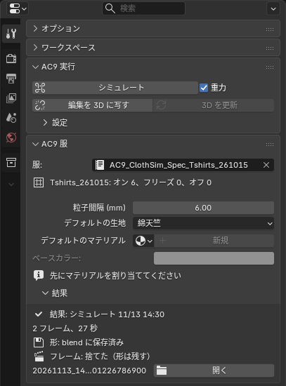
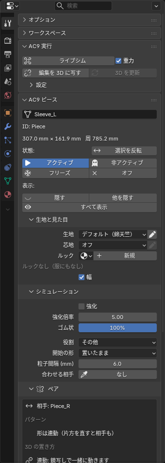
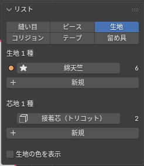

# 生地と服の設定

## ツールタブの「AC9 服」（AC9 Garment）

何も選んでいないとき、ツールタブに出ます。

- 「**服**」（Garment）: 扱う服。
- 「**粒子間隔 (mm)**」（Particle Distance (mm)）: 布を細かい三角形に分けるときの点の間隔（mm、2 から 30、既定 6）。小さいほど細かいしわまで出ますが遅くなります。4 mm は 6 mm のおよそ 2 倍の時間がかかります。
- 「**デフォルトの生地**」（Default Fabric）: 個別の生地を持たないピースが使う生地。新しい服の既定は「**綿天竺**」（Cotton Jersey）です。
- 「**デフォルトのマテリアル**」（Default Material）: ピースの見た目に使うBlenderのマテリアルの既定。生地の物理特性とは別です。
- 「**ベースカラー**」（Base Color）: 上で割り当てたマテリアルの色。画面を切り替えずに変更できます。同じマテリアルを共有するピースはすべて変わります。個別の色にする場合は、先に別のマテリアルを割り当てます。
- 「**結果**」（Result）: 結果の枠（「Run」の節）。

## ツールタブの「AC9 ピース」（AC9 Piece）

ピースを選んだとき、ツールタブに出ます。何枚か選ぶと、欄には選んだうちの 1 枚の値が出て、値が違えば欄の名前が赤く「(mixed)」になり、変えると選んだ全部に効きます。

- いちばん上の欄: ピースの名前（表示用。F2 でも付けられます）。その下に番号、幅×高さと外周の長さ、属する服のまとまり。
- 「**対称編集**」（Symmetric Edit）: 左右対称の 1 ピースの編集（「左右ペア」）。
- **State**: 4 つの状態（「Pieces と重ね着」）と「**選択を反転**」（Invert Selection）。
- 「**役割**」（Role）: 役割。 役割は試験中の機能です（[説明](roles.md)）。通常のシミュレートには不要です。
- 「**生地**」（Fabric）と「**芯地**」（Interlining）: 生地と芯地。右の鉛筆で、その生地・芯地の数値を直す画面が開きます（「**リスト**」（Lists）の「**生地**」（Fabrics）タブの「**編集…**」（Edit...）と同じ画面）。
- 「**マテリアル**」（Material）: 見た目に使うBlenderのマテリアル。空なら服の「**デフォルトのマテリアル**」（Default Material）。
- 直下の「**ベースカラー**」（Base Color）で色を変更します。既定マテリアルを使っている場合は、同じ既定を使うほかのピースにも反映されます。ノードで色をつないでいるマテリアルや、異なるマテリアルの複数選択では、この簡易欄から変更できません。
- 「**厚み**」（Thickness）: 配置したピースと着た服に厚みを付けて見せるか（見た目だけ）。内部線で折った所は 2 枚重ねに見えます。
- 「**レイヤー**」（Layer）（試験中の機能をオンにしたとき、またはレイヤーを持つピースがあるとき）: 0〜9。番号の違うピースどうしでは、高い方を低い方の外側に保ちます。落ち着いたら 0 に戻します（右の矢印で全ピース）。自動では戻りません。別のレイヤーのピースとつなぐ縫い目の近くの点にはレイヤーが効かず、普通の当たりになります。細いピースを縁に沿って縫うと全部の点がそうなり、レイヤーは効きません。そのときは実行開始時の警告とログで、レイヤーが効く頂点数を確認します。これはレイヤーの作用範囲の記録で、現在形の診断の赤い表示とは別です。現在の侵入・交差・伸びは「診断」で確認してください。
- 「**粒子間隔 (mm)**」（Distance (mm)）: ピースごとの点の間隔（小さい部品だけ細かく）。左の矢印で服の値に戻ります。
- 「**ゴム**」（Elastic）: ピースの長い軸に沿って縮める率（100 で縮めない）。
- 「**合わせる相手**」（Closes Onto）: ボタンで留める相手のピース（「ボタン（Fasteners）」）。
- 置いたかどうか（「Placed」か「Not placed yet」）と、内部線の数。
- 値の変更は、次に「**シミュレート**」（Simulate）を押したときから効きます（回っている間に変えて効くものは「着せる（実行）」の「シミュレート」の節）。

## 生地と芯地の一覧（Fabrics）

「**リスト**」（Lists）の「**生地**」（Fabrics）タブに、その服の生地が並びます。1 つが既定（星の印）で、すべてのピースが必ず 1 つの生地を持ちます。

- 1 行が 1 つの生地で、色、名前、使っているピースの数です。行を押すと、その生地のピースが選ばれ、ツールタブに「**AC9 生地**」（AC9 Fabric）が出ます。下の「**新規**」（New）で、既定の生地と同じ数値の新しい生地を足します。
- 「**AC9 生地**」（AC9 Fabric）: 名前、「**プリセット**」（Preset）（用意された生地から選ぶ）、数値（重さ・曲げ・厚み・伸び・せん断・ヒステリシス）、「**編集…**」（Edit...）（数値を直す）、「**デフォルトにする**」（Make Default）、「**ピースを選ぶ**」（Select Pieces）、「**削除**」（Delete）（既定の生地は消せません）。
- 下半分は芯地の一覧で、行を押すと「**AC9 芯地**」（AC9 Interlining）（「**プリセット**」（Preset）、「**編集…**」（Edit...）、「**ピースを選ぶ**」（Select Pieces）、「**削除**」（Delete））。直すとその芯地の全ピースに効きます。「**新規**」（New）で足し、「**AC9 ピース**」（AC9 Piece）の「**芯地**」（Interlining）で付けます。
- いちばん下の「**生地で色分け**」（Color by Fabric）で、生地ごとの色を型紙に出します。

## 生地の数値の意味（「生地を編集」）

「**編集…**」（Edit...）で開く「**生地を編集**」（Edit Fabric）の数値は、実際の生地を測った値です。まずは近いプリセットを選び、足りないところだけを少しずつ直すのがおすすめです。

| 欄 | 何の値か | 上げると | 下げると | 目安（プリセット） |
|---|---|---|---|---|
| **目付** g/m²（Weight） | 布の重さ（1 m² あたりのグラム） | 重くなり、自分の重みで垂れる | 軽くなり、形を保ちやすい | 天竺 約 125、ポプリン 140、ウールのスーツ地 276、キャンバス 390、革 706 |
| **曲げ** µN·m（Bending） | 曲がりにくさ。**硬さの本体** | 硬くなり、しわが少なく大きく丸くなる | 柔らかくなり、細かいしわが出る | 天竺 0.65、ポプリン 6、ウールのスーツ地 18、キャンバス 245、革 262 |
| **伸び 縦** N/m（Stretch warp） | 型紙の x 方向（左右）の伸びにくさ | ほとんど伸びない | ニットのようによく伸びる | 織物 約 3000、天竺 280、リブ 15、革 11900 |
| **伸び 横** N/m（Stretch weft） | 型紙の y 方向（上下）の伸びにくさ | 同上 | 同上 | 同上 |
| **せん断** N/m（Shear） | 斜めのゆがみにくさ（正方形を菱形に引っぱったときの硬さ） | 織り目が四角のまま保たれ、丸みから離れて張る | 丸い形に沿いやすく、斜めのしわが増える | ふつうの布 15〜30、キャンバス 150、革 704 |
| **ヒステリシス** /m（Hysteresis） | 曲げたあと、力が抜けても曲がりが残る度合い（曲げぐせ） | 折り目や落ちた形が残り、早く止まる | よく元に戻り、長く動き続ける | ふつうの布 約 40、天竺 61 |
| **厚み** mm（Thickness） | 布を描く厚み | 見た目だけ（シミュレーションには使いません） | 同左 | 0.6〜1.2 |

### 用意された生地（プリセット）

| 生地 | 目付 g/m² | 曲げ µN·m | 数値の出どころ |
|---|---|---|---|
| 綿ポプリン（Cotton Poplin） | 140 | 6 | 実測（論文） |
| ウールのスーツ地（Wool Suiting） | 276 | 18 | 実測（論文） |
| デニム（Denim） | 354 | 27 | 実測（論文。洗い加工のある市販品。生のデニムはもっと硬い） |
| サテン（Satin） | 120 | 4 | 推定 |
| シフォン（Chiffon） | 50 | 2 | 推定 |
| ナイロンタフタ（Nylon Taffeta） | 82 | 3.3 | 目付は実測の平均、曲げは推定（ウインドブレーカーの生地） |
| 綿天竺（Cotton Jersey） | 125.5 | 0.65 | 実測（論文） |
| 裏毛（スウェット）（French Terry） | 250 | 2.5 | 推定 |
| リブニット（Rib Knit） | 220 | 6 | 推定 |
| 革（Leather） | 706 | 262 | 実測（論文） |
| 合成皮革（Synthetic Leather） | 440 | 112 | 実測（論文） |
| キャンバス（Canvas） | 390 | 245 | 曲げは推定 |

推定の生地は、実物に合わせたいときに「生地を編集」で直す前提の出発点です。

### 硬くしたい・垂れさせたいとき

- **立つか垂れるかは、「曲げ」と「目付」の釣り合いで決まります。** 曲げだけ上げても、目付が大きい（重い）と自分の重みで沈みます。
  - 張りを出して立たせたい → 「曲げ」を上げて「目付」を下げる。
  - とろりと垂れさせたい → 「曲げ」を下げる（重さを出したいなら「目付」も上げる）。
- 「曲げ」は効き方がゆるやかです。2 倍にしても違いは小さく、10 倍で布が張り出せる長さがおよそ 2 倍になります。少しずつではなく、桁で変えてみてください（例: 6 → 60 → 600）。
- 「曲げ」の上限は 10000 で、これは厚紙くらいの硬さです。金属やプラスチックの板のような硬さは出せません。
- ピースだけを硬くしたいときは、生地を変えるより「**芯地**」（実物の芯と同じく重さと曲げを足す）か「**強化**」（下記）が手軽です。
- 伸びとせん断は、垂れ方にはあまり効きません。「伸びる生地か」「体の丸みに沿うか」を変えたいときに触ります。

## 実行中の異常記録（Experimental）

Experimental Featuresを有効にすると、AC9実行の「設定」に「**シミュレーション中の異常を記録**」（Record Run Anomalies）が出ます。実行中のピースの移動や縫い目の引き合い・裏返りの候補を記録する研究用の機能です。通常は記録して続行します。服の基本設定には置きません。

- 既定はオフです。「**シミュレート**」（Simulate）を押す前に入れてください。Experimentalをオフにすると、旧ファイルに保存されたチェックは通常画面からの実行には使いません。保存値は保持します。明示的な研究用プリセットやヘッドレス指定は維持します。
- 記録は「異常の候補」で、良い服でも鳴ることがあります。
- 結果はAC9実行の「設定」→「ログ」で確認します。記録オフ・オンで候補なし・候補ありを区別し、候補ごとの段階・フレーム・対象をログへ残します。段階別のanomaly.jsonとjob.jsonにも記録を残します。
- 現在形の診断とは別で、過去の位置を赤く描き直す機能ではありません。既定の交差監視も別機能です。この設定をオフにしても交差監視を止めることはありません。高速な起動経路ではなく通常の単発起動になる場合があります。

## 強化

ピースを選び、プロパティの ツールタブ → **AC9 Piece** → **強化**をオンにします。**強化倍率**は既定 5、範囲 1〜100 です。伸び・せん断・曲げの硬さを同じ倍率で増やします。倍率 1 は硬さを変えません。重さ・厚みは変わりません。もう垂れているピース（縫い終わってしわが落ち着いたもの）に掛けると、そのときの形を保ちます。平らな型紙の形へ戻らず、まわりの縫い目も引きません。倍率を変えても同じ形を保ち、外してもう一度掛けると、そのときの形を保ち直します。

複数選択では選んだピース全部とその対へ適用します。強化中は型紙と 3D に紫の色が付きます。フリーズやオフの状態表示が優先されます。Simulate 中もオン・オフと倍率を変更でき、次に値を受け取るコマから効きます。解除しても倍率欄の値は残ります。設定は spec と .blend に保存され、外すまで効きます。

芯地は実物の素材として重さと曲げを足す機能です。強化とは別です。強化で硬くした形を残すか、解除して落ち着かせるかは使い手が選びます。高倍率では縫い付けや自然な曲がりに強く抵抗します。

色はオーバーレイの「ピースの色」が表示されているときに見えます。End Taper を併用してシミュレート中に強化を変えた回は、次のシミュレートが見た形から再構築されます。見た形と強化の設定は保存されます。
