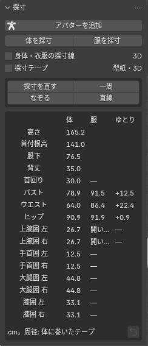

# 採寸

このパネルでやること: 体の寸法を測る。着せた服がどれだけゆとりを持っているか、サイズ表の目標に合っているかを見る。

画面上の採寸ラベルは、体・テープ・型紙とも「名前: 数値」の形式です（例: `Tape1: 35.6`）。

「**身体・衣服の採寸線**」と「**採寸テープ**」で、採寸線と数値ラベルを別々に表示・非表示にできます。身体・衣服の採寸線を隠しても、手動テープは残せます。測った値は消えません。身体・衣服の採寸線の切替は服の同じ高さの採寸線にも、テープの切替は型紙の採寸にも反映されます。

## アバターを追加（Add Avatar）

- 目的: 着せる体が手元に無いときに、アドオン付属のアバター（CC0）を使う。
- 操作:「**採寸**」（Measure）の先頭で、「**アバターを追加**」（Add Avatar）を押します。今のシーンに、コレクション「AC9 Avatar」（体・リグ・目）が足されます。ファイルを開き直すのではないので、シーンのほかの物はそのままです。
- 期待結果: 体が選ばれた状態になり、「**配置**」（Placement）パネルの「**体**」（Body）が空なら、この体が入ります。続けて「**ガイド検出**」（Detect Guides）へ進めます。
- 2 回押すと 2 体目が足されます（名前の後ろに .001 が付きます）。
- 体はリグ（AC9 Avatar Rig）で動きます。A ポーズの開きを変える、T ポーズにするなどは、着せる前にポーズモードでリグを動かします（着せている間にアバターが動くこと、つまりアニメーションには、まだ対応していません）。

- 追加直後は未採寸です。寸法と採寸線が必要なときに「**体を採寸**」（Measure Body）を押します。採寸前でも、配置やシミュレーションに使えます。既にシーンにある身体・衣服の採寸線結果は変更しません。

## 体を測る

- 「**体**」（Body）: 測る体（Placement と同じ欄）。
- 「**体を採寸**」（Measure Body）: 体を測ります。高さ、周径（バスト・ウエスト・ヒップ・首・腕・脚の 1 周の長さ）、背丈。測った場所は体のまわりに線で描かれます。まっすぐ立って −Y を向いている前提です。「**身体・衣服の採寸線**」で線と数値ラベルを表示・非表示にします。
- 表（「**体**」（Body）、「**服**」（Cloth）、「**ゆとり**」（Ease））は 1 行が 1 項目で、単位はセットアップの「**単位**」（Units）です。「**服**」（Cloth）は服の同じ高さでの周径（「**服を採寸**」（Measure Garment）のあと）。服が覆っていなければ「open」。「**ゆとり**」（Ease）はゆとり。項目名を押すと、体のどこで測ったかが光ります。表の右下の戻しアイコンは、全部の線を最初に見つけた位置へ戻します。
- 「**服を採寸**」（Measure Garment）: 着せた服を、体の線と同じ高さで測ります。「**シミュレート**」（Simulate）が終わると自動で、その結果（最後のコマ）を測ります。

## 測定のツール

パネルのツール箱（「**採寸を直す**」（Edit Measure）、「**一周**」（Around）、「**なぞる**」（Along）、「**直線**」（Straight））と、左の列のツールは同じです。

- 「**採寸を直す**」（Edit Measure）: 測った線を体に沿って上下にずらします。自分で置いた巻き尺も動かせます。線を指すと白く光り、ドラッグして離すと確定、右クリックか Esc で元に戻ります。巻き尺に沿わせた縫い目は付いていきます。
- 「**一周テープ**」（Tape Around）: 上部のツール設定で「**3点で指定**」（Three Points）と「**1点・向き指定**」（One Point / Direction）を切り替えます。既定は3点です。3点指定は体の1点目、2点目、3点目を順にクリックし、3点を通る断面の一周を測ります。3点目を合わせている間に輪と長さを確認でき、クリックで1本を確定します。途中で体の裏へ回れます。Backspace／Ctrl＋Zで1点戻り、Esc／右クリックで今回の作成を取り消します。点がほぼ一直線、または別々の輪に分かれる場合は3点目を取り直してください。凹みでは張ったテープが皮膚から浮くため、指定した点と実線が重ならないことがあります。
- 「**1点・向き指定**」では、体の上を指すと輪と長さが先に見え、クリックで残します。上部に向きと傾きが表示され、Tabで向き、Ctrl＋ホイールで5°ずつ前後に傾けます（Shiftも押すと1°）。既存線上から新しいテープを作るときはCtrlを押しながら最初の点をクリックします。どちらの方式も確定した1本がUndo一回の対象となり、Redoで戻せます。
- 「**なぞるテープ**」（Tape Along）: 体の上を順にクリックすると、表面に沿ってその点を通る巻き尺を置きます（袖丈、股上など）。Enter で残します（Esc／右クリックは取り消し）。表面に沿った長さと、まっすぐの長さの両方を持ちます。
- 「**直線テープ**」（Tape Straight）: 体の 2 点のあいだに、巻き尺をぴんと張った長さ（バストポイント間、肩越しなど）。出っ張りの上は体に沿い、くぼみは宙を渡ります。体の中を通るまっすぐの長さも一緒に残ります。
- 測った線・巻き尺・型紙の長さは、どれも「採寸」として同じに扱います。3Dの線をクリックするか、「**テープ**」（Tapes）タブの行を押すと選べて、ツールタブの「**AC9 採寸**」（AC9 Measurement）に名前、種類、長さ、目標、傾き（1点方式の一周テープだけ）、ミラー、削除が出ます。3点式は「採寸を直す」で表示された点を1つずつドラッグして直します。体の変形後に輪が成立しなければ長さを未計測にして旧輪を隠し、点を直すか再採寸すると再検査します。

## 寸法の確認（Size Check）

「**採寸**」（Measure）の中の「**寸法の確認**」（Size Check）は、服の寸法（「**服**」（Cloth））、目標（「**目標**」（Target））、差（「**差**」（Diff））を並べます。

- 項目名を押すと、目標の寸法（サイズ表の値）を入れる画面が出ます。0 で消えます。
- 「**型紙を測る**」（Measure Pattern）: 平らな型紙の外周を 2 点クリックすると、その 2 点のあいだの長さが行として残ります（直線の長さと、同じピースなら外周に沿った長さ）。Esc で終わります。× で消します。
