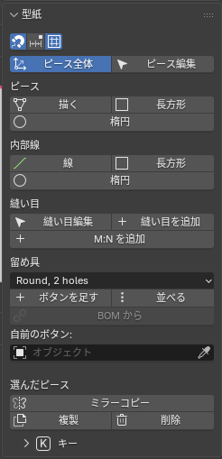

# 型紙を直す・描く

このパネルでやること: 型紙の形を直す、新しく描く、左右をそろえる。既定では直した形をすぐ3Dへ写さず、次の「シミュレート」または「3Dを更新」でまとめて反映します。「編集を3Dに写す」がオンなら、直すたびに反映します。反映は形の更新で、布を落ち着かせる物理計算とは別です。

## パネルの並び

上から、吸着の設定、「**ピース全体**」（Whole Pieces）と「**ピース編集**」（Edit Pieces）（型紙を直す 2 つのツール）、「**ピース**」（Piece）（「**描く**」（Draw）、「**長方形**」（Rectangle）、「**楕円**」（Ellipse））、「**内部線**」（Internal）（「**線**」（Line）、「**長方形**」（Rectangle）、「**楕円**」（Ellipse））、「**縫い目**」（Seams）（「**縫い目編集**」（Edit Seams）、「**縫い目を追加**」（Add Seam）、「**M:N を追加**」（Add M:N））、「**留め具**」（Fasteners）（ボタン。下の「ボタン（Fasteners）」）、区切り線、「**選んだピース**」（Selected Pieces）（「**ミラーコピー**」（Mirror Copy）、「**複製**」（Duplicate）、「**削除**」（Delete））、いちばん下に閉じた「**キー一覧**」（Keys）（「**ピース全体**」（Whole Pieces）と「**ピース編集**」（Edit Pieces）の全部のキー）です。

- 長さの単位は、セットアップのパネルの「**単位**」（Units）で選びます。
- いちばん上の 3 つのボタンは、ドラッグ中の吸着（磁石）、グリッドへの吸着、グリッドの表示です。
- ピースの名前は、ツールタブの「**AC9 ピース**」（AC9 Piece）のいちばん上の欄（か F2）で付けます。

## 型紙を直す 2 つのツール: ピース全体（Whole Pieces）とピース編集（Edit Pieces）

型紙を直すツールは 2 つに分かれています。**ピースを丸ごと動かすのが Whole Pieces、ピースの形（角・辺・内部線の点）を変えるのが Edit Pieces** です。パネルのボタンを押すと、左のツールがそのツールに切り替わります。型紙の上にカーソルを持っていくと、そのツールでつかめるものが光ります。

「**ピース全体**」（Whole Pieces）（ピースと内部線を丸ごと）

2Dでは、クリックで先に選んだ物を明暗2色の点線枠で囲みます。枠には画面上20pxの余白があります。枠内のドラッグとG／R／Sは選択済みだけを操作し、未選択や枠外からのドラッグは範囲選択です。未選択ではG／R／Sを押しても動きません。Shiftで追加、Ctrlで減算する範囲選択は枠内からも始められます。

同じ選択を保つ間、枠は中身と同じ中心で回転し、次のRでも中心と向きを保ちます。Escで取り消し、Undo／Redoにも追従します。選び直しやファイルの読込では表示用の枠を作り直し、型紙の地の目や3D配置には枠の向きを保存しません。

選択枠がある間のG／R／Sは、カーソルが別のピース上や空白にあっても選択中の物を操作します。カーソルを重ねただけでは対象は変わりません。別の物を操作するにはクリックして選び直します。

| 操作 | 何をするか |
|---|---|
| クリック | ピースか内部線を選びます。Shift＋クリックで足す・外す。 |
| ドラッグ | 選択枠の中なら、選んだ全部を動かします。それ以外の場所からは範囲選択です。 |
| 何も無い所から引く | 箱が出て、囲んだピースを選びます（ほかのピースの上の内部線も）。 |
| G／R／S | 選んだ物を動かす／真ん中のまわりに回す／拡大縮小する。G は X／Y で軸、数字で mm、Shift で 0／45／90°、ピースごと動かすとほかのピースにそろう（Ctrl で吸着を切る）。R は数字で角度、Shift で 15° 刻み。S は X／Y で一方向、数字で倍率。 |
| Shift+D | 選んだピースを写します（鏡像ではなく、左右ペアにもなりません）。写しはクリックするまでマウスに付いて動きます。確定前の右クリック／Escは複製自体を取り消し、確定後はUndo 1回で戻します。 |
| F2 | ピースに名前を付けます（表示用）。 |
| X または Delete | 選んだ物を消します。 |

「**ピース編集**」（Edit Pieces）（角・辺・内部線の点）

| 操作 | 何をするか |
|---|---|
| クリック | 角・外周の1辺・内部線の1辺を選びます。Shift＋クリックで足す・外す（ピースをまたいで何本でも）。何も無い所をクリックすると選択が外れます。 |
| 面をクリック／ダブルクリック | ピースの属性と3D上の対応位置を参照します。ピース全体の移動対象にはしません。 |
| 何も無い所かピースの内側から引く | 箱が出て、囲んだ角・内部線の点と辺を選びます。Shift で足す、Ctrl で外す。**ピースの内側を引いてもピースは動きません**（ピースごと動かすのは「**ピース全体**」（Whole Pieces））。 |
| ドラッグ | 角・辺・カーブの取っ手・内部線の点・1辺を動かします。選んである角・辺・内部線の 1 つをつかむと、選んだ全部が一緒に動きます。ドラッグ中に X／Y で軸を固定、Shift で 0／45／90° に固定、数字で長さを指定、Ctrl で吸着を切る。右クリック／Esc で取り消し。 |
| G／R／S | 選んだ角・辺・内部線を、真ん中を基準に動かす／回す／拡大縮小する。 |
| K | カーソルの下の辺か内部線に点を足します。 |
| C | 辺か内部線の区間をカーブにする／直線に戻す。カーブには取っ手が 2 つ付き、ドラッグで形を直せます。 |
| N | 合印（ノッチ）を置きます。置いた合印はドラッグで滑らせられます。 |
| 右クリック | カーソルの下の物にできることの全部。上のキーのほか、外周の辺で「**ダーツを追加**」（Add Dart）、ダーツの上で「**ダーツを移動**」（Move Dart）、外周の辺で「**平行な線**」（Parallel Line。上部のツール設定で距離・本数）。 |
| Shift+D | 選んだピース（かカーソルの下のピース）を写します。写しはクリックするまでマウスに付いて動きます。 |
| X または Delete | カーソルの下の角・内部線の途中の点・合印を消します。内部線の1辺だけの削除には対応していません。線全体は「ピース全体」で選んで削除します。 |

- 吸着（既定でオン、Ctrl で切る）: 動かすと同じピースの外周・内部線までの距離（mm）が出て、真ん中・等間隔・同じ距離に吸い付きます。ピースごと動かすと、ほかのピースの角にそろいます。
- 寸法: カーソルを重ねた辺・線には長さ、選んだ物には長さと周りまでの距離が出ます。ツールタブの「**数値入力…**」（Numeric Input...）で、選んだ線・辺を今の位置から X・Y に、または周りまでの距離を入れて動かせます。ピース全体と閉じた内部図形（右クリック）では「**幅**」「**高さ**」の欄もあり、寸法を打つと中心を基準に大きさが変わります。縫い目の番号は、カーソルの下の辺・線にだけ出ます。
- ツールのオプション行には、カーソルの下の物に効くキーだけが出ます。全部のキーは「**型紙**」（Pattern）パネルの下の「**キー一覧**」（Keys）にあります。
- 内部線は3Dと同じ濃い青です。「ピース編集」ではカーソルを重ねる前から、外周の点は●、内部線の点は○、重なった点は◎で表示します。
- 外周と内部線の接続した頂点は一緒に動きます。右クリックの「頂点を分離して移動」で候補へマウスを合わせると線が強調され、選んだ頂点だけを分離できます。候補はツールバーとサイドバーを避けて表示します。Escで取消、ホイールで候補を切り替えられます。
- 内部線同士は、作図・頂点編集で相手の頂点・辺へ位置だけを吸着できます。重ねても自動接続はせず、後から相手を変形しても追従しません。内部同士のXY・距離整列は対象外です。複数の線を明示的に選択したときは一緒に移動・回転・拡縮できます。手描きの折れ線は13点以上でも各頂点を編集できます。
- 新旧どちらの型紙でも同じ動作です。以前の接続情報が保存されていても、読み込み時の形・位置は変えず、以後の編集では内部線同士の連動に使いません。
- 内部線の端や頂点を外周の頂点へ明示吸着して確定すると、外周へ再接続します。外周角を内部端へ寄せる向きも同じです。開いた内部線の端を外周辺の途中へ明示吸着した場合は、作図直後と同じ外周への追従に戻ります。近くへ置くだけでは分離を解除しません。外周の曲線取っ手だけを変形した場合の追従は対象外です。
- 2Dの縫い目の色・対応線・番号は、縫い目を追加／M:N／縫い目編集のツール中に表示します。ほかのツールでも確認するには、オーバーレイの「他のツールでも縫い目を表示」をオンにします。3Dの表示設定は別です。
- 戻し方: Ctrl+Z。
- 制限: 型紙のピースのオブジェクトには鍵が掛かっていて、Blender の G／R／S では動きません。ピースを動かすのは「**ピース全体**」（Whole Pieces）です。

## ピースを描く（Draw Piece）と内部線（Internal Line）と図形

- 「**ピースを描く**」（Draw Piece）: 新しいピースを描きます。角を順にクリックし、最初の角をもう一度クリック（か Enter）で閉じます。数字で辺の長さ、Shift で 15° 刻み、Backspace で 1 歩戻ります。
- 「**長方形のピース**」（Rectangle Piece）と「**楕円のピース**」（Ellipse Piece）: 長方形と楕円のピースを、ドラッグか 2 点のクリックで描きます。Shift で正方形・円、Alt で中心から。寸法を数値で決めるときは、描いた後にピースを右クリック（「**ピース全体**」のツールで）して「**数値入力…**」。
- 「**内部線**」（Internal Line）: ピースの中に内部線を描きます（ダーツの脚、ポケットの位置、折り線など）。点をクリックしていき、Enter で終わります。3 点以上を描いてから最初の点をクリックすると、閉じた図形になります（自分と交わる図形は作れません）。Shift で 15° 刻み（外周の上でも角度を保ちます）。
- 「**内部の長方形**」（Internal Rectangle）と「**内部の楕円**」（Internal Ellipse）: 既存のピースの内側に、図形の内部線を描きます。楕円は 4 つのカーブの区間でできていて、点をドラッグして形を直せます。
- 描いた内部線は、あとから「**ピース編集**」（Edit Pieces）で点を足し（K）、動かし、消し（X）、カーブにできます（C）。
- 閉じた図形では、「**穴に変換**」（Convert to Hole）は ツールタブと右クリックのメニューに、2 つの複製は右クリックのメニューにあります。
  - 「**穴に変換**」（Convert to Hole）: 図形の中を穴にします（布が無くなる）。もう一度押すと埋まります（「**穴を戻す**」（Fill Hole））。外周に触れる・交わる、ほかの穴と重なる、折り・ゴムの付いた図形は穴にできません。左右ペアと中心線の反対側の図形も一緒に変わります。
  - 「**型紙として複製**」（Clone as Pattern）: 図形と同じ形の新しいピースを作ります（ポケットを描いた位置から作る、など）。生地は元のピースと同じで、縫い目は無く、3Dには未配置です。型紙ビューでマウスに付くコピーをクリックして配置します。図形は元のピースに残ります。
  - 「**型紙として複製（＋縫う）**」（Clone as Pattern (+Sew)）: 同じように作り、さらに新しいピースの辺を、図形の区間に縫い付けます。元のピースが置いてあれば、新しいピースも 3D でその上に付きます。
- 「**選んだピース**」（Selected Pieces）の「**複製**」（Duplicate）: 選んだピースを複製し、型紙ビューでマウスに付くコピーをクリックして配置します。写したピースどうしの縫い目も写ります。コピーは独立し、3Dには未配置なので、「**配置**」（Place）で置きます。
- 複製・ミラーコピー・型紙として複製（＋縫うも含む）は、ボタン・右クリック・Shift+Dの入口によらず同じクリック配置です。複数枚は一組で動き、アクティブな元ピースに対応するコピーの中心がマウスに付きます。確定前のEsc・右クリックは複製自体を取り消します。確定後はUndo 1回で複製一式を戻せます。型紙上の位置指定は3Dの配置とは別です。
- 「**選んだピース**」（Selected Pieces）の「**削除**」（Delete）: 選んだピースを消します。そのピースの縫い目・配置・折り線も一緒に消えます。

内部線を折る設定と、シミュレート中に変更できる条件は「[折り](fold-roles.md)」を参照してください。

## 左右ペア

左右対称のピースは「左右ペア」としてつながっていて、片方を直すともう片方も鏡像で直ります。

- 「**ミラーコピー**」（Mirror Copy）: 選んだピース全部の鏡像をマウスに付け、クリックで配置して、それぞれを左右ペアにします。選んだピースの縫い目も鏡で写ります。元のピースが置いてあれば、写しは 3D でも鏡の位置に置かれます（ボタンは写りません）。ツールタブ「AC9 ピース」の「ペア」の「**鏡の面**」（Mirror Plane）で「**左右**」（Left / Right）か「**前後**」（Front / Back）を選べます（既定は左右）。前後では写しを上下逆にして並べます。3D では、平らに置いたピースの写しは服の中心（Empty「AC9 Center」）で鏡写しになり、片側を動かすと反対側は逆へ動きます。体の上のピースは胴の中心で鏡写しです。後から ツールタブ「AC9 Piece」の「ペア」でも変えられます。
- 「**対称編集**」（Symmetric Edit）（ツールタブの「**AC9 ピース**」（AC9 Piece）にある、押すと押されたままになるボタン）: 1 枚で裁つ前身頃のような左右対称の 1 ピースで、片側の角・辺・カーブの取っ手を動かすと反対側も鏡で動きます。内部線・折り・ダーツ・切り開き・縫い目・切る線も、中心線の反対側に付いていきます。対称でなくなると赤く「(broken)」と出て、効きません。
- 「**対称にそろえる**」（Symmetrize）（「**対称編集**」（Symmetric Edit）の右）: ピースを中心線で左右対称にし直します。残す半分を選びます。右クリックに「**対称にそろえる（左を残す）**」と「**対称にそろえる（右を残す）**」、ツールタブのボタンは 2 つから選ぶ一覧です。押すと「**対称編集**」（Symmetric Edit）がオンになります。
- パネルに赤い「○ left / right pair(s) no longer mirror images」が出たら、左右ペアがずれています。そのままでも着せられますが、左右を別々に計算します。そろえたいなら片方を消し、もう片方を「**ミラーコピー**」（Mirror Copy）します。

## 直した型紙を着せた服に反映する

型紙を直した後、3Dへ写る時点は「編集を3Dに写す」の設定によって変わります。既定のオフでは、調整した形と着た服は「3Dを更新」または次の「シミュレート」まで変わりません。オンでは編集ごとに写します。写しただけでは布として落ち着いていません。「**シミュレート**」（Simulate）を押すと、今の服の形から続けて計算し、服全体が直した型紙に落ち着きます（「Run」の節）。写せない形（布が裏返る、面積が 0 になる）なら、理由を出して止まります。

- 「**編集を 3D に写す**」（3D Follows Edits）（ツールタブの「**AC9 実行**」（AC9 Run）の、実行ボタンの下）: 既定は外れています。外れている間は、型紙の直しは型紙だけに入り、着た服と調整した形は次の実行までそのまま待ちます（3D を待たずに、続けて型紙を直せます）。押すと、上のとおり直すたびに 3D へ写します（そのたびに少し待ちます）。
- 待っている直しがあると、右隣の「**3D を更新**」（Update 3D）が赤くなり、ツールのオプション行に「3D not updated」と出ます。「**3D を更新**」（Update 3D）を押す、「**編集を 3D に写す**」（3D Follows Edits）を押し直す、または次の「**シミュレート**」（Simulate）で、まとめて 3D に写ります（物理計算なし）。

## 合印とダーツと切り開き

- ダーツは、「**ピース編集**」（Edit Pieces）で外周の辺を右クリックし、「**ダーツを追加**」（Add Dart）で足します。口は外周に沿い、頂点はまっすぐ内側に入ります。脚どうしを縫う縫い目も一緒にできます。
- ダーツの縫い目を「**縫い目**」（Seams）で選ぶと、その下にダーツの角度と脚の長さが出ます。「**移動**」（Move）は選んだダーツを、クリックした外周の点へ動かします（あいだの外周が頂点を軸に回り、角度は変わりません）。「**折り**」（Fold）は、ダーツを閉じた形の外周を点線で見せます。縫ったときに外周が折れる場合は「**ダーツ口を整える**」（True Mouth）が出て、押すと縫ったときになめらかにつながる口の形にします。
- 内部線を「**切り開き**」（Slash and Spread）で切り開くと、フレア（線の片端を軸に扇形に開く）とギャザー（線に直角に平行に開く）を選べます。開く量・開き方・軸にする端・動かす側（A／B）は先に小窓で聞きます。

## ボタン（Fasteners）

ボタンは縫い目ではなく、ボタンと穴をシミュレーションの間だけ引き寄せて留めます。外して「**シミュレート**」（Simulate）すると開きます。

- 相手: ピースを選び、「**AC9 ピース**」（AC9 Piece）の「**合わせる相手**」（Closes Onto）（スポイト）で相手のピースをクリックすると、穴が相手に付きます。相手の無いピースのボタンは飾りです。
- 「**型紙**」（Pattern）パネルの「**留め具**」（Fasteners）: 種類を選び、「**ボタンを足す**」（Add Button）（クリックごとに 1 個、Esc で終わり）、「**並べる**」（Line Up）（内部線に沿って並べる。個数と間隔は先に小窓で聞きます）、「**BOM から**」（From BOM）（BOM のボタン付けの縫い目の所に置く）、「**自前のボタン:**」（Your own button）の欄（自分で作ったボタンのメッシュを、欄の右のスポイトでクリックするか名前で選ぶと、その形が種類に加わり、今の種類になる。原点を裏の中央に、+Z を布の外向きに、メートルで作っておく）。
- 一覧は「**リスト**」（Lists）の「**留め具**」（Fasteners）タブ。行の鍵で 1 個を留める・外す。選ぶと ツールタブに「**AC9 ボタン**」（AC9 Button）（「**ボタンを動かす**」（Move Button）、「**穴を置く**」（Set Hole）、「**穴なし**」（No Hole）、「**穴を自動に**」（Hole Auto）、「**留めた**」（Fastened）／「**外した**」（Unfastened）、「**削除**」（Remove）、「**種類を付ける**」（Set Style））が出ます。

## 外周を延長する

「ピース編集」で外周辺を選び、辺を右クリックして「**延長する…**」を開きます。X・Yの移動量を入力すると、曲線や離れた複数の辺も同じ方向・距離で延長します。元の辺は内部線として残ります。

- 「**縫い目を新しい外周に移す**」は毎回オフから始まります。オフなら元の位置で縫い続け、新しい外周は縫いません。オンなら新外周へ移り、区間によっては追加した側辺も縫います。
- プレビューではピンクの線が縫う位置です。元からある内部線は動かしません。自己交差などで延長できない場合は、理由を確認して数値を直してください。
- 確定するまで元データは変わりません。取消で元のまま、確定後はUndo一回で戻ります。

延長は「**外周からの幅**」から始まります。幅を入れると、各辺の外側へ生地を足します。

- 「**X・Y移動量**」を選ぶと、＋Xは右、＋Yは上で、全ての選択範囲を同じ方向へ延長します。
- 生地が削れる、元の線が内部に残らない、外周が交差・重複する場合は、全体を確定しません。

## 数値の入力中に画面を動かす

「延長する…」「数値入力…」「平行な線」「ダーツを追加」「切り開き」「長さを合わせる」を始めると、型紙ビューに小窓が開きます。パン・回転・ズームしても値と水色のプレビューは残り、確定までは型紙を変えません。タイトルをドラッグすると小窓の位置を変えられます。

小窓の「適用」で確定、「取消」または右上の×で取り消します。キャンバス上ではEnter／Escも使えます。数値欄でのEnterはその値だけを確定し、Escは入力前の値へ戻します。コピー・貼り付け、文字選択、Tabでの欄移動、横ドラッグでの増減（Shiftで細かく）に対応します。長さは `1cm + 2mm` のような単位・四則・括弧を入力できます。関数呼出しは使えません。欄が収まらないときは小窓の中をスクロールできます。

## 外周からの幅で延長

方式を「**外周からの幅**」にすると、軸を選ばず、選択した各辺から垂直に測る幅で外へ延長します。つながった斜めの辺も、それぞれの外側へ動き、角では延長した辺同士の交点でつながります。離れた複数辺と外周全体も選べます。全周の場合、元の外周は閉じた内部線になります。

尖った角の形は保ちます。鋭い角では、先端が入力した幅より長く伸びます。曲線の新外周は細かい折れ線で近似し、元の内部線には元の曲線と制御点を保ちます。新外周をベジェ曲線として編集したい場合は、既存のC操作で曲線へ変換できます。

「角の処理」を「**辺ごと**」にすると、各辺から別々に帯を延長し、角の空きを埋めません。例えば長方形の3辺を選ぶと、3本の帯が元のピースにつながります。滑らかに接する辺では隙間を作りません。既定は「**角をつなぐ**」です。

「辺ごと」では元の外周1辺につき、独立した内部線を1本残します。3辺なら3本、全周4辺なら開いた内部線4本になり、折り角度なども各線に設定できます。曲線の細かな点で線を分割することはありません。以前に保存した1本の内部線を自動分割はしません。

縫い目の移動をオフにすると元の材料位置を保ち、オンにすると既存の辺上の割合を保って新外周へ移します。「辺ごと」で角をまたぐ区間は、切れ込みの側辺も含めた新しい外周に沿って縫います。幅を増やす途中で辺が消える・反転する場合や、外周が交差する場合は確定せず、元データを保ちます。
