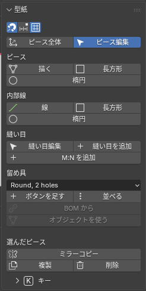

# 型紙を直す・描く

このパネルでやること: 型紙の形を直す、新しく描く、左右をそろえる。直した形は、着せた服があれば、その場で服へ写ります（物理計算なしで形だけ）。

## パネルの並び

上から、吸着の設定、「**ピース全体**」（Whole Pieces）と「**ピース編集**」（Edit Pieces）（型紙を直す 2 つの道具）、「**ピース**」（Piece）（「**描く**」（Draw）、「**長方形**」（Rectangle）、「**楕円**」（Ellipse））、「**内部線**」（Internal）（「**線**」（Line）、「**長方形**」（Rectangle）、「**楕円**」（Ellipse））、「**縫い目**」（Seams）（「**縫い目編集**」（Edit Seams）、「**縫い目を追加**」（Add Seam）、「**M:N を追加**」（Add M:N））、「**留め具**」（Fasteners）（ボタン。下の「ボタン（Fasteners）」）、区切り線、「**選んだピース**」（Selected Pieces）（「**ミラーコピー**」（Mirror Copy）、「**複製**」（Duplicate）、「**削除**」（Delete））、いちばん下に閉じた「**キー一覧**」（Keys）（「**ピース全体**」（Whole Pieces）と「**ピース編集**」（Edit Pieces）の全部のキー）です。

- 長さの単位は、セットアップのパネルの「**単位**」（Units）で選びます。
- いちばん上の 3 つのボタンは、ドラッグ中の吸着（磁石）、グリッドへの吸着、グリッドの表示です。
- ピースの名前は、Tool タブの「**AC9 ピース**」（AC9 Piece）のいちばん上の欄（か F2）で付けます。

## 型紙を直す 2 つの道具: ピース全体（Whole Pieces）とピース編集（Edit Pieces）

型紙を直す道具は 2 つに分かれています。**ピースを丸ごと動かすのが Whole Pieces、ピースの形（角・辺・内部線の点）を変えるのが Edit Pieces** です。パネルのボタンを押すと、左の道具がその道具に切り替わります。型紙の上にカーソルを持っていくと、その道具でつかめるものが光ります。

「**ピース全体**」（Whole Pieces）（ピースと内部線を丸ごと）

| 操作 | 何をするか |
|---|---|
| クリック | ピースか内部線を選びます。Shift＋クリックで足す・外す。 |
| ドラッグ | つかんだピースか内部線を動かします。選んである物の 1 つをつかむと、選んだ全部が一緒に動きます。 |
| 何も無い所から引く | 箱が出て、囲んだピースを選びます（ほかのピースの上の内部線も）。 |
| G／R／S | 選んだ物を動かす／真ん中のまわりに回す／拡大縮小する。G は X／Y で軸、数字で mm、Shift で 0／45／90°、ピースごと動かすとほかのピースにそろう（Ctrl で吸着を切る）。R は数字で角度、Shift で 15° 刻み。S は X／Y で一方向、数字で倍率。 |
| Shift+D | 選んだピースを写します（鏡像ではなく、左右ペアにもなりません）。写しはクリックするまでマウスに付いて動き、右クリックで元のすぐ横に残ります。 |
| F2 | ピースに名前を付けます（表示用）。 |
| X または Delete | 選んだ物を消します。 |

「**ピース編集**」（Edit Pieces）（角・辺・内部線の点）

| 操作 | 何をするか |
|---|---|
| クリック | 角・外周の辺・内部線を選びます。Shift＋クリックで足す・外す（ピースをまたいで何本でも）。何も無い所をクリックすると選択が外れます。 |
| ダブルクリック | その上に何があっても（内部線・合印・縫い目）、ピース全体を選びます。 |
| 何も無い所かピースの内側から引く | 箱が出て、囲んだ角と内部線を選びます。Shift で足す、Ctrl で外す。**ピースの内側を引いてもピースは動きません**（ピースごと動かすのは「**ピース全体**」（Whole Pieces））。 |
| ドラッグ | 角・辺・カーブの取っ手・内部線（端・途中の点・線全体）を動かします。選んである角・辺・内部線の 1 つをつかむと、選んだ全部が一緒に動きます。ドラッグ中に X／Y で軸を固定、Shift で 0／45／90° に固定、数字で長さを指定、Ctrl で吸着を切る。右クリック／Esc で取り消し。 |
| G／R／S | 選んだ角・辺・内部線を、真ん中を基準に動かす／回す／拡大縮小する。 |
| K | カーソルの下の辺か内部線に点を足します。 |
| C | 辺か内部線の区間をカーブにする／直線に戻す。カーブには取っ手が 2 つ付き、ドラッグで形を直せます。 |
| N | 合印（ノッチ）を置きます。置いた合印はドラッグで滑らせられます。 |
| 右クリック | カーソルの下の物にできることの全部。上のキーのほか、外周の辺で「**ダーツを追加**」（Add Dart）、ダーツの上で「**ダーツを移動**」（Move Dart）、外周の辺と内部線で「**平行な線**」（Parallel Line。先に小窓で距離・本数、内部線なら側・両側・外周まで延ばすか）、外周から外周まで引いた内部線で「**切り開き**」（Slash and Spread。フレアかギャザー）と「**線で切る**」（Cut Along Line。2 枚に切り、線が通った点は角になる）。 |
| Shift+D | 選んだピース（かカーソルの下のピース）を写します。写しはクリックするまでマウスに付いて動きます。 |
| X または Delete | カーソルの下の角・内部線の点・内部線・合印を消します。 |
| F9 | 直前の操作の数値（ダーツ、切り開き、平行線の距離、長さなど）を直します。 |

- 吸着（既定でオン、Ctrl で切る）: 動かすと同じピースの外周・内部線までの距離（mm）が出て、真ん中・等間隔・同じ距離に吸い付きます。ピースごと動かすと、ほかのピースの角にそろいます。
- 寸法: カーソルを重ねた辺・線には長さ、選んだ物には長さと周りまでの距離が出ます。Tool タブの「**数値で動かす…**」（Move by Number...）で、選んだ線・辺を今の位置から X・Y に、または周りまでの距離を入れて動かせます。縫い目の番号は、カーソルの下の辺・線にだけ出ます。
- 道具のオプション行には、カーソルの下の物に効くキーだけが出ます。全部のキーは「**型紙**」（Pattern）パネルの下の「**キー一覧**」（Keys）にあります。
- 戻し方: Ctrl+Z。
- 制限: 型紙のピースのオブジェクトには鍵が掛かっていて、Blender の G／R／S では動きません。ピースを動かすのは「**ピース全体**」（Whole Pieces）です。

## ピースを描く（Draw Piece）と内部線（Internal Line）と図形

- 「**ピースを描く**」（Draw Piece）: 新しいピースを描きます。角を順にクリックし、最初の角をもう一度クリック（か Enter）で閉じます。数字で辺の長さ、Shift で 15° 刻み、Backspace で 1 歩戻ります。
- 「**長方形のピース**」（Rectangle Piece）と「**楕円のピース**」（Ellipse Piece）: 長方形と楕円のピースを、ドラッグか 2 点のクリックで描きます。Shift で正方形・円、Alt で中心から。W Tab H Enter で数値入力。
- 「**内部線**」（Internal Line）: ピースの中に内部線を描きます（ダーツの脚、ポケットの位置、折り線など）。点をクリックしていき、Enter で終わります。3 点以上を描いてから最初の点をクリックすると、閉じた図形になります（自分と交わる図形は作れません）。Shift で 15° 刻み（外周の上でも角度を保ちます）。
- 「**内部の長方形**」（Internal Rectangle）と「**内部の楕円**」（Internal Ellipse）: 既存のピースの内側に、図形の内部線を描きます。楕円は 4 つのカーブの区間でできていて、点をドラッグして形を直せます。
- 描いた内部線は、あとから「**ピース編集**」（Edit Pieces）で点を足し（K）、動かし、消し（X）、カーブにできます（C）。
- 閉じた図形では、「**穴に変換**」（Convert to Hole）は Tool タブと右クリックのメニューに、2 つの複製は右クリックのメニューにあります。
  - 「**穴に変換**」（Convert to Hole）: 図形の中を穴にします（布が無くなる）。もう一度押すと埋まります（「**穴を戻す**」（Fill Hole））。外周に触れる・交わる、ほかの穴と重なる、折り・ゴムの付いた図形は穴にできません。左右ペアと中心線の反対側の図形も一緒に変わります。
  - 「**型紙として複製**」（Clone as Pattern）: 図形と同じ形の新しいピースを作ります（ポケットを描いた位置から作る、など）。生地は元のピースと同じで、縫い目は無く、置かれていない状態で、元のピースのすぐ右に出ます。図形は元のピースに残ります。
  - 「**型紙として複製（＋縫う）**」（Clone as Pattern (+Sew)）: 同じように作り、さらに新しいピースの辺を、図形の区間に縫い付けます。元のピースが置いてあれば、新しいピースも 3D でその上に付きます。
- 「**選んだピース**」（Selected Pieces）の「**複製**」（Duplicate）: 選んだピースを元のすぐ横に写します。写したピースどうしの縫い目も写ります。写しは置かれていないので、「**配置**」（Place）で置きます。
- 「**選んだピース**」（Selected Pieces）の「**削除**」（Delete）: 選んだピースを消します。そのピースの縫い目・配置・折り線も一緒に消えます。

## 左右ペア

左右対称のピースは「左右ペア」としてつながっていて、片方を直すともう片方も鏡像で直ります。

- 「**ミラーコピー**」（Mirror Copy）: 選んだピース全部の鏡像を横に作り、それぞれを左右ペアにします。選んだピースの縫い目も鏡で写ります。元のピースが置いてあれば、写しは 3D でも鏡の位置に置かれます（ボタンは写りません）。押した後の F9（Redo パネル）の「**鏡の面**」（Mirror Plane）で「**左右**」（Left / Right）か「**前後**」（Front / Back）を選べます（既定は左右）。前後では写しを上下逆にして並べます。3D では、平らに置いたピースの写しはその場（元と重なる位置）に鏡写しで出て、前後に動かすと反対へ離れていきます。体の上のピースは胴の中心で鏡写しです。後から Tool タブ「AC9 Piece」の「ペア」の箱でも変えられます。
- 「**対称編集**」（Symmetric Edit）（Tool タブの「**AC9 ピース**」（AC9 Piece）にある、押すと押されたままになるボタン）: 1 枚で裁つ前身頃のような左右対称の 1 ピースで、片側の角・辺・カーブの取っ手を動かすと反対側も鏡で動きます。内部線・折り・ダーツ・切り開き・縫い目・切る線も、中心線の反対側に付いていきます。対称でなくなると赤く「(broken)」と出て、効きません。
- 「**対称にそろえる**」（Symmetrize）（「**対称編集**」（Symmetric Edit）の右）: ピースを中心線で左右対称にし直します。左半分を残して右半分を鏡で作り直します（F9 で右半分を残す方に変えられます）。押すと「**対称編集**」（Symmetric Edit）がオンになります。
- パネルに赤い「○ left / right pair(s) no longer mirror images」が出たら、左右ペアがずれています。そのままでも着せられますが、左右を別々に計算します。そろえたいなら片方を消し、もう片方を「**ミラーコピー**」（Mirror Copy）します。

## 直した型紙を着せた服に反映する

型紙を直すと、直した形はその場で今の服へ写されます。ただし写しただけで、布としては落ち着いていません。「**ライブシム**」（Live Sim）を押すと、今の服の形から続けて計算し、服全体が直した型紙に落ち着きます（「Run」の節）。写せない形（布が裏返る、面積が 0 になる）なら、理由を出して止まります。

- 「**編集を 3D に写す**」（3D Follows Edits）（Tool タブの「**AC9 実行**」（AC9 Run）の、実行ボタンの下）: 既定は外れています。外れている間は、型紙の直しは型紙だけに入り、着た服と置いた形は次の実行までそのまま待ちます（3D を待たずに、続けて型紙を直せます）。押すと、上のとおり直すたびに 3D へ写します（そのたびに少し待ちます）。
- 待っている直しがあると、右隣の「**3D を更新**」（Update 3D）が赤くなり、道具のオプション行に「3D not updated」と出ます。「**3D を更新**」（Update 3D）を押す、「**編集を 3D に写す**」（3D Follows Edits）を押し直す、または次の「**ライブシム**」（Live Sim）で、まとめて 3D に写ります（物理計算なし）。

## 合印とダーツと切り開き

- ダーツは、「**ピース編集**」（Edit Pieces）で外周の辺を右クリックし、「**ダーツを追加**」（Add Dart）で足します。口は外周に沿い、頂点はまっすぐ内側に入ります。脚どうしを縫う縫い目も一緒にできます。
- ダーツの縫い目を「**縫い目**」（Seams）で選ぶと、その下にダーツの角度と脚の長さが出ます。「**移動**」（Move）は選んだダーツを、クリックした外周の点へ動かします（あいだの外周が頂点を軸に回り、角度は変わりません）。「**折り**」（Fold）は、ダーツを閉じた形の外周を点線で見せます。縫ったときに外周が折れる場合は「**ダーツ口を整える**」（True Mouth）が出て、押すと縫ったときになめらかにつながる口の形にします。
- 内部線を「**切り開き**」（Slash and Spread）で切り開くと、フレア（線の片端を軸に扇形に開く）とギャザー（線に直角に平行に開く）を選べます。開く量・開き方・軸にする端・動かす側（A／B）は先に小窓で聞きます。実行直後に F9 でも直せます。

## ボタン（Fasteners）

ボタンは縫い目ではなく、ボタンと穴をシミュレーションの間だけ引き寄せて留めます。外して「**ライブシム**」（Live Sim）すると開きます。

- 相手: ピースを選び、「**AC9 ピース**」（AC9 Piece）の「**合わせる相手**」（Closes Onto）（スポイト）で相手のピースをクリックすると、穴が相手に付きます。相手の無いピースのボタンは飾りです。
- 「**型紙**」（Pattern）パネルの「**留め具**」（Fasteners）: 種類を選び、「**ボタンを足す**」（Add Button）（クリックごとに 1 個、Esc で終わり）、「**並べる**」（Line Up）（内部線に沿って並べる。個数と間隔は F9）、「**BOM から**」（From BOM）（BOM のボタン付けの縫い目の所に置く）、「**オブジェクトを使う**」（Use Object）（選んだメッシュを種類にする）。
- 一覧は「**リスト**」（Lists）の「**留め具**」（Fasteners）タブ。行の鍵で 1 個を留める・外す。選ぶと Tool タブに「**AC9 ボタン**」（AC9 Button）（「**ボタンを動かす**」（Move Button）、「**穴を置く**」（Set Hole）、「**穴なし**」（No Hole）、「**穴を自動に**」（Hole Auto）、「**留めた**」（Fastened）／「**外した**」（Unfastened）、「**削除**」（Remove）、「**種類を付ける**」（Set Style））が出ます。
