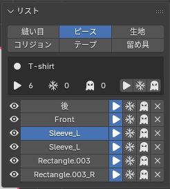

# ピースの状態と重ね着

ピースごとに 4 つの状態があります（「**リスト**」（Lists）の「**ピース**」（Pieces）タブか、ピースを選んだときの「**AC9 ピース**」（AC9 Piece）の **State**）。

| 状態 | アイコン | 動く | ほかの布が当たる | 縫い目 |
|---|---|---|---|---|
| 「**アクティブ**」（Active） | 再生 | ○ | ○ | ○ |
| 「**フリーズ**」（Freeze） | 雪の結晶 | ×（今の場所に止まる） | ○ | ○ |
| 「**非アクティブ**」（Inactive） | おばけ | ×（今の場所に止まる） | ×（すり抜ける） | ○（縫い目は引っぱる） |
| 「**オフ**」（Off） | × | 網目に入らない | — | ×（縫い目ごと外れる） |

- 「**フリーズ**」（Freeze）と「**非アクティブ**」（Inactive）は、縫う段を含む全部の段で止まります。
- 状態のボタンは、左右の対（鏡のペアと「**ペア**」（Pair）で組んだ対）を一緒に切り替えます。片側だけ変えたいときは Ctrl＋クリック。「**オフ**」（Off）から戻したピースは、残っていた側の鏡の形にそろいます。
- **State** の行の「**選択を反転**」（Invert Selection）は、この服のほかのピースを選び直します（「服のまとまり」の手順）。
- 「**オフ**」（Off）のピースは一覧に数だけ出ます。戻すには「**ピース編集**」（Edit Pieces）で灰色のピースを選び、「**アクティブ**」（Active）にします。
- 「**ピース**」（Pieces）タブの服の行: 丸が塗ってあるのが今の服、`10 on 2 fz 1 off` が状態ごとの数、右の 3 つのアイコンでまとめて切り替え。ピースの行は名前（押すと選ばれる）と 4 つの状態のボタン。赤い行は Blender の X でオブジェクトだけ消されたピースで、**Restore N Deleted Object(s)** で戻せます。

## 重ね着

- 「**服**」（Garment）で服を切り替えて「**シミュレート**」（Simulate）すると、結果を持つほかの服は自動で「動かない障害物」になります。「内側を着せる →「**服**」（Garment）で外側に切り替えて「**シミュレート**」（Simulate）」の順です。
- 障害物になるのは、ほかの服の最後の形です。ほかの服で「**非アクティブ**」（Inactive）／「**オフ**」（Off）にしたピースは障害物から外れます。
- ほかの服をシミュレーションすると、それまでの服の経過（タイムラインのコマ）は消え、最後の形だけが残ります（Result の欄が `Frames: dropped (shape kept)` になる）。
- 「**コリジョン**」（Collision）タブでは、型紙を持たない物（小物や普通のメッシュの服）を障害物にできます。「**追加**」（Add）の欄の右のスポイトで 3D ビューの物をクリックするか、欄で名前を選ぶと、その物が加わります（どのツールを使っていても取れます）。いくつかまとめて加えるときは、物を選んで「**選んだ物を追加**」（Add Selected）。やめるときは「**削除**」（Remove）。
- 加えた物は、3D ビューで「**ピース全体**」（Whole Pieces）でクリックすると選べ、ギズモや G／R で動かせます（作業画面の 3D ビューには、ほかに物を選ぶツールがありません）。加えていない物は、ピース全体では選べません。
- 今、シミュレーションで動くのは今の服だけです。
