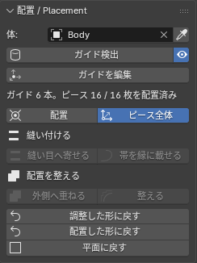
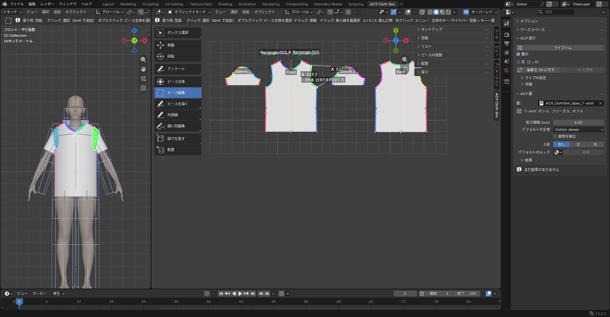

# 体のまわりに置く

このパネルでやること: 体を指定し、各ピースを体のどこに置くかを決める。バッグなど体の無いものは、体を指定せずに平らに置けます（下の「平らに置く」）。

## 体（Body）とガイド検出（Detect Guides）とガイドを編集（Edit Guides）

- 「**体**」（Body）: アバターの体のメッシュを選びます。欄の右のスポイトで 3D ビューの体をクリックするか、名前で選びます（体が入っているときも、× の横のスポイトで選び直せます）。服はこのまわりに置かれ、この体に当たりながら垂れます。
- 「**ガイド検出**」（Detect Guides）: 体の形から、ピースを置く目安を探します。胴・首・腕・脚に円柱（ガイド）をかぶせます。アバターはまっすぐ立って −Y を向いている前提です（違うと「upright, facing -Y?」と出ます）。隣の目のアイコンで、目安を画面に出すかどうかを切り替えます。
- 「**ガイドを編集**」（Edit Guides）: 円柱を手で直します。押すと円柱が 1 本ずつオブジェクトになるので、G（動かす）、R（傾ける）、S（太さ。軸の向きだけ伸ばすと長さ）で直します。直している間だけ「**左右一緒に**」（L/R together）のボタンが出て、オンなら腕・脚の片方を動かすともう片方も体の中心の鏡の位置に付いてきます。終わったら「**完了**」（Done）を押します。
- 目安が見つかると `○ guides; 20 / 20 pieces placed`（目安の数、置いたピースの数／on のピースの数）が出ます。

## 配置（Place）と平面に戻す（Back to Flat）

「配置」では移動・回転ギズモを隠し、「ピース全体」で表示します。円柱へ配置し直すと、G・R・ギズモで加えた自由移動と回転をリセットし、配置の傾きと折り設定を保ちます。クリックで選ぶだけのときと、キャンセルしたときはリセットしません。

配置を整えている間は、リンクした左右のピースへ移動・回転が鏡向きに伝わります。シミュレーション結果の手直しは選んだ側だけに効きます。部分シミュレーションの結果も同じです。「調整した形に戻す」は計算前の手調整へ戻し、「配置した形に戻す」は手調整もリセットします。古いファイルで形の由来が分からない場合は、このどちらかで基準を明確にしてから動かしてください。

- 「**配置**」（Place）（左の道具の列の道具。パネルのボタンはこの道具に切り替えます。隣の「**ピース全体**」（Whole Pieces）のボタンは、置いたピースを動かす道具に切り替えます）:
  1. ピースをクリックして選びます（Shift で追加・外す）。クリックは選ぶだけで、置くことはしません。何も無い所をクリックすると選択が外れます（Ctrl+Z で戻ります）。
  2. カーソルを円柱の上へ持っていくと、その円柱が黄色に光ります。
  3. 円柱の上（体や着た服の上も同じ）から押してドラッグすると、選んだピースがそこへ置かれ（緑の輪郭）、動かすと円柱のまわり・円柱に沿って滑り、離した所で決まります。もう置いたピースも置き直されます（Ctrl+Z で戻ります）。着ているピースは置き直さず、下の帯に 1 行出ます（先に「**調整した形に戻す**」（Back to Adjusted Shape））。ピースを選んでいないときは「Place: click pieces first …」と出ます（置いたピースをドラッグすると、どこをつかんでも跳ばずに、動かした分だけ円柱に沿って滑ります。着た服のピースは **G**／**R** か「**ピース全体**」（Whole Pieces）で動かします。角度だけ・高さだけ変えるときと、ピースを倒すときは、Tool タブ「AC9 Piece」の Around（まわりの角度）・Height（高さ）・Tilt（倒す角度。90° で上側が外へ水平、180° で上下逆＝衿の外周が首の側。横の ↻ で +180°））。Esc／右クリックで取り消し。
  4. 箱で何枚か選ぶときは「**ピース全体**」（Whole Pieces）の道具で、3D の何も無い所からドラッグします。着た服の上でもピースを 1 枚ずつ選びます（Shift で足す、Ctrl で外す）。
  - 3Dの鏡像ピースをドラッグすると、最初に触れた側が操作対象になります。そのピースを離した円柱側へ置き、連動する相手だけを反対側へ配置します。
  - 複数のピースを選んでいれば、型紙での並びを保って横に並んで置かれます。
  - 円柱の無い所からドラッグすると、平らに置きます（下の「平らに置く」）。型紙の上から始めたドラッグは、円柱・面・地面に届いた所から置きます。
  - 離すと、シミュレーションが実際に始まる形が出ます。ピースは置いた所のままで、体から押し出しません。帯（衿リブなど）は自分の長さ×「伸び」（Stretch）の輪で、体内への侵入や布の重なりは、診断ボタンで確認します。
- 「**平面に戻す**」（Back to Flat）: 選んだピースと連動中の鏡像を、**3D の今の位置と向きのまま**、平らにします。円柱（または着た服）の上で曲がっていた形を、ピースの中心の下の平面へ広げます。中心は動きません。手で動かした分と調整した形の上の編集は捨てます。何も選んでいないときは、確認のあとで置いたピース全部。着た服のピースは、平らにした形の置いたピースに戻ります。配置を解除してやり直す場合は、下の「未配置に戻す」を使います。
- 「**未配置に戻す**」（Return to Unplaced）: 選んだピースの3D配置・移動・手編集・保存形を破棄し、2Dから再配置できる状態に戻します。型紙・内部線・折り設定・合印・縫合・生地は保持します。連動中のペアは両側、連動解除済みなら選択側だけが対象です。何も選んでいない場合は実行しません。全体を戻す場合は全ピースを選択します。計算中は実行できません。Ctrl+Zで取り消せます。状態の「Off」は配置と形を保持して非表示にする操作で、配置解除とは異なります。
- 置き方の決まり: ピースは 1 本の円柱に沿って曲げるか、平らなまま置かれ、体の凹凸をなぞって伸ばすことはしません。置いた所から勝手に動かすこともしません（体や重なりから外へ出す、帯を持ち上げる、などは自分で動かすか下の道具を押したときだけ）。

## 平らに置く（体の無いもの・バッグなど）

- 「**配置**」（Place）で円柱の無い所からドラッグすると、選んだピースを平らなまま置きます。
  - 体・衝突オブジェクト・ほかのメッシュの面の上: ピースの向きを面の向き（法線）にそろえ、面から 2 mm 浮かせて置きます。ピースの上側は、ワールドの上（Z）を面に寝かせた向きです。
  - 何も無い所: 地面（Z = 0）の上に、上向きに寝かせて置きます。
  - 刺さり（凸凹の面に平らな板が当たる所）は自動では直しません。画面で見て、G で持ち上げてください。
  - 平らに置いたピースを押してドラッグすると、カーソルの下の面（または地面）の上を滑ります。
  - 地面の上では、ピースの中心が X = 0（左右ペアの鏡の面。体があれば胴の中心）と Y = 0 に近づくと吸い付き、線と白い点が出ます。左右ペアは Y = 0 だけに吸い付きます。Ctrl を押している間は吸い付きません（胴の前中心・後ろ中心への吸い付きも同じ）。
  - 「**向き**」（Orientation）: Tool タブ「AC9 Piece」の欄（°）で、置いた面の上での向きを数値で決めます。0 で型紙の上が面の上向き（地面なら +Y 向き）、90 で左回りに 90°。横の ↻ で +90°。置いた場所は変わりません。左右ペアは鏡の向きで付いてきます。
  - ペアは、置いた段では最初から鏡写しで連動しています（片側を動かすと反対側も動く）。状態とボタンは「AC9 Piece」の「ペア」（下の「ペア」）。前後のペアは X = 0 だけに吸い付きます（左右ペアは Y = 0 だけ）。
  - 位置・回転は Tool タブ「AC9 Piece」の「**位置と回転**」（Location & Rotation）の欄で数値でも直せます（調整した形ができてから）。
- 体を指定しなくても、平らに置いたピースだけで「**シミュレート**」（Simulate）が回ります。
- 「**床（Z = 0）**」（Floor (Z = 0)）: Run の「重力」の下のスイッチ。オンにすると、Z = 0 に布が着地する床を置きます（シーンには何も足しません）。体も衝突オブジェクトも床も無いときは、重力なしで縫うところまでで止め、1 行で知らせます。
- 形を保つのは主に生地の硬さです。バッグには生地の「**キャンバス**」（Canvas）「**革**」（Leather）「**合成皮革**」（Synthetic Leather）が向いています（キャンバスの曲げは推定値です）。

## 配置した形と着装した形を確かめる: 診断（Diagnose）

「**診断**」パネルの「**診断**」（Diagnose）を押します。配置したピース、シミュレーション後の着装ピース、両者が混在する状態の表示中の布面を調べます。形は動かさず、厚みを付ける前の面を検査します。

- 選んだピースと連動ペアが対象です。無選択なら表示中の対象すべて。表示されていない選択を、全体の診断へ勝手に広げません。
- 体・衝突物の内側（床も含む）の頂点と、他ピースとの交差・同じピース内の自己交差を調べます。侵入は表面から0.5 mmより深く50 mm以内、開口の縁や条件に応じた腕の面は除外します。布交差は面の内部を横切る交差を調べ、当該2面を直接つなぐ縫合辺を確認できる面対だけを縫合近傍として除外します。
- 「**診断結果**」（Diagnosis Results）を開くと、ピースごとの内訳、交差する相手、自己交差、伸びを読めます。面数は交差箇所の個数ではありません。縫合との区別がつかない交差は「交差候補」と表示し、確認済みの交差や他の項目の結果を残します。面積のない面も未検査として示します。開始形の注意は別枠です。
- 「**表示**」では **問題箇所／伸び／表裏／なし** を切り替えます。「オーバーレイ」の「**診断の表示**」（Diagnosis Display）も同じ設定です。表示の切り替えで全体診断をやり直しません。伸びの数値と色は型紙に対する面の最大主伸長でそろえています。表裏は現在形の表示で、表が青・裏が赤。裏が見えても異常件数には入りません。
- 問題箇所では確認済みの面を赤、縫合を照合できない交差候補を黄で示し、3Dと型紙の対応位置に件数付きの四角を出します。体などに隠れた所は破線と薄い点です。交差の印は3Dの交差線と各面に補間した型紙位置に対応し、近い領域の表示は3Dまたは型紙上の距離でまとめます。
- 結果には診断時刻とフレームが付きます。対象・相手・人体の変形、表示元や可視集合、型紙や縫合、粒子間隔、開始形の参照などが変わると古い赤を止め、再診断を促します。別のビューを見るだけでは失効しません。再読込とUndo/Redoでは未診断へ戻ります。
- 開始形の点検は、配置済みピースのない服でも実行できます。次回のソルバー入力を組み立ててすべて照合するものではありません。直近の実行で分かった注意は「実行時の検査記録」として分けて読みます。
- 同一平面上の接触、縫い目の接続の正誤、服の最終品質はこの診断の保証対象ではありません。

配置を確定しただけでは品質警告や赤塗りを付けません。形を作れない・指定が足りない等の操作上の注意はその場で出ます。形を直した後は、もう一度「診断」を押してください。

## 調整した形を整える道具（物理計算なし）

どれも、ピースを選んでから押します。シミュレーションの前に、始まりの形を整えるための道具です。

- 「**縫い目へ寄せる**」（Part to Seam）: 折りの設定を反映し、選んだピースの縫う点を、**今回指定した相手との縫合点の上へ乗せます**。そのあと縫う点はそのままにして、体の外へ出し、相手の自分の側へ 2 mm 載せ、辺の長さを戻します（「整える」と同じ）。相手は配置形でも着せた後の形でも使えます。形は伸びることがあります。操作による伸びは結果の1行で、現在の侵入・交差の場所と伸びの表示は「診断」で確認できます。断るのは三角が潰れるとき（シミュを始められない形）だけです。乗せると伸びが赤（1.5 倍）を超える場合（相手どうしが離れて置かれているときなど）は、乗せずに形を保ったまま指定相手の近くへ運び、隙間を 1 行で知らせます。その縫い目はシミュで閉じます。ボタンを押すと寄せ先の選択に入ります。相手をクリックし、Shiftクリックで追加・解除、Aで全相手、Enterで適用、Escで取消します。指定は今回だけで、選ばなかった相手との縫い目も次のシミュレーションでは有効なままです。さらに外側へ浮かせたいときは「外側へ重ねる」（Move Outside）を別に押します。寄せる前の手配置・頂点の編集・折りは別に保持し、繰り返しても準備形を上書きしません。Fold Angle を変えたら、もう一度押すと新しい折りから寄せ直します。
- 「**帯を縁に載せる**」（Band on Edge）: 細い帯（衿リブなど）を、指定した相手の縫い付け線に沿わせ、幅方向も含めて配置します。相手の選び方は「縫い目へ寄せる」と同じです。どちらも動かす側と追従するペアを表示し、寄せ先選択で元の選択やアクティブを入れ替えません。
- 「**外側へ重ねる**」（Move Outside）: 選んだピースの現在の形を保ち、近くで重なる布の表側へ出します。自分・相手とも、配置中の形でもシミュレーション後の形でも使えます。縫い合わせは不要です。相手から8 mm離れるよう必要分を移動し、既に離れていればさらに8 mm移動します。補正後は、その形から再シミュレーションできます。折り返しなどで表側を決められない場合や、別の層・人体を通り抜ける場合は、理由を表示して形を保ちます。
- 「**整える**」（Settle）: 物理計算なしで整えます（体から出す、辺の長さを戻す）。残った侵入・交差の場所は「診断」で確認できます。
- 着せた服の一部のピースには、先に「**調整した形に戻す**」（Back to Adjusted Shape）を押してから使います（「Back to Adjusted Shape it first」と出ます）。

## 調整した形を手で直す: ピース全体（Whole Pieces）と配置した形に戻す（Back to Placed Shape）

- 3D ビューで「**ピース全体**」（Whole Pieces）: ピースをクリックすると選ばれ、ギズモか G・R で動かせます（W でギズモの移動と回転を切り替え）。
  - 着せる前: 調整した形はピースごとのオブジェクトです。Edit Mode でも直せ、「**シミュレート**」（Simulate）はその形から始めます。
  - 着せた後: 着た服のそのピースにつまみが付きます（下の「着せた後の操作」）。
  - 調整した形は、ピースを置いたときにでき、ガイドを取り直したときもその場で作り直します（手で動かした分つき）。置いてあるのに形が無いピースには「調整した形がありません: 「配置」で置き直してください」と出ます。
- 「**配置した形に戻す**」（Back to Placed Shape）: 選んだピース（選んでいなければ全部、確認が出ます）の手の直しを捨てて、現在の配置設定から作る配置した形に戻します（ガイド上・平置きの両方）。着た服のピースは、先に調整した形に戻してから（Back to Adjusted Shape を挟んで）戻します。
- 「戻す」は 3 つ、近い順に並んでいます:「**調整した形に戻す**」（Back to Adjusted Shape）（調整した形への復帰。復帰時点は下記）、「**配置した形に戻す**」（Back to Placed Shape）（→ ガイドの上、手の直しも捨てる）、「**平面に戻す**」（Back to Flat）（→ その場で平らに、手の直しも捨てる）。
- 古いファイルに寄せる前の形が残っていない場合や、寄せた後に型紙の網目・ペアが変わった場合は、推測で復元せず理由を表示します。変更を元に戻すか、「配置した形に戻す」で配置し直してください。
- 調整した形を 1 つ選ぶと、目安からの動き（Move と Turn）が出ます。数値で動かすときは、Tool タブ AC9 Piece の「**位置と回転**」（Location & Rotation）を使います。
- 連動しているペアは一緒に動き、相手は鏡で付いてきます。片側だけ動かしたいときは、下の「ペア」で連動を切ってください。

「調整した形に戻す」は、シミュレーション後なら開始時に残した形（縫い目へ寄せた調整も含む）へ戻します。まだシミュレーション結果がない場合は、縫い目へ寄せる前の形へ戻し、手配置・頂点編集・折りは残します。

## ペア（Tool タブ「AC9 Piece」の「ペア」）

Tool タブ「AC9 Piece」は上から、ピースの名前と大きさ、「**状態**」（State）と「**表示**」（Display。いつも出ます）、その下に折りたためる見出しの「**生地と見た目**」（Fabric & Look）・「**シミュレーション**」（Simulation）・「**ペア**」（Pair）・「**このピースの左右対称**」（This Piece's Symmetry）・「**配置**」（Placement）の順です。

「**ペア**」には相手と、「型紙」「3D の置き方」「シミュ結果」の 3 段が出ます（右クリックのメニューは残っています）。

- 「相手: ○○」: 対の相手。「**型紙**」の段は、「**ミラーコピー**」（Mirror Copy）で描いた対なら「形は連動（片方を直すと相手も）」、「**ペア**」（Pair）で組んだ対なら「形は別々（置き方だけの対）」です。
- 「**鏡の面**」（Mirror Plane、「3D の置き方」の段）: 「**左右**」（Left / Right）か「**前後**」（Front / Back）。どちらの対でも選べます。ミラーコピーの対を前後にすると、型紙では鏡側のピースが上下逆になります（以後の編集は上下の鏡で付いてきます）。ペアで組んだ対は型紙をそのままにし、相手を上下逆に描いても左右の鏡像に描いても正しい向きで置きます（逆に描いてあったときは 1 行で知らせます）。縫い目の自動の鏡写しも同じ面で写ります。前後はバッグの側面のように前と後ろで対になる物に使います。
- 「**鏡の中心**」: 体の上のペアは体の中心で鏡写しです。平らに置いたペアは、服の中心の Empty「AC9 Center: （服の名前）」で鏡写しになります。平らに置いた最初のペアがこれを作り（2 枚とも置いてあれば 2 枚の真ん中。片方だけなら、前後はそのピースの位置、左右は体の中心）、その服の平らなペアは左右も前後もこの点で鏡写しになります。3D ビューで「**ピース全体**」（Whole Pieces）で Empty の印をクリックすると Empty だけを選べ、ギズモか **G** で動かせます。「**中心も選ぶ**」（Select Center）で選択に足し、**G** で動かすと各ペアの反対側が逆へ動きます。ピースと一緒に選んで動かすと服ごと動きます。ボタンの下の欄に数値でも入れられます。動かすだけで、回転と拡大縮小はロックしてあります。
- 古いファイルで自分の面を持っているペアは、その面を赤く出し、「**中心にそろえる**」（Align to Center）で反対側を中心の鏡の位置へ動かします。ファイルを開いただけでは何も動きません。ペアにしてから平らに置いて中心がまだ無いペアは「鏡の中心: 体の中心」と出て、同じボタン（または「鏡の面」を押す）で 2 枚の真ん中に中心を作ります。
- 「**連動を切る**」（Unlink）: ミラーコピーの対を左右別々に置けるようにします（型紙の鏡の関係は残ります）。「**連動する**」（Link）で元に戻ります。連動を切った対には「**置き場所を鏡写し**」（Mirror Placement）が出て、片側の置き場所と手の動きを相手へ 1 回写します。
- 「**ペア解除**」（Unpair）: ペアで組んだ対を解きます。手で動かした分は付いてこないので、「**置き場所を鏡写し**」で写します。
- 「ペアなし」: 相手なし。対にしたい 2 枚を選んで「**ペア**」（Pair）。鏡の面は Tool タブ「AC9 ピース」の「ペア」の「**鏡の面**」です。
- 「**左右を入れ替え**」（Swap Sides）: 置いた対の左右を入れ替えます（手で動かした分と折りは場所の側に残り、形は「**配置**」（Place）と同じに作り直します）。
- 「**3D をペアへミラー**」（Mirror 3D to Pair、「シミュ結果」の段）: シミュレーション後の片側の形を反対側へ写します。ペアの両側がシミュレーション結果に載っているときだけ出ます。
- 1 枚のピースの左右を対称に直す「**対称編集**」（Symmetric Edit）と「**対称にそろえる**」（Symmetrize）はペアの設定ではないので、「**このピースの左右対称**」にあります。

## 着せた後の操作

着せた後は、着た服 1 つの上で操作します。

- 「**ピース全体**」（Whole Pieces）・「**配置**」（Place）・「**ピース編集**」（Edit Pieces）の道具で着た服のピースをクリックすると、そのピースの真ん中につまみ（矢印の Empty）が出て選ばれます。Shift＋クリックで足せます。
- 着せた後に新しく置いたピースは、調整した形で出ます（次の「**シミュレート**」（Simulate）で縫い付けます）。
- つまみを G・R で動かすと、そのピースが着た服の中で付いてきます。めり込んだ所を直してから「**シミュレート**」（Simulate）します。縫い付いたまま大きく動かすと、「**シミュレート**」（Simulate）の始めに引き戻されます。
- つまみを選んだまま「**調整した形に戻す**」（Back to Adjusted Shape）を押すと、そのピースが調整した形に戻ります。
- 着せた服や置いたピースをクリックした所は、型紙の同じ位置にも赤い点で出ます（コマを動かしても付いてきます）。逆に、型紙のピースをクリックすると、着せた服（まだ着せていないピースは置いたピース）の同じ位置に赤い点が出ます。左右・前後が同じ形の型紙で、どこが 3D のどこかを確かめるのに使えます。AC9 の道具で2D／3Dの何もない所をクリックすると、両方の赤い点が消えます。Shiftでの追加選択や範囲選択のドラッグでは残ります。
- クリックで選んだだけの操作は、元に戻す（Ctrl+Z）の履歴に残りません。Ctrl+Z を押すと、その前に行った移動や配置が戻ります。
