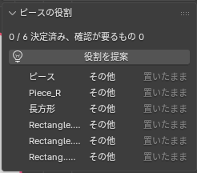

# ピースの役割（試験中）

このページは「試験中の機能」を使う人向けです。通常の「シミュレート」を使うために、役割を付ける必要はありません。フェーズシムと役割の欄は、アドオンの設定で「試験中の機能」をオンにしたときだけ表示されます。

## 役割の付け方

- Nパネルの「ピースの役割」に、服の種類、役割が決まった数、確認が必要な数が表示されます。
- 「役割を提案」は、縫い目のつながり・型紙の形・配置点・名前などから役割を提案します。自分で決めた役割は上書きしません。確認が必要な印は見直してください。
- 自分で指定する場合はピースを選び、ツールタブの「AC9 ピース」>「役割」から選びます。左右ペアの相方にも同じ役割が付きます。

## フェーズシムとの関係

「フェーズシム」は、身頃・衿・袖・付属品などの役割を使い、段を追って縫います。すべての段が終わると自動で止まります。「[着せる（実行）](run.md)」の試験中の機能から使います。

通常の「シミュレート」は、役割による縫う順番を使いません。置き方は「AC9 ピース」の「両端」など、現在の設定で決めます。折り角度は「[折り](fold-roles.md)」、動く・止まる・衝突する違いは「[ピースの状態と重ね着](pieces.md)」を参照してください。

## 以前のファイルを使うとき

以前のファイルには、役割を使って作られた輪や配置形、開始形の設定が残っている場合があります。試験中の機能をオフにしても、保存された設定や形を消す操作にはなりません。現在の配置形と「両端」などの欄を確かめ、必要なピースだけ置き直します。

「役割を変える」ことと「現在の形を作り直す」ことを同じ操作として扱わないでください。役割を通常の着装手順の必須工程にしたり、将来の自動着装を現在の機能として案内したりしません。
