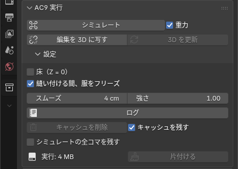
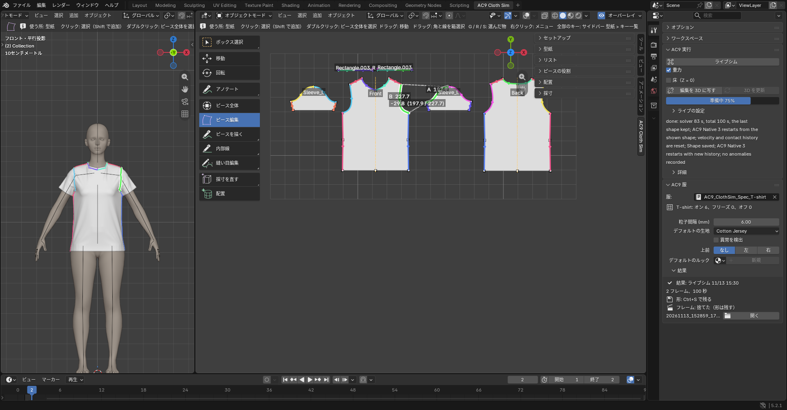

# 着せる（実行）

実行のボタンは、ツールタブのいちばん上の「**AC9 実行**」（AC9 Run）にまとまっています。いつも見えているのは「**シミュレート**」（Simulate）とその横の「**重力**」（Gravity）のチェック、「**編集を 3D に写す**」（3D Follows Edits）と「**3D を更新**」（Update 3D）（「直した型紙を着せた服に反映する」）、状態表示の1行です。「**手で直す**」（Fix by Hand）は、服の経過の再生が有効なときに表示されます。「**床（Z = 0）**」（Floor (Z = 0)）、ライブの筆の「ならす」「強さ」、状態表示の全文、ログ、「**キャッシュを削除**」（Delete Cache）と「**キャッシュを残す**」（Keep Cache）は閉じた「**設定**」（Settings）の中です。調整した形に戻す「**調整した形に戻す**」（Back to Adjusted Shape）は、ほかの「戻す」と一緒に「**配置**」（Placement）パネルにあります。着せるのも、直してから落ち着かせるのも「**シミュレート**」（Simulate）です。

## シミュレート（Simulate）

- 目的: 縫って着せる。直した型紙・手直しした形から続けて落ち着かせる。布を手でつまんで直す。
- 前提: Body が選ばれていて、「**ガイド検出**」（Detect Guides）で目安があること（なければボタンは灰色）。3D に配置済みのピースだけを計算します。未配置のピースとそれにつながる縫い目は、その回の計算から外れます。型紙のオン／オフ設定は変わりません。体を指定しなくても、平らに置いたピースだけなら回ります。
- 操作:「**シミュレート**」（Simulate）を押します。はじめて着せるときは、調整した形から縫い目を引き寄せて垂らします。着せた後は、画面の形から続けます（「**フリーズ**」（Freeze）したピースはそのまま）。型紙を直していれば、先に服へ写してから回ります。
- 止め方: 自動では止まりません。服が落ち着いたら、ボタン（「**停止**」（Stop）に変わっています）をもう一度押すか **Esc**。止まった所が結果になります。実行時間にコマ数の上限はありません。途中の経過を残す範囲には設定と記録上限があります（下の「経過を残す」）。
- 「**重力**」（Gravity）: 既定でオンです。回っている間にも切り替えられます。縫い目を先に閉じたいとき（衿や袖が落ちる前に縫い付けたいとき）は、重力を外して回し、縫い目が閉じたら重力を入れます。
- 「**床（Z = 0）**」（Floor (Z = 0)）: オンにすると、高さ 0 に床があるものとして布が乗ります（シーンには何も足しません）。回す前に決めます。「**設定**」（Settings）の中にあります。
- 「**縫い付ける間、服をフリーズ**」（Freeze Garment While Sewing）: 既定でオン、「**設定**」（Settings）の中にあります。縫い終わった服にピースを 1 枚（衿・帯など）置き直して回すと、そのピースが縫い付くまで服を止めます。縫い目がピースを服の方へ引き寄せるので、服が持ち上がりません。その間、服は「**フリーズ**」（Freeze）の色で塗られてつかめず、実行のボタンの下に 1 行出ます。ピースが縫い付くと服は動き出し、またつかめます。ピースが縫い目まで届かないときは、しばらくすると服の止めを解いて服の方からも寄せます。オフ: 服とピースが引き合い、服がピースの方へ持ち上がります。回す前に決めます。
- 回っている間、布を **Ctrl＋左ドラッグ**でつまんで引っぱれます（半径 2 cm）。布が布を突き抜けたときは、ドラッグ中に**Alt**を押すと、つかんだ布がほかの布をすり抜けます（押している間だけ）。Alt を押しながらつかみ始めると、マウスの下のピース 1 枚だけをつかみます。
- **Ctrl＋Shift＋左ドラッグ**は「**ならす**」（Smooth）ブラシです。ブラシの円の中の浮いた布を押さえ、ドラッグした向きへ運びます。しわは運んだ先へ送られ、裾や緩い所から抜けます（布の長さはそのまま。その場でしわを消す Sculpt の Smooth とは違います）。円の中で同じピースが自分を突き抜けて裏返っている所は、なでている間に元の向きへ戻します（折り線のそば、たとえばボックスプリーツの重なりは、わざと重なっている所なので触りません。別のピースとの交差は Ctrl＋Alt のすり抜けで直します）。半径と強さは「**設定**」（Settings）の「**ならす**」（Smooth）・「**強さ**」（Strength）で変えられます。「**フリーズ**」（Freeze）したピースと「**オフ**」（Off）のピースはつかめません（つかもうとすると、そう表示されます）。
- 回っている間に変えて効くものは、ボタン下の「今効く」の案内で確認します。重力、縫い目のオン/オフ、アクティブ/フリーズ、ピースのゴム、強化のオン/オフと倍率、条件を満たす折りの角度・方向・終端減衰が対象です。折りは[反映時期の表](fold-roles.md#when-settings-apply)、強化は[生地と服の設定](fabric.md)を参照してください。生地の物性や粒子間隔など、実行中の対象にない設定は次にシミュレートするときから使います。
- 期待結果: 計算中は服が画面で動き、ボタンの下に状態が出ます。止めると「done: …」と 1 行で出ます（全文は「**設定**」（Settings）の中）。
- 制限: 押してから布が動き始めるまで少し待ちます（パソコンによって変わります）。動き始めてからつまんでください。始まらないときは、状態表示に `… did not start: <理由>` が残ります。

## 試験中の機能（Experimental Features）

アドオンの設定（Edit → Preferences → Add-ons → AC9 Cloth Sim）の「**試験中の機能**」（Experimental Features）をオンにすると、まだ試している機能が出ます。既定はオフで、この説明書はオフの画面で書いています。

- 「**フェーズシム**」（Phase Sim）: 段を追って縫い、決まった段を全部終えたら自動で止まります。正常終了後に経過のコマを残すには「キャッシュを残す」をオンにします。オフでは最後の形だけが残ります。
- [ピースの役割（試験中）](roles.md): 役割の指定・提案とフェーズシムへの影響。通常のシミュレートには役割付けは不要です。
- 縫い目の引き寄せ方、ピースの「**レイヤー**」（Layer）。

## 調整した形に戻す（Back to Adjusted Shape、配置パネル）

- 調整した形（手で動かした分は残る）に戻します。シミュレーションは回しません。着せ直すときは「**調整した形に戻す**」（Back to Adjusted Shape）のあとに「**シミュレート**」（Simulate）。
- ピースを選んでから押すと、押した瞬間に、着た服の中のそのピースだけ（左右ペアは両方）が調整した形に戻ります。パネルに「Next: 2 piece(s) from placed」と出ます。次の「**シミュレート**」（Simulate）は、そのピースを今の形から縫い寄せ、ほかは結果の続きから回します。戻したピースを、つまみで動かしてから「**シミュレート**」（Simulate）してもかまいません。
- 何も選ばずに押すと、服全体の結果を外して調整した形に戻します（確認が出ます）。次の「**シミュレート**」（Simulate）は最初から着せます。
- 戻し方: Ctrl+Z で戻せます（ジョブのフォルダは残ります）。

## 手で直す（Fix by Hand）

- **スカルプトや編集モードで直す前に押します。** 画面に出ているコマを服の形そのものにして、そのままスカルプトモードに入ります（右の小さなボタンは編集モード）。直してから「**シミュレート**」（Simulate）を押すと、直した形から続きます。
- 使う場面: シミュレーションで衿が裏返った、布が体に食い込んだ、布どうしが絡んだなど、手で直したほうが早いとき。直したいコマはタイムラインで選びます。
- 押すと経過の再生は止まります（Ctrl+Z で戻る）。
- 出るのは経過を再生しているときだけです。経過を再生していないときは、服の形がそのままメッシュなので、押さずにスカルプトできます。
- 押し忘れて、再生中のままスカルプトや編集モードに入ると、ビューポートに赤い字で知らせが出て、このボタンも赤くなります（再生中は手で直しても形に出ません）。
- 直した形も、続きのシミュレーションでは縫い目・体・生地の力で落ち着く形へ寄っていきます。手で直した形を残したいときは、続きを短く止めます。

## 経過を残す {#recording-progress}

- 「**キャッシュを削除**」（Delete Cache）: 経過のコマとそのファイルを消します。服は今の形を保ち、そこから続けられます。消したコマは戻せません。
- 「**キャッシュを残す**」（Keep Cache）: 「AC9 実行 > 設定」またはアドオンの設定で確認します。既定はオンで、通常のシミュレートでも縫い付く間とその直後の経過を残します。オフでは、正常終了または自分で停止した後は最後の形だけを残します。失敗時の診断用記録は、この通常終了の扱いと分けます。
- 「**シミュレートの全コマを残す**」（Keep All Simulate Frames）: キャッシュを残すときに使えます。既定はオフ。オンでは縫い付けた後も記録しますが、途中の記録は最大1,500コマです。上限後も計算は続き、最後の形は残ります。停止までの全時間を必ず連続再生できるという意味ではありません。
- 縫う区間だけの記録では、その区間の終わりから最後の形へ再生が飛びます。開始と最後だけの記録になった場合は、経過を残しません。停止後に「結果」の経過表示を確認してください。
- 形はCtrl+Sで.blend内へ保存します。経過を別のPCへ渡すときは、対応する.blendの隣の `AC9_ClothSim_jobs` も必要です。.blendを別名保存しただけでは経過のバックアップにはなりません。削除を試す場合は、結果フォルダも別途退避します。

## 結果と状態表示

シミュレーションを止めると、ツールタブの「**AC9 服**」（AC9 Garment）の「**結果**」（Result）に、何の結果か（止めたものは `(stopped)`）、日時、コマ数と所要時間が出ます。

- `Shape: Ctrl+S to keep it` は、結果の形がまだ .blend に保存されていない印です（保存すると `Shape: saved in the blend`）。保存していないファイルなら `Shape: file never saved`。
- `Frames: on the timeline` は経過を再生できる印、「**手で直す**」（Fix by Hand）の後は `Frames: off (shape kept)`、経過を残さなかった実行や「**キャッシュを削除**」（Delete Cache）の後は `Frames: dropped (shape kept)`。
- いちばん下はジョブのフォルダ名で、「**開く**」（Open）で開きます。見つからない（.blend だけを渡した、など）と `Result: folder gone` と `Shape stays in garment` が出ます。形は服に残っていて、そこから続けられます。
- 状態表示の下の「**設定**」（Settings）を開くと、前回の状態表示の全文、ログの最後の数行、「**ログ**」（Log）（前回のログ全体）が出ます。おかしかったときは「**ログ**」（Log）の内容を添えてください。

## Accurate（研究用）

アドオン設定の **Experimental Features** をオンにすると、**AC9 Run** に **Accurate（研究用）／Accurate (Research)** が表示されます。既定はオフです。計算を止めてから切り替えてください。オフに戻すと従来方式へ戻り、選択は.blendに保存されます。

静止した体のシミュレート用の研究機能です。フェーズSim・ローカルSimの方式は変わりません。現実的な形や速度向上を保証せず、遅くなる場合があります。折った二重の布の戻り・張り出しには未解決の問題があります。
