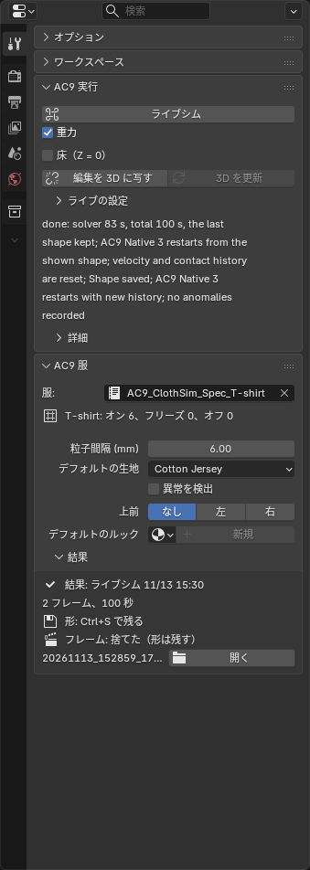
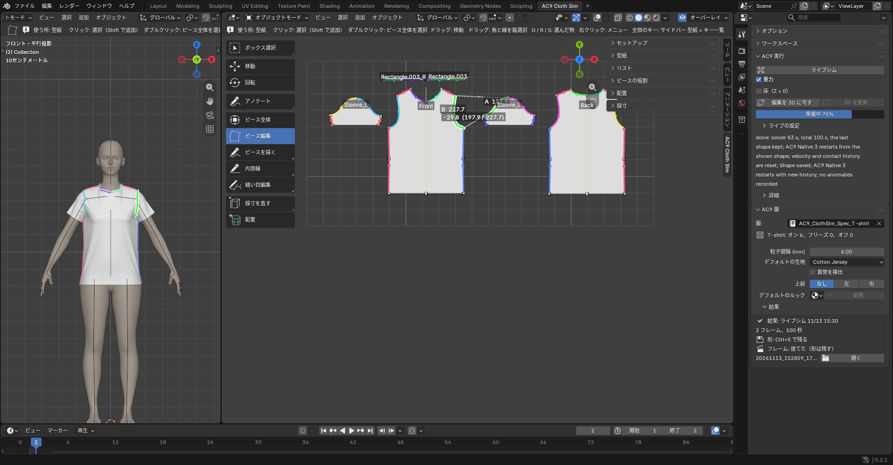

# 着せる（実行）

実行のボタンは、Tool タブのいちばん上の「**AC9 実行**」（AC9 Run）にまとまっています。上から「**ライブシム**」（Live Sim）とその下の「**重力**」（Gravity）のチェック、「**床（Z = 0）**」（Floor (Z = 0)）、「**編集を 3D に写す**」（3D Follows Edits）と「**3D を更新**」（Update 3D）（「直した型紙を着せた服に反映する」）、「**手で直す**」（Fix by Hand）です。ライブの筆の「スムーズ」「強さ」は閉じた「**ライブの設定**」（Live Options）の中、「**キャッシュを削除**」（Delete Cache）と「**キャッシュを残す**」（Keep Cache）は閉じた「**詳細**」（Details）の中です。置いた形に戻す「**置いた形に戻す**」（Back to Placed）は、ほかの「戻す」と一緒に「**配置**」（Placement）パネルにあります。着せるのも、直してから落ち着かせるのも「**ライブシム**」（Live Sim）です。

## ライブシム（Live Sim）

- 目的: 縫って着せる。直した型紙・手直しした形から続けて落ち着かせる。布を手でつまんで直す。
- 前提: Body が選ばれていて、「**ガイド検出**」（Detect Guides）で目安があること（なければボタンは灰色）。3D に配置済みのピースだけを計算します。未配置のピースとそれにつながる縫い目は、その回の計算から外れます。型紙のオン／オフ設定は変わりません。体を指定しなくても、平らに置いたピースだけなら回ります。
- 操作:「**ライブシム**」（Live Sim）を押します。はじめて着せるときは、置いた形から縫い目を引き寄せて垂らします。着せた後は、画面の形から続けます（「**フリーズ**」（Freeze）したピースはそのまま）。型紙を直していれば、先に服へ写してから回ります。
- 止め方: 自動では止まりません。服が落ち着いたら、ボタン（「**停止**」（Stop）に変わっています）をもう一度押すか **Esc**。止まった所が結果になります。コマ数の上限はありません。経過のコマは残らず、最後の形だけが残ります。
- 「**重力**」（Gravity）: 既定でオンです。回っている間にも切り替えられます。縫い目を先に閉じたいとき（衿や袖が落ちる前に縫い付けたいとき）は、重力を外して回し、縫い目が閉じたら重力を入れます。
- 「**床（Z = 0）**」（Floor (Z = 0)）: オンにすると、高さ 0 に床があるものとして布が乗ります（シーンには何も足しません）。回す前に決めます。
- 回っている間、布を **Ctrl＋左ドラッグ**でつまんで引っぱれます（半径 2 cm）。布が布を突き抜けたときは、ドラッグ中に**Alt**を押すと、つかんだ布がほかの布をすり抜けます（押している間だけ）。Alt を押しながらつかみ始めると、マウスの下のピース 1 枚だけをつかみます。
- **Ctrl＋Shift＋左ドラッグ**は「**ならす**」（Smooth）ブラシです。ブラシの円の中の浮いた布を押さえ、ドラッグした向きへ運びます。しわは運んだ先へ送られ、裾や緩い所から抜けます（布の長さはそのまま。その場でしわを消す Sculpt の Smooth とは違います）。円の中で同じピースが自分を突き抜けて裏返っている所は、なでている間に元の向きへ戻します（折り線のそば、たとえばボックスプリーツの重なりは、わざと重なっている所なので触りません。別のピースとの交差は Ctrl＋Alt のすり抜けで直します）。半径と強さは「**ライブの設定**」（Live Options）の「**ならす**」（Smooth）・「**強さ**」（Strength）で変えられます。「**フリーズ**」（Freeze）したピースと「**オフ**」（Off）のピースはつかめません（つかもうとすると、そう表示されます）。
- 回っている間に変えて効くもの: 折りの角度、縫い目の「**オン**」（On）／「**オフ**」（Off）、「**フリーズ**」（Freeze）、ピースの「**ゴム**」（Elastic）、「**重力**」（Gravity）。値は止めた後も残ります。ほかは次に押したときから効きます。
- 期待結果: 計算中は服が画面で動き、ボタンの下に状態が出ます。止めると「done: …」と出ます。
- 制限: 押してから布が動き始めるまで少し待ちます（パソコンによって変わります）。動き始めてからつまんでください。始まらないときは、状態表示に `… did not start: <理由>` が残ります。

## 試験中の機能（Experimental Features）

アドオンの設定（Edit → Preferences → Add-ons → AC9 Cloth Sim）の「**試験中の機能**」（Experimental Features）をオンにすると、まだ試している機能が出ます。既定はオフで、この説明書はオフの画面で書いています。

- 「**ライブシム**」（Live Sim）: 段を追って縫い、決まった段を全部終えたら自動で止まります。経過のコマがタイムラインに残ります。
- 「**ローカルシム**」（Local Sim）: 選んだピースだけを動かします。ほかのピースは「全部オフ」と同じ扱い、重力は既定でオフ。
- 「**Native 3**」の切り替え（既定はオン。受け付けない服のときは、通常の計算で回して 1 行知らせます）。
- 縫い目の引き寄せ方、ピースの「**レイヤー**」（Layer）。

## 置いた形に戻す（Back to Placed、配置パネル）

- 置いた形（手で動かした分は残る）に戻します。シミュレーションは回しません。着せ直すときは「**置いた形に戻す**」（Back to Placed）のあとに「**ライブシム**」（Live Sim）。
- ピースを選んでから押すと、押した瞬間に、着た服の中のそのピースだけ（左右ペアは両方）が置いた形に戻ります。パネルに「Next: 2 piece(s) from placed」と出ます。次の「**ライブシム**」（Live Sim）は、そのピースを今の形から縫い寄せ、ほかは結果の続きから回します。戻したピースを、つまみで動かしてから「**ライブシム**」（Live Sim）してもかまいません。
- 何も選ばずに押すと、服全体の結果を外して置いた形に戻します（確認が出ます）。次の「**ライブシム**」（Live Sim）は最初から着せます。
- 戻し方: Ctrl+Z で戻せます（ジョブのフォルダは残ります）。

## 手で直す（Fix by Hand）

- **スカルプトや編集モードで直す前に押します。** 画面に出ているコマを服の形そのものにして、そのままスカルプトモードに入ります（右の小さなボタンは編集モード）。直してから「**ライブシム**」（Live Sim）を押すと、直した形から続きます。
- 使う場面: シミュレーションで衿が裏返った、布が体に食い込んだ、布どうしが絡んだなど、手で直したほうが早いとき。直したいコマはタイムラインで選びます。
- 押すと経過の再生は止まります（Ctrl+Z で戻る）。
- 出るのは経過を再生しているときだけです。「**ライブシム**」（Live Sim）の後など再生していないときは、服の形がそのままメッシュなので、押さずにスカルプトできます。
- 押し忘れて、再生中のままスカルプトや編集モードに入ると、ビューポートに赤い字で知らせが出て、このボタンも赤くなります（再生中は手で直しても形に出ません）。
- 直した形も、続きのシミュレーションでは縫い目・体・生地の力で落ち着く形へ寄っていきます。手で直した形を残したいときは、続きを短く止めます。

## キャッシュを削除（Delete Cache）とキャッシュを残す（Keep Cache）

- 「**キャッシュを削除**」（Delete Cache）: 経過のコマとそのファイルを消します。服は今の形を保ち、そこから続けられます。消したコマは戻せません。
- 「**キャッシュを残す**」（Keep Cache）（アドオンの設定）: オフにすると、毎回最後の形だけを残し、経過のコマを消します。

## 結果と状態表示

シミュレーションを止めると、Tool タブの「**AC9 服**」（AC9 Garment）の「**結果**」（Result）に、何の結果か（止めたものは `(stopped)`）、日時、コマ数と所要時間が出ます。

- `Shape: Ctrl+S to keep it` は、結果の形がまだ .blend に保存されていない印です（保存すると `Shape: saved in the blend`）。保存していないファイルなら `Shape: file never saved`。
- `Frames: on the timeline` は経過を再生できる印、「**手で直す**」（Fix by Hand）の後は `Frames: off (shape kept)`、コマを消した後（「**ライブシム**」（Live Sim）、「**キャッシュを削除**」（Delete Cache）など）は `Frames: dropped (shape kept)`。
- いちばん下はジョブのフォルダ名で、「**開く**」（Open）で開きます。見つからない（.blend だけを渡した、など）と `Result: folder gone` と `Shape stays in garment` が出ます。形は服に残っていて、そこから続けられます。
- 状態表示の下の「**詳細**」（Details）を開くと、ログの最後の数行、「**ログ**」（Log）（前回のログ全体）、「**AC9 Cloth Retopo へ渡す**」（To AC9 Cloth Retopo）が出ます。おかしかったときは「**ログ**」（Log）の内容を添えてください。
