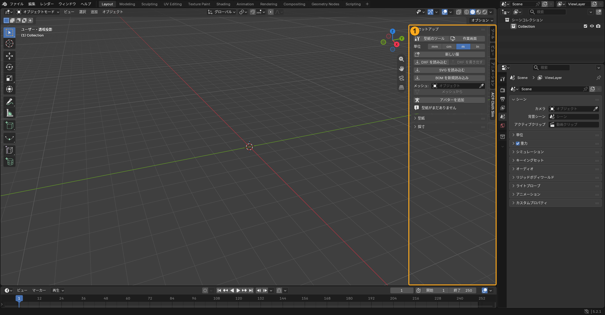
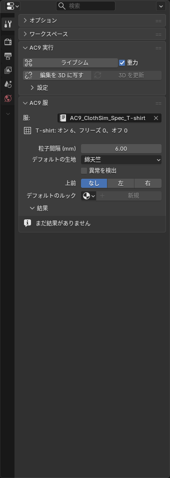
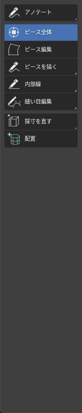
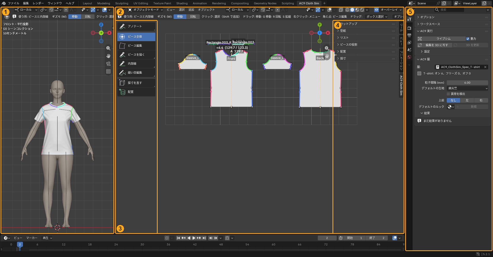

# 画面の配置

操作の場所は 3 か所に分かれます。

## サイドバー（3D ビューの N パネル、AC9 Cloth Sim タブ）

上から次のパネルが並びます。

- 「**セットアップ**」（Setup）: 型紙の読み込みと書き出し、作業画面の切り替え、服の切り替え。
- 「**型紙**」（Pattern）: 型紙を直す・描く・縫い目を付ける道具とボタンの道具（「**留め具**」（Fasteners））のボタン。
- 「**リスト**」（Lists）: 一覧を見て選ぶ場所。タブが 6 つあります（「**縫い目**」（Seams）、「**ピース**」（Pieces）、「**生地**」（Fabrics）、「**コリジョン**」（Collision）、「**テープ**」（Tapes）、「**留め具**」（Fasteners））。一覧は見て選ぶだけで、選んだ物の設定は Tool タブに出ます。行の名前をクリックで 1 つ、Shift＋クリックで足す・外す、はどの一覧も同じです。
- 「**ピースの役割**」（Piece Roles）（普段は閉じています）: ピースの役割。
- 「**配置**」（Placement）: 体と目安、置く道具。
- 「**採寸**」（Measure）（普段は閉じています）: 採寸。中に「**寸法の確認**」（Size Check）。
- 「**オーバーレイ**」（Overlays）は 3D ビューのヘッダー（右上）にある目のボタンと、その右の一覧から開きます。

## Properties エディタの Tool タブ

選んだものの設定が、右下の Properties エディタの Tool タブに出ます。出るパネルは、最後に触った物で切り替わります。

- 「**AC9 実行**」（AC9 Run）: いちばん上に常に出ます。「**ライブシム**」（Live Sim）と「**重力**」（Gravity）、型紙の直しを写す「**編集を 3D に写す**」（3D Follows Edits）と「**3D を更新**」（Update 3D）、短い状態表示があります。「**床（Z = 0）**」（Floor (Z = 0)）などの設定と、状態の全文・ログは閉じた「**設定**」（Settings）の中です。「**手で直す**」（Fix by Hand）は経過のコマを編集できるときに出ます。
- 「**AC9 服**」（AC9 Garment）: 何も選んでいないとき。服の設定、生地、結果。
- 「**AC9 ピース**」（AC9 Piece）: ピースを選んだとき。名前、状態、役割、生地、芯地、見た目、厚み、点の間隔など。
- 「**AC9 縫い目**」（AC9 Seam）: 一覧か型紙で縫い目を選んだとき。下に「**長さと合印**」（Lengths & Notches）と「**ブレンド**」（Blend）。
- 「**AC9 内部線**」（AC9 Internal Line）: 型紙の内部線をクリックして選んだとき。
- 「**AC9 辺**」（AC9 Edges）: 型紙の外周の辺・角・内部線の点をクリックして選んだとき（長さと合計、角と点の数、選んだ物を別のピースのものもまとめて X・Y で動かす「**数値入力…**」）。
- 「**AC9 生地**」（AC9 Fabric）と「**AC9 芯地**」（AC9 Interlining）:「**リスト**」（Lists）の「**生地**」（Fabrics）タブで生地か芯地の行を押したとき。
- 「**AC9 ボタン**」（AC9 Button）:「**リスト**」（Lists）の「**留め具**」（Fasteners）タブでボタンを選んだとき。
- 「**AC9 採寸**」（AC9 Measurement）: 採寸の線や巻き尺を選んだとき。

Blender 標準の Options や Workspace のパネルが先に出ることがあります。畳めば 1 行ずつになります。

## 左の道具の列（ツールバー）

オブジェクトモードの道具の列の末尾に、AC9 の道具が並びます。長押しで同じ仲間の道具が出ます（▾）。

`Whole Pieces ｜ Edit Pieces ｜ Draw Piece ▾ Rectangle Piece ▾ Ellipse Piece ｜ Internal Line ▾ Internal Rectangle ▾ Internal Ellipse ｜ Edit Seams ▾ Add Seam ▾ Add Seam (M:N) ── Edit Measure ▾ Tape Around ▾ Tape Along ▾ Tape Straight ｜ Place`

- 区切り線より前の型紙の道具は、「**セットアップ**」（Setup）パネルの「**型紙のツール**」（Pattern Tools）をオンにしたときだけ出ます。型紙を読み込むか描くと、そのファイルで一度だけ自動でオンになります（自分で切ればオフのまま）。ほかのパネルの道具のボタンを押したときも、自動でオンになります。
- 道具を持つと、道具のオプション行に「Works on: …」（使える相手）と、その道具の操作キーが出ます。「**ピース編集**」（Edit Pieces）では、カーソルの下にある物に効くキーだけが出ます（全部のキーは「**型紙**」（Pattern）パネルの下の「**キー一覧**」（Keys））。使えない相手の上にカーソルを置くと、カーソルの横に黄色の案内が出ます。
- 道具は、クリックした相手で働きを変えます（型紙、体、着た服など）。
- 「**作業画面**」（Work Screen）の真ん中の型紙のビューでは、道具の列に AC9 の道具と、Blender の Annotate だけが出ます（ほかの道具は見えないだけで、キーは効きます）。ピースを選ぶ・動かす・回すのは「**ピース全体**」（Whole Pieces）です。
- Blender 標準の選択の道具（クリック・箱・投げ縄・円）では、ピースは選ばれません（選んでいたピースは外れます）。コリジョンや体などの普通のオブジェクトは、今までどおり選べます。アウトライナーでピースのオブジェクトを押すと、そのピースが選ばれます。
- 「**リスト**」（Lists）の「**コリジョン**」（Collision）に加えた物は、「**ピース全体**」（Whole Pieces）でクリックしても選べ、ギズモや G／R で動かせます。加えるときは「**追加**」（Add）の欄のスポイトで、3D ビューの物をクリックします。
- 標準の道具で着た服を押すと、服全体の 1 つのオブジェクトが選ばれます。そのときは Tool タブの「AC9 Garment」の上に「服全体を選択中」と「**ピース全体**」（Whole Pieces）のボタンが出ます。
- **右クリック**: 操作の途中なら取り消しです。何もしていないときは、カーソルの下の物に使えるメニューが出ます（「**ピース全体**」（Whole Pieces）・「**ピース編集**」（Edit Pieces）・「**縫い目編集**」（Edit Seams）・「**配置**」（Place）・「**採寸を直す**」（Edit Measure）と、着た服の上）。右クリックした物が先に選ばれ、メニューの項目はキーやボタンと同じ働きです。
- サイドバーの道具のボタンは、押されている物をもう一度押すと「**ピース全体**」（Whole Pieces）に戻ります。
- **X** と「**削除**」（Delete）は、AC9 の道具を持っているとき、カーソルの下の角・合印・内部線の端を消します。無ければ選んでいる内部線・縫い目・採寸を消します。ピースは確認が出てから消えます。オブジェクトそのものは消しません。

## 作業画面（Work Screen）

「**セットアップ**」（Setup）パネルの「**作業画面**」（Work Screen）を押すと、作業用のワークスペース（名前は AC9 Cloth Sim）が出ます。左に 3D、真ん中に型紙（真上から見る平行投影、回転は固定）、右に Properties の Tool タブが並びます（Outliner はなく、下にタイムラインがあります）。2 回目からは同じ画面に切り替えるだけで、増えません。前の版のアドオンで作った作業画面は、押したときに新しいものへ置き換わります。型紙を直す作業は、この真ん中の 3D ビューで行います。

作業画面の 2 つのビューでは、Blender の「オブジェクトのギズモ」がオンになります。「**ピース全体**」（Whole Pieces）で置いたピースや着た服のピースを選ぶと、その上にギズモが出ます（平らな型紙には出ません）。ギズモは移動か回転の片方ずつ出ます（両方を一度に出すと矢印が欠けて見づらいため）。道具のヘッダー（ビューの上）の「**ギズモ**」（Gizmo）で切り替えるか、**W** を押します。ほかのワークスペースのビューでは設定を変えません。そこでギズモを使うときは、3D ビューの右上のギズモのメニューで「オブジェクトのギズモ」の移動と回転をオンにします。

