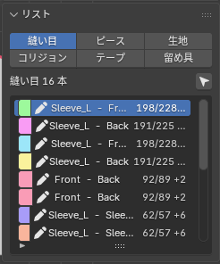

# 縫い目

このパネルでやること: どこがどこと縫われるかを確かめる、足す、直す。縫い目は型紙を読み込んだときにできますが、間違っていることもあるので、ここで見ます。

3Dの縫い目は、両側の縫い辺と、その対応をつなぐ線で表示します。配置中のピースとシミュレーション済みのピースの間も、それぞれ現在表示されている形をつなぎます。ピースを動かしたり頂点を編集したりすると線も追従します。画面から隠したピースとの接続は表示しません。

## 縫い目とは

縫い目 1 本は「ピース A の外周（または内部線）のこの区間」と「ピース B のこの区間」を縫い合わせる指定です。区間は外周の辺と割合で持っているので、網目を作り直しても縫い目は壊れません。片側を A 側、もう片側を B 側と呼びます。

## 一覧

「**リスト**」（Lists）の「**縫い目**」（Seams）タブに 1 行 1 本で並びます。左から、縫い目の色の四角、名前（ラベル）、`A 側の長さ / B 側の長さ`（mm）、差があれば差（mm）。左のアイコンは、警告（確かめてほしい）、鉛筆（自分で足した）、鎖（BOM から読んだ）、空の四角（off、縫わない）です。

- 上の行に「○ seams, ○ to check」が出ます。BOM の縫い目は服のまとまりごとに持ち、ピースの on／off では変わりません（まとまりを直すと作り直され、自分で足した・確認した縫い目は残ります）。
- 一覧の右上の矢印のボタンで、選んだピースの縫い目だけに絞れます（既定はオフ）。
- 縫い目を選ぶと、右下の Tool タブに「**AC9 縫い目**」（AC9 Seam）が出ます。型紙の上でも、縫い目は色分けされます（確かめてほしいものはオレンジ、off は灰色）。

## 縫い目編集の道具（Edit Seams）

「**型紙**」（Pattern）パネルの「**縫い目編集**」（Edit Seams）（または左の道具の列）で持ちます。型紙の上で使います。

- クリックで縫い目を選びます。同じ所をもう一度クリックすると、重なった次の縫い目。縫い目以外の所をクリックすると、選択が外れます。
- Shift＋クリックで縫い目を足す・外す（一覧の名前の Shift＋クリックも同じ）。2 本以上選んでいる間、Tool タブには本数と「**オン**」（On）／「**オフ**」（Off）、「**削除**」（Delete）だけが出て、選んだ全部に効きます。ダブルクリックでピース全体を選びます。
- 「**縫い目編集**」（Edit Seams）を持っている間は、全部のピースの内部線も細く出ます（縫い目の端を合わせる目安）。
- 選んだ縫い目の端（白い点）をドラッグすると、区間が変わります。外周・内部線に沿って動き、角・合印・ほかの縫い目の端に吸い付きます（Ctrl で吸着なし）。
- 選んだ縫い目の両端を点線で結び、両側の長さと差を出します。
- **M**: カーソルの下の側を、別の場所へ付け替えます（行き先をクリック。**F** で向き）。付け替えた所は、続きの「**ライブシム**」（Live Sim）で新しく縫う扱いになります。
- **N**: 合印とその相手を置きます。**Ctrl+N** は片側だけ。**X** または「**削除**」（Delete）: 選んだ縫い目を消します。
- 戻し方: Ctrl+Z。

## 縫い目を追加（Add Seam）と縫い目を追加 (M:N)（Add Seam (M:N)）

- 「**縫い目を追加**」（Add Seam）: 片方のピースの外周で始点と終点をクリックし、次に相手のピースで（同じ端から）始点と終点をクリックします。4 点で両側の長さと差が出るので、見直して Enter（またはもう一度クリック）で足します。辺の途中をクリックすると、その辺を丸ごと取ります（途中の点は Ctrl＋クリック）。点は角と合印に吸着するので、合印から合印まで縫えます。区間が逆回りに取られたときは **F** で向きを逆にします。Backspace で 1 歩戻り、Esc／右クリックで取り消し。足した縫い目は「U1」「U2」…という名前になります。
- 「**縫い目を追加 (M:N)**」（Add Seam (M:N)）（「**型紙**」（Pattern）パネルでは「**M:N を追加**」（Add M:N））: 片側が何本かの区間でできている縫い目を足します。側 A の区間ごとに始点と終点をクリックし、Enter で反対側へ。側 B も同じようにして Enter で足します。両側はつないだ長さの割合で切り分けられ、1 対 1 の縫い目の束（同じグループ）として入ります。

## 選んだ縫い目の設定（AC9 Seam）

- 上に縫い目の名前と、確かめてほしい理由（赤）。同じ 2 本を縫う重複があれば警告が出ます。
- A、B それぞれのピース名（名前があれば名前と、かっこに番号）、区間、長さ。型紙の上にも A・B の札が出ます。
- 「**長さを合わせる:**」（Fit the length of）の **A**／**B**: 押した側の長さを、もう片側（といせ）に合わせます。区間の端が角なら角が辺に沿って動き、辺の途中なら端が滑ります。
- 「**向きを反転:**」（Flip the direction of）の **A**／**B**: その側の向きを逆にします。縫い目がねじれて縫われるときに使います。
- 「**オフ**」（Off）または「**オン**」（On）: その縫い目を縫わない／縫う。
- 「**確認**」（Confirm）: 確かめた印を付けます（警告が消える）。警告のある縫い目にだけ出ます。
- 「**削除**」（Delete）: 縫い目を消します。
- 「**折り (°)**」（Fold (deg)）: 縫い目をまたいで 2 枚が保つ角度（＋は山、0 で無し）。変えると置いた形がその場で折れます。「**倒す側**」（Turns）で回るピースを選びます。一直線に続く縫い目は同じ角度になります。折れないときは理由が出ます。
- 「**引く**」（Pull）: 引き寄せ方。「**直線**」（Straight）か **Round**（体の部位のまわりを通る。「**部位**」（Part）で部位）。

## 縫い目の長さと合印（Lengths & Notches）

選んだ縫い目について、A 側と B 側の長さ、いせ（長さの差、mm と %）、合印の数を出します。対になっていない合印があると赤く出ます。合印で区切った区間ごとに、A／B の長さ、その区間のいせ、そこまでの合計を表で出します。

- 「**反対の端から**」（From the other end）: 反対の端から数えます。
- 「**合印を並べる:**」（Lay the notches of）の **A**／**B**: 押した側の合印を、もう片側と同じ割合の位置に置きます（いせは区間に按分）。
- 「**BOM から合印**」（Notches from BOM）: BOM の合印を型紙に読み込みます（今ある合印は残る）。BOM から読んだ服にだけ出ます。

## 縫い目の端のなめらかなつながり（Blend）

2 枚のピースを縫い目で並べたとき、縫い目の端で外周が折れてつながる（角ができる）ことがあります。「**ブレンド**」（Blend）の欄で、縫い目の両端（From と To）の折れ具合（kink、度）を確かめ、「**ブレンド**」（Blend）を押すと、その端から 30 mm ぶんの外周を 2 枚で半分ずつ曲げて、なめらかにつなげます（左右ペアも）。角でない所や直せない理由があるときは、ボタンの代わりに理由が出ます。
