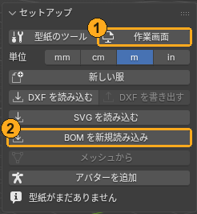

# セットアップ（型紙の読み込み）

このパネルでやること: 型紙を Blender に持ってくる、服を分けて使うピースを選ぶ、作業画面を出す。

## 単位（Units）

- 「**単位**」（Units）の **mm**・**cm**・**m**・**in**: 長さをすべてこの単位で表示します（型紙の上の寸法、採寸の表、ダーツの幅や線の距離などの入力欄）。入力欄には単位を付けて打てます（例 `5cm`）。ドラッグ中に打つ数値もこの単位で読みます。「**粒子間隔 (mm)**」（Particle Distance (mm)）だけは mm のままです。
- 変わるのは表示だけで、型紙の大きさは変わりません。
- 「**新しい服**」（New Garment）と各読み込みは、新しいシーンを mm にします。

## BOM を新規読み込み（Import BOM）

- 目的: 3D の服のソフトが書き出した `BOM.xml` から型紙を読み込む。
- 前提: `BOM.xml` のファイルがあること。
- 操作:「**BOM を新規読み込み**」（Import BOM）を押し、`BOM.xml` を選びます。現在のBOMの服の3D・配置・保存した配置形は破棄されます。体・別の服・ディスク上の計算結果は消しません。失敗した場合は元の状態を保持します。
- 期待結果: 型紙が床に平らに並びます。BOM に入っている縫い目も読み込まれ、「**縫い目**」（Seams）の一覧に出ます。画面に「○ pieces, ○ seams」と出ます。
- 1 つの BOM に何着ぶんも入っているときは、読み込むときにピースを服ごとのまとまりに分け、縫い目の相手はそのまとまりの中で決めます（別の服のピースと縫い合わせない）。分類が不確かなまとまりはオレンジで示します。
- BOM の Hole の形（ダーツの菱形など）は、ピースから切り抜かれます（そこには布がありません）。
- 共用の線でピースを自分自身に縫う偽の縫い目は、取り込みません。帯の両端を閉じて輪にする縫い目は残ります。

## BOM から縫い目を更新（Update BOM Seams）

着装形を保持して縫い目を読み直す場合に使います。「服」の欄の下の「**BOM から縫い目を更新**」（Update BOM Seams）を押します。読み込み元のBOMの縫い目と自動分類を更新します。

<!-- screenshot: 読み込んだ直後の型紙 -->

- 保持: 着装形、配置、ピースのオン／オフ・凍結、生地、役割、折り、手動の縫い目・服分類・名前。
- 全ピースの形と参照が一致する場合だけ更新します。BOMの2Dレイアウトの平行移動は許容し、現在の型紙の配置は保持します。
- ピース・形状・辺や内部線のIDが変わった場合、または手設定や参照のある縫い目が消える場合は、変更せず理由を表示します。
- 更新した縫い目で落ち着かせるには、続けてライブシムを実行します。
- 新規読み込みでは、旧3Dを共有していた設定の別版も「previous」の名前で退役します。旧版を選んでも古い配置や結果は復活しません。

## DXF を読み込む（Import DXF）と DXF を書き出す（Export DXF）

- 「**DXF を読み込む**」（Import DXF）: DXF-AAMA 形式の型紙を、新しい服として読み込みます。外周、角（ターンポイント）、内部線、合印、ピース名が入ります。
  - 縫い目は DXF に入っていないので、読んだ服には縫い目がありません。「**縫い目編集**」（Edit Seams）と「**縫い目を追加**」（Add Seam）で縫い合わせます。
  - 読まないもの（読んだ後の報告に数が出ます）: 地の目線、内側の切り抜き（ダーツの穴など）、ほかのサイズ（段階を付けた DXF は基準サイズだけ）。
  - 今は新しい服として読むだけです。今の服のピースを、縫い目を残したまま差し替える読み方はありません。
- 「**DXF を書き出す**」（Export DXF）: 型紙を DXF-AAMA で書き出します。外周、角、内部線、合印、ピース名が入ります。縫い目は DXF に入らず、AC9 側に残ります。AC9 で書き出した DXF を読み戻すと、ピース名・辺の番号・合印の番号がそのまま戻ります。

## SVG を読み込む（Import SVG）

- 「**SVG を読み込む**」（Import SVG）: 描画アプリで描いた型紙や、型紙ジェネレーターが書き出した SVG を、新しい服として読み込みます。外周、角、内部線、合印、ピース名が入ります。
  - ピースはレイヤーではなく描いた線で分けます。ほかの線の中に入っていない閉じた線が 1 枚のピースで、その中の線・印がそのピースのものです。ピース名は、中にピースが 1 枚だけのレイヤー・グループの名前、無ければピースの中の文字です。
  - 仕上がり線を縫い代の幅（だいたい 2〜40 mm）で囲む裁断線があれば、仕上がり線を外周にして裁断線は読みません。閉じた線が 1 本だけのピースは、その線を仕上がり線として読みます。
  - 合印は、外周か裁断線に触れる 15 mm 以下の短い線、外周の上の小さな丸、名前に notch の付いたシンボルです。
  - 読まないもの（読んだ後の報告に数が出ます）: 矢印の付いた線（地の目線など）、ボタン・穴などの小さな印、補助線、どのピースにも入らない線。
  - 単位: 幅・高さに mm・cm・in・pt があればそのとおり。px か単位なしなら、ポイントで描く描画アプリのファイルは 1 単位 = 1 pt、それ以外は 1/96 インチとみなします。違っていたら、ファイルを選ぶ画面の「単位」（Units）で選び直します。報告に「1 単位 = ○ mm」が出ます。
  - 縫い目は SVG に入っていないので、「**縫い目編集**」（Edit Seams）と「**縫い目を追加**」（Add Seam）で縫い合わせます。

## メッシュから（From Mesh）

- 目的: Blender で服を直接モデリングした場合（BOM が無い服）に、縫える型紙と縫い目へ変えて、シミュレーションできるようにする。
- 前提:
  - 服のメッシュは、厚みの無い面 1 枚で作り、袖口や裾は開いたままにします。モディファイアは、見えている形がそのまま使われます。
  - 型紙を分けたい所（脇・肩など）に **UV シーム**を入れて展開しておきます。UV の島 1 つが型紙 1 枚になり、2 つの島が接している辺が縫い目になります。
  - 「**配置**」（Placement）パネルの「**体**」（Body）に体を選んでおきます（選んでいないとボタンは押せません）。
  - 服のメッシュをアクティブにします（体とは別のオブジェクト）。
- 操作: 服のメッシュを選んで「**メッシュから**」（From Mesh）。
- 期待結果: 床に平らな型紙が並び、着た状態の服 `AC9_Garment_<名前>` ができて、モデリングした形のまま体に着た状態で始まります。元のメッシュは非表示になります。画面に「○ pieces, ○ seams」と、体の中に入っている点の数が出ます。入っている所は赤く塗られます。
- 続けて「**ライブシム**」（Live Sim）を押すと、布として垂れて落ち着きます。
- 制限: 「作った形のまま」の状態で、布として落ち着いてはいません。UV を展開していないと、UV が無いという旨のエラーで止まります。

## アバターを追加（Add Avatar）

- 目的: 着せる体が手元に無いときに、アドオン付属のアバター（CC0）を使う。
- 操作:「**アバターを追加**」（Add Avatar）を押します。今のシーンに、コレクション「AC9 Avatar」（体・リグ・目）が足されます。ファイルを開き直すのではないので、シーンのほかの物はそのままです。
- 期待結果: 体が選ばれた状態になり、「**配置**」（Placement）パネルの「**体**」（Body）が空なら、この体が入ります。続けて「**ガイド検出**」（Detect Guides）へ進めます。
- 2 回押すと 2 体目が足されます（名前の後ろに .001 が付きます）。
- 体はリグ（AC9 Avatar Rig）で動きます。A ポーズの開きを変える、T ポーズにするなどは、着せる前にポーズモードでリグを動かします（着せている間にアバターが動くこと、つまりアニメーションには、まだ対応していません）。

## 新しい服（New Garment）

ピースが 1 枚も無い新しい服を始めます。続けて「**ピースを描く**」（Draw Piece）で描きます。

## 服の欄（Garment）と使うピース

- 「**服**」（Garment）: いま扱う服（型紙データ）を選ぶ欄です。切り替えると、型紙、縫い目の一覧、配置など、パネルの表示がその服のものに替わります。重ね着では、1 着ずつここで切り替えます。
- `<服の名前>: 13 / 20 pieces on` は、使う（on の）ピースの数と全部の数です。
- 「**全部オン**」（All On）: 全部のピースを on にします（機能名は All Pieces）。
- シミュレーションで縫うのは on のピースだけです。off のピースは灰色の半透明で出ます。
- 「**スペックを読み直す**」（Reload Spec）: 型紙データ（テキストの JSON）を読み直して、画面の型紙を作り直します。JSON を手で直したときに押します。JSON が壊れていると、パネルに「The spec text is not valid JSON」と、どこがおかしいかが出ます。

## 服のまとまり（1 つの BOM に何着も入っているとき）

まとまりが 2 つ以上あると、「**服**」（Garment）の欄の下に 1 まとまり 1 行で並びます。行の名前と `(on の数/ピースの数)`、右の鉛筆で名前を変えます。オレンジの行は、配置から分けたので確かではないまとまりです。1 枚だけのピースは「Pieces alone (○)」の 1 行にまとまります。

使う 1 着だけを on にする手順:

1. 使うまとまりの行を押します（そのまとまりのピースが選ばれます。Shift で足す）。
2. ピースを選んだまま、Tool タブの「**AC9 ピース**」（AC9 Piece）の **State** で「**アクティブ**」（Active）を押します。
3. **State** の行の「**選択を反転**」（Invert Selection）で選択を反転し、「**全部オフ**」（Off All）を押します。

縫い目を読み直す場合は「BOM から縫い目を更新」を使います。手動の分類訂正が必要な場合だけ、ピースを選んでF3の「選択から服を作る」（Garment from Selection）を使えます。通常パネルにはありません。

## 表示

- 「**オーバーレイ**」（Overlays）（目のボタンと一覧）: アドオンが画面に描くものを切り替えます。一覧は「**縫い線**」（Seam Lines）、「**縫い目の長さ**」（Seam Lengths）、「**合印**」（Notches）、「**ピースの色**」（Piece Colors）、「**生地の色**」（Fabric Colors）、「**ピースの名前**」（Piece Names）、「**ガイド**」（Guides）、「**採寸**」（Measurements）、「**診断**」（Diagnose）の「**問題**」（Problems）（アドオンが見つけた問題を赤で。既定でオン）と「**伸び**」（Stretch）（型紙からの伸びを色分け。1.05 倍まで色なし、1.2 倍で黄、1.5 倍で赤、縮みは青）。さらに「**厚み**」（Thickness）（着た服に布の厚みを見た目だけ付ける。シミュレーションには使いません）と、厚みの付く側（「**内側**」（Inside）、「**中央へ**」（Center）、「**外側**」（Outside））があります。
