# はじめての 1 着

何も無い状態から、T シャツの型紙を自分で描いて、付属のアバターに着せるまでを通します。
ボタンの名前は「日本語表示の名前」（英語表示の名前）の順に書いています。Blender の操作に慣れていない方は、先に [Blender の基本](blender-basics.md) を読んでください。

<!-- video: はじめての 1 着（章ごとに 1〜2 分） -->

作る型紙は 6 枚です。

| ピース | 作り方 |
|---|---|
| 前身頃 | 長方形を描いて、角を動かして形にする |
| 後ろ身頃 | 前身頃を複製して、衿ぐりを直す |
| 袖（左右） | 片方を描いて、ミラーコピーで左右ペアにする |
| 衿ぐりのリブ（左右） | 細い長方形を描いて、ミラーコピー |

## 用意するもの

- AC9 Cloth Sim を入れた Blender 5.2（入れ方は「[インストール](install.md)」）。体も型紙も要りません。体は付属のアバター（CC0）を使います。

自分の体（アバター）や、ほかのソフトで作った型紙（`BOM.xml`・DXF・SVG・服のメッシュ）から始めるときは、最後の「ほかの始め方」を見てください。

## 1. 作業画面に入る

1. Blender を起動して、新しいファイルのまま、**最初に別の名前で保存します**（**Ctrl＋Shift＋S**）。シミュレーションの経過は、保存した .blend の隣にできるフォルダに残ります。
2. 3D ビューポートで **N** を押してサイドバーを出し、「AC9 Cloth Sim」のタブを開きます（[Blender の基本](blender-basics.md)の「作業画面にたどり着くまで」）。
3. 「**セットアップ**」（Setup）のパネルの「**作業画面**」（Work Screen）を押します。左に 3D、真ん中に型紙、右に Tool タブが並んだ画面になります。

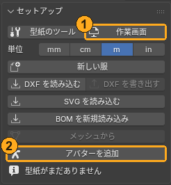

## 2. アバターを読み込んで、採寸する

1. 「**セットアップ**」（Setup）の「**アバターを追加**」（Add Avatar）を押します。左の 3D にアバターが入り、「**体**」（Body）の欄にも設定されます。
2. サイドバーの「**採寸**」（Measure）のパネルで「**体を採寸**」（Measure Body）を押します。バスト・ウエスト・ヒップ・首・腕などの寸法が表に出て、測った場所が体のまわりに線で描かれます。

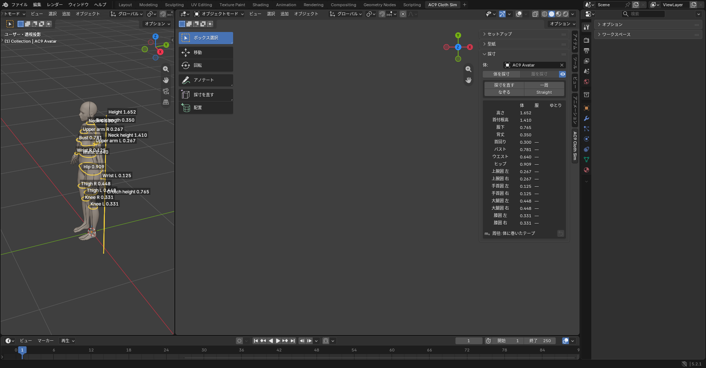

この寸法を、これから描く型紙の大きさの目安にします。たとえば前身頃の幅は「バストの 1/4＋ゆとり」くらいです。長さの単位は「**セットアップ**」（Setup）の「**単位**」（Units）で変えられます。

## 3. 前身頃を長方形から作る

1. 「**セットアップ**」（Setup）の「**新しい服**」（New Garment）を押します。ピースが 1 枚も無い服ができます。
2. 「**型紙**」（Pattern）のパネルの「**ピース**」（Piece）の「**長方形**」（Rectangle）を押し、真ん中の型紙のビューでドラッグして長方形を描きます。大きさを数字で決めるときは、描き始めてから幅を打って **Tab**、高さを打って **Enter** です。
3. 「**ピース編集**」（Edit Pieces）を押して、角をドラッグして形にします。
   - 辺の上で **K** を押すと、そこに点が足せます（肩先・脇の下の点など）。
   - 辺の上で **C** を押すと、その辺がカーブになります。取っ手をドラッグして、衿ぐりと袖ぐりを丸くします。
   - 動かしている間は、長さと周りまでの距離が mm で出ます。数字を打つと、その長さで止まります。
4. 名前を付けます。ピースを選んで **F2** か、Tool タブの「**AC9 ピース**」（AC9 Piece）のいちばん上の欄に「Front」などと入れます。

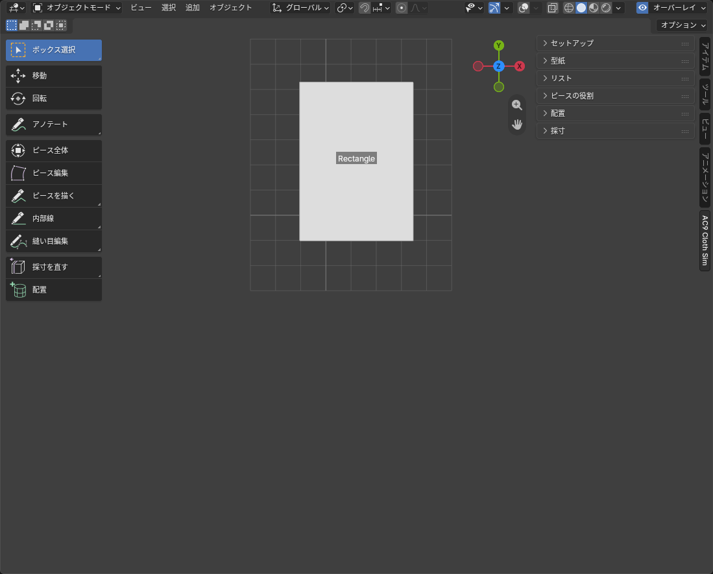
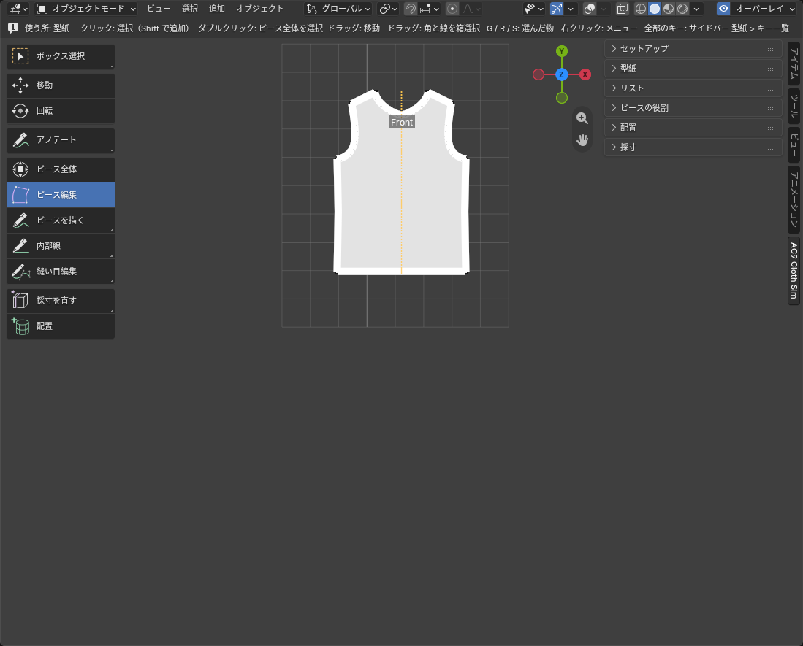

左右対称のピースは、Tool タブの「**対称編集**」（Symmetric Edit）をオンにすると、片側の角を動かすだけで反対側も鏡で動きます（詳しくは「[型紙を直す・描く](features/pattern.md)」）。

## 4. 後ろ身頃を複製で作る

1. 前身頃を選んで、「**選んだピース**」（Selected Pieces）の「**複製**」（Duplicate）を押します（**Shift＋D** でも同じ）。写しはマウスに付いてくるので、前身頃の横でクリックして置きます。
2. 「**ピース編集**」（Edit Pieces）で、衿ぐりを浅く直します（後ろの衿ぐりは前より浅い）。
3. 名前を「Back」にします。

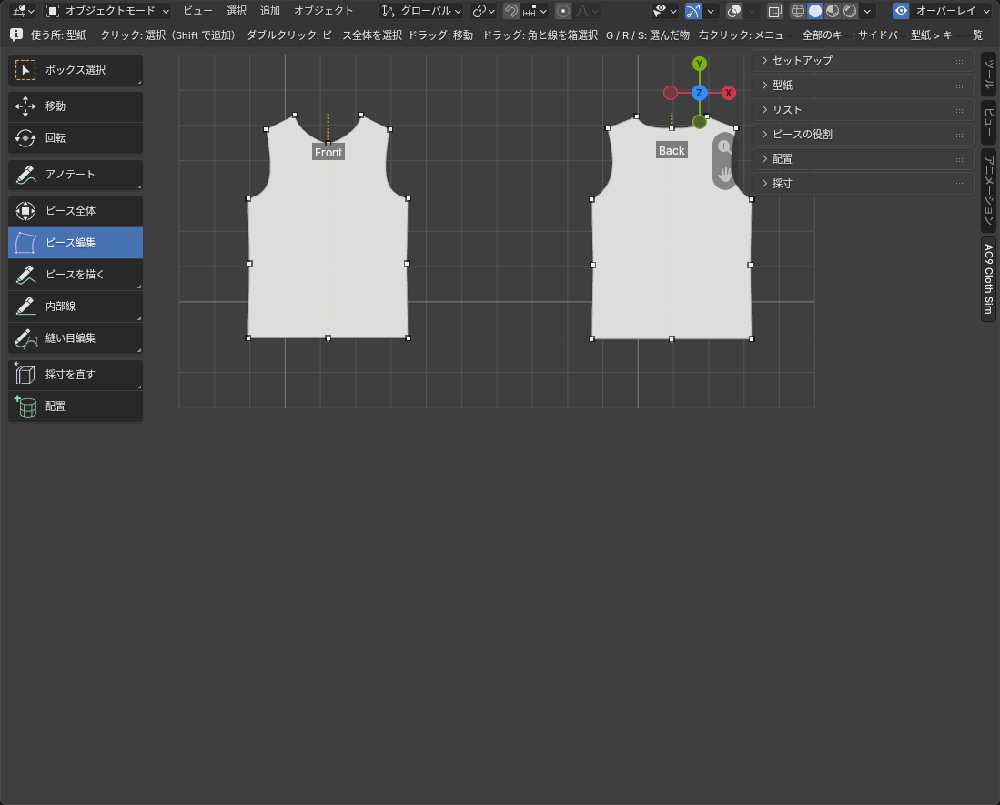

## 5. 袖を左右ペアで作る

1. 「**ピース**」（Piece）の「**描く**」（Draw）を押し、角を順にクリックして片方の袖を描きます。最初の角をもう一度クリック（か **Enter**）で閉じます。
2. 「**ピース編集**」（Edit Pieces）で、袖山の辺を **C** でカーブにして丸くします。
3. 袖を選んで、「**選んだピース**」（Selected Pieces）の「**ミラーコピー**」（Mirror Copy）を押します。鏡写しのもう片方ができ、2 枚が左右ペアになります。ペアは、片方を直すともう片方も鏡で直ります。
4. 衿ぐりのリブも同じように作ります。細い長方形（長さは衿ぐり 1 周の半分くらい、幅は 1〜2 cm）を描き、「**ミラーコピー**」（Mirror Copy）で左右の 2 枚にします。1 枚が、前中心から後ろ中心までの衿ぐりの片側を受け持ちます。

## 6. 縫い目を付ける

1. 「**型紙**」（Pattern）のパネルの「**縫い目を追加**」（Add Seam）を押します。
2. 片方のピースの外周で始点と終点、相手のピースで始点と終点の順にクリックします（**両方とも同じ端から**）。辺の途中をクリックすると、その辺を丸ごと取ります。4 点で両側の長さと差が出るので、見直して **Enter** で足します。区間が逆回りに取られたときは **F** で向きを逆にします。
3. 次の所を縫います。
   - 前身頃と後ろ身頃の、肩と脇
   - 袖の袖下（袖を筒にする）
   - 袖と身頃の袖ぐり（袖付け）
   - リブと衿ぐり（前・後ろ）、左右のリブどうし（前中心と後ろ中心）
4. 袖下のように、左右ペアのピースどうしの縫い目は、片側を縫うと反対側にも鏡で入ります。身頃のように 1 枚のピースとの縫い目は、左右とも縫います。

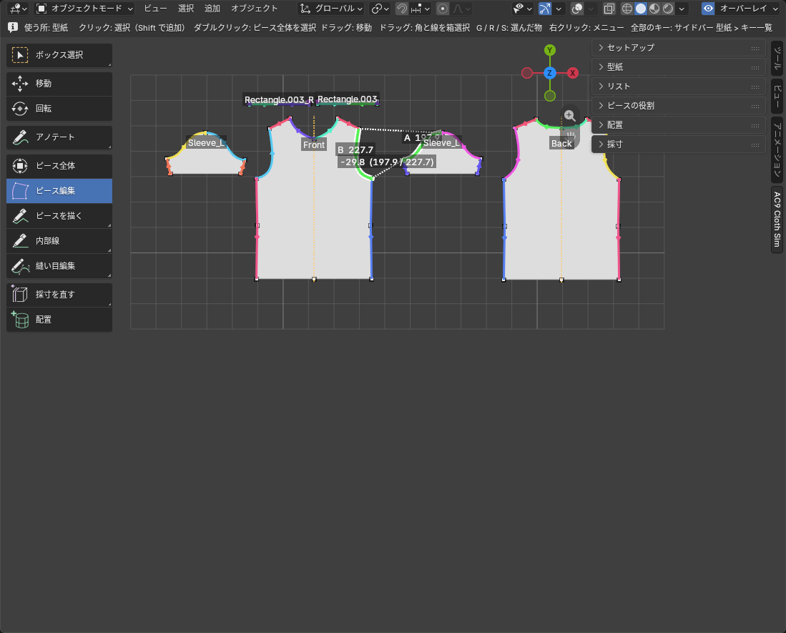

縫い目は、サイドバーの「**リスト**」（Lists）の「**縫い目**」（Seams）タブに 1 行 1 本で並びます。両側（A と B）の長さと、差があれば差（mm）が出ます。

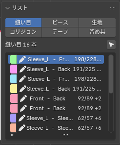

縫い目の付け方の詳しい説明は「[縫い目](features/seams.md)」にあります。

## 7. 置く目安を作る

1. サイドバーの「**配置**」（Placement）のパネルで、「**体**」（Body）の欄にアバターが入っていることを確かめます。
2. 「**ガイド検出**」（Detect Guides）を押します。胴・首・腕・脚のまわりに、ピースを置く目安の円柱（ガイド）ができます。円柱がずれていたら、「**ガイドを編集**」（Edit Guides）で直せます。

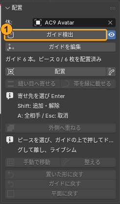

## 8. ピースを体のまわりに置く

1. 「配置」（Placement）のパネルの「**配置**」（Place）を押して、道具を持ちます。
2. 型紙のビューでピースをクリックして選びます（**Shift** で足す）。左右のペアは、片方を置くと相手も鏡の位置に付いてきます。
3. 左の 3D ビューポートで、置きたい円柱の上にカーソルを持っていきます（円柱が黄色に光ります）。
4. 円柱の上で押すと、そこに置かれます。**押したまま動かす**と、円柱のまわり・円柱に沿って滑ります。離した所で決まります（置いたピースを押してドラッグすると、跳ばずに動かした分だけ動きます。角度だけ・高さだけ変えるときと、ピースを倒すときは、Tool タブ「AC9 Piece」の Around（まわりの角度）・Height（高さ）・Tilt（倒す角度。90° で上側が外へ水平、180° で上下逆＝衿の外周が首の側。横の ↻ で +180°））。
5. すべてのピースを置くまで繰り返します。パネルに「○ / ○ pieces placed」（置いた数／使う数）が出ます。

どのピースをどの円柱に置くかの目安:

| ピース | 置く円柱 | 置く所 |
|---|---|---|
| 前身頃 | 胴 | 体の前（正面） |
| 後身頃 | 胴 | 体の後ろ |
| 袖 | 腕 | 左右の腕に 1 枚ずつ。袖山を肩の側に |
| 衿・衿ぐりのリブ | 首 | 首のまわり |
| スカート・パンツ | 胴・脚 | 腰から下 |

- 後ろ側に置くときは、左の 3D ビューポートで視点を回して、体の後ろが見えるようにしてから置きます（中ボタンのドラッグ。中ボタンが無いときは [Blender の基本](blender-basics.md)の「中ボタンやテンキーが無いとき」）。
- 前と後ろ、左と右を取り違えても、計算はそのまま進みます。おかしな着方になったら、置き直します。

離したときに見えている形が、シミュレーションが始まる形です。赤くなったピースは、体に入っている・ほかのピースと重なっているピースです（理由が出ます）。そのままでも始められますが、置き直すか、「配置」パネルの整える道具を使うときれいに始まります。

置き直したいときは、ピースを選んでもう一度「**配置**」（Place）で置きます。「**平面に戻す**」（Back to Flat）は、その場で平らにします。

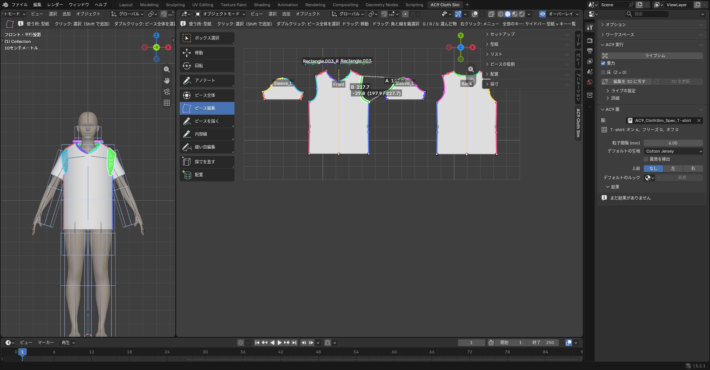

## 9. 着せる（ライブシム）

1. 右の Tool タブのいちばん上（「**AC9 実行**」（AC9 Run））の「**ライブシム**」（Live Sim）を押します。
2. はじめは計算の準備で、少し待ちます（3D ビューに「シミュレーションを準備中（経過 N 秒）」と出ます。はじめて着せるときは、もう少しかかります）。**この間は布が動きませんが、止まってはいません。ボタンをもう一度押さずに待ちます**（もう一度押すと止まります）。
3. 計算が始まると、縫い目が引き寄せられて閉じ、服が体に落ち着いていきます。
4. **自動では止まりません。** 服が落ち着いて動かなくなったら、ボタン（「**停止**」（Stop）に変わっています）をもう一度押すか **Esc** を押します。止めた所の形が結果です。

- 衿や袖が、縫い付く前に落ちてしまうときは、「**重力**」（Gravity）のチェックを外して回し、縫い目が閉じてからチェックを入れます（回っている間に切り替えられます）。
- 計算にかかる時間は、服の大きさとパソコンによって変わります。

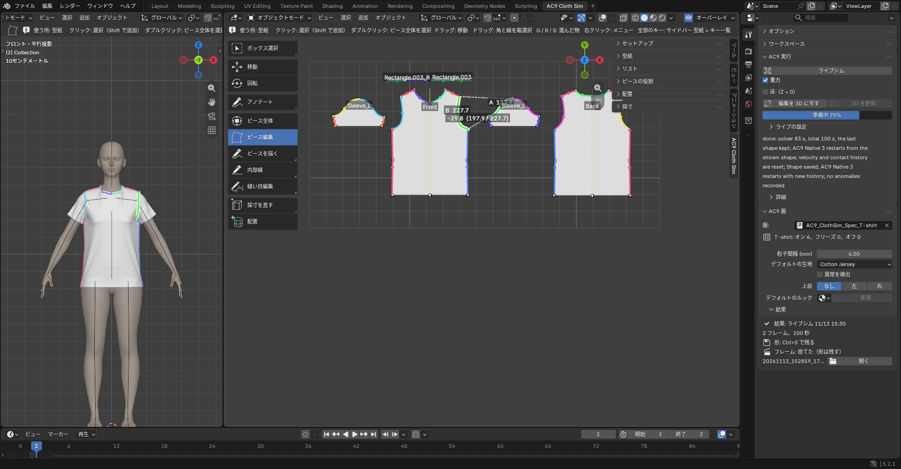

## 10. 結果を見る

- 何も選んでいない状態で Tool タブを見ると、「**AC9 服**」（AC9 Garment） に結果（Result）が出ます。
- 赤い塗りは「異常の候補」です。そのまま不良という意味ではありません。
- 同じ設定でも、計算のたびに仕上がりが少し変わります。1 回で良し悪しを決めず、何度か回して見てください。
- うまく着られたかの目安: 袖が腕に付いている、衿（衿ぐり）が首を囲んでいる、布が体の中に入り込んでいない。

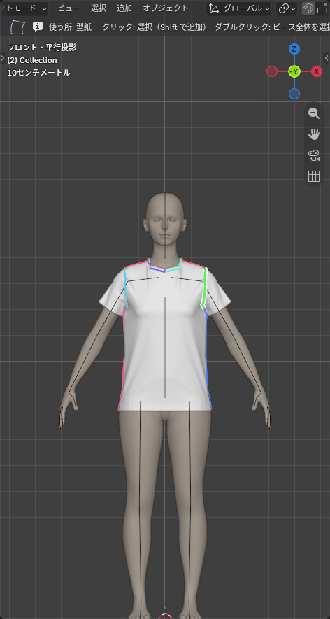

**2 回目からは、今の服の形から続けて計算します。**

## 11. 直して、もう一度着せる

- **型紙を直す**: 「**型紙**」（Pattern） パネルの「**ピース編集**」（Edit Pieces）で角や辺をドラッグします。着た服は、すぐには変わりません。続けて「**ライブシム**」（Live Sim）を押すと、直した形を着た服に写してから**今の形から続けて**計算し、直した型紙に落ち着きます。直すたびに 3D の形を見たいときは、Tool タブの「**AC9 実行**」（AC9 Run）の「**編集を 3D に写す**」（3D Follows Edits）を押します。
- **布を手でつまんで直す**: 「**ライブシム**」（Live Sim）で布が動いている間、**Ctrl＋左ドラッグ**で布をつまんで引っぱれます。布が布を突き抜けたときは、ドラッグ中に **Alt** を押すと、つかんだ布がほかの布をすり抜けます。**Esc** で止めた所の形が残ります。
- **最初から着せ直す**: 何も選ばずに「配置」パネルの「**置いた形に戻す**」（Back to Placed）を押し（確認が出ます）、「**ライブシム**」（Live Sim）を押します。

## 12. 保存する

**Ctrl＋S** で保存します。着せた服の最後の形は .blend の中に、経過のコマは .blend の隣のフォルダに保存されます。

## 次にすること

- 重ね着: 「服」（Garment）の欄でほかの服に切り替えて「ライブシム」を押すと、着せ終わった服は動かない障害物になります。内側の服から順に着せます。
- 生地を変える: ピースを選ぶと、Tool タブの 「**AC9 ピース**」（AC9 Piece） で生地を選べます。
- Cloth Retopo に渡す: Tool タブの 「**AC9 実行**」（AC9 Run） の Details にある「**AC9 Cloth Retopo へ渡す**」（To AC9 Cloth Retopo）で、着せた服を [AC9 Cloth Retopo](https://github.com/openfashion-labs/ac9_cloth_retopo) の Guide にします。

## ほかの始め方

- 自分の体（アバター）を使う: 体の入った .blend を開いて保存し、「**配置**」（Placement）の「**体**」（Body）に体のメッシュを選びます。体はまっすぐ立って、正面が **−Y** を向いているもの（A ポーズでも T ポーズでもかまいません）。
- ほかのソフトの型紙から: 「**BOM を新規読み込み**」（Import BOM）、「**DXF を読み込む**」（Import DXF）、「**SVG を読み込む**」（Import SVG）、「**メッシュから**」（From Mesh）。どれも「[セットアップ](features/setup.md)」に書いてあります。BOM 以外は縫い目が入っていないので、この章の「6. 縫い目を付ける」と同じように付けます。

うまくいかないときは、README の「うまくいかないとき」と、機能ごとの説明の「困ったとき」を見てください。
