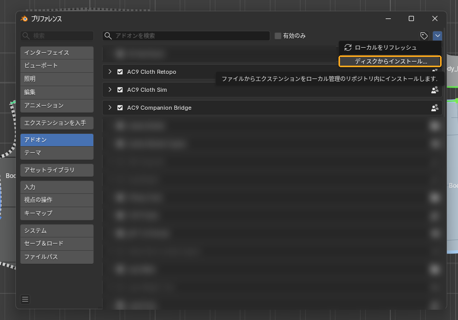

# インストールと前提

## インストール

> この説明は0.4.1の候補です。分離版の正式公開前は、[0.4.0のRelease](https://github.com/openfashion-labs/ac9_cloth_sim/releases/tag/v0.4.0)の全部入りZIPを使います。

### Extensionsから入れる（0.4.1・公開準備中）

正式公開後は、この節からExtensionsの導入ページへ案内します。現在はまだ利用できません。

1. Blender 5.2を開き、プリファレンスでオンラインアクセスを許可します。
2. 導入ページの本体インストールボタンをBlenderへドラッグ＆ドロップします。
3. 配布元が未登録なら追加を確認し、同じボタンをもう一度ドラッグします。
4. 本体をインストールし、アドオン設定の「**計算部品を入れる**」から対応するRuntime（Newton/Warp）を追加します。初回は両方必要です。
5. 対応するRuntimeが変わらない本体更新では、Runtimeを再取得しません。全部入りZIPで入れた旧環境からの自動移行は行いません。

### ZIPから手動で入れる

1. Blender **5.2** を使います。配布版は5.2より前のBlenderには入りません。
2. 現在は0.4.0 Releaseの `ac9_cloth_sim-0.4.0.zip` をダウンロードします。0.4.1公開後の全部入り版は `ac9_cloth_sim-0.4.1-full.zip` です。**解凍しません**。
3. 「編集」→「プリファレンス」（Edit → Preferences）の「アドオン」（Add-ons）を開きます。
4. 右上の **∨** →「Install from Disk…」（ディスクからインストール…）からZIPを選び、インストールします。
5. **AC9 Cloth Sim** が有効になっていることを確認します。

### 導入後の確認と更新

- 3Dビューポートで **N** を押し、サイドバーの「AC9 Cloth Sim」タブを確認します。
- 更新後は**Blenderを終了して起動し直します**。古い部品が残る場合があるためです。F3のReload Scriptsで止まる場合も再起動します。
- 日本語化はPreferences → Interface → Translation → Languageで日本語を選びます。一部の表記は英語のままです。
- 初回の計算はGPUの準備に時間がかかります。待ち時間はパソコンによって異なります。

## 動作環境とGPUの確認範囲

- Windows 64ビット、Blender 5.2、空き容量約1 GB。Macは対象外です。
- NVIDIA GeForce RTX 20・30・40・50シリーズ向けにGPUプログラムのビルドを確認しています。実機で動作確認したのはRTX 50シリーズです。
- GTX 10・16シリーズなど非RTXのNVIDIA GPUと、NVIDIA以外のGPUは対象外です。非RTX機での動作は未検証です。
- 最新のドライバーを使います。古い場合は計算開始時に更新案内が出ます。NVIDIA AppまたはNVIDIA公式サイトから更新してください。
- GPU名はタスクマネージャーの「パフォーマンス」→「GPU」で確認できます。
- α版のため、保存した.blendを次版で開けない場合があります。

## 計算の前提

- シミュレーションは、NVIDIA の Newton という別のプログラムで計算します。Preferences の Add-ons で **AC9 Cloth Sim** を開き、分離版では設定から追加したRuntime、全部入りZIPでは同梱部品を使うので、「**Newton の Python**」（Newton Python）の欄は空のままで構いません。開発環境では、この欄に Newton が入った Python を指定します。
- 指定が足りないと、「**シミュレート**」（Simulate）を押したときに「Set the Newton Python in the add-on preferences」と出て始まりません。
- 同じ Preferences の「**シミュレーション高速起動**」（Fast Simulation Start）（既定でオン）: 計算の準備を先に済ませて待たせ、前の Simulate の服を持っておき、型紙を直した後は次の Simulate を裏で組んでおくので、実行が早く始まります。GPU のメモリを多めに使い（大きい服ほど多く）、編集の後に Blender が少し止まることがあります。GPU のメモリが足りなくなったらオフにしてください。毎回準備から始めるようになります。
- Windows と NVIDIA の GPU（GeForce RTX 20・30・40・50 シリーズ）が要ります。ドライバーは最新にしてください（上の「動作環境とGPUの確認範囲」）。
- 同じ設定でも、計算のたびに仕上がりが数 cm 単位で揺れることがあります。1 回の結果だけで良し悪しを決めないでください。

## 最初にしておくこと

- テスト用の .blend は、開いたらまず別名で保存してください。シミュレーションの経過（タイムラインのコマ）は、保存した .blend の隣の `AC9_ClothSim_jobs` フォルダに作られます（保存していないと一時フォルダになり、経過の再生が後で使えなくなります）。
- 着た服の最後の形は .blend の中に残ります。.blend だけを別の PC に渡しても、開けば最後の形が見え、「**シミュレート**」（Simulate）でそこから続けられます（経過の再生だけはできません）。
- アバターは、まっすぐ立って −Y 方向（正面）を向いている前提です。

インストール後は「[使い始める前に](before-start.md)」で、作業先・初期設定・経過の保存を確認してください。
