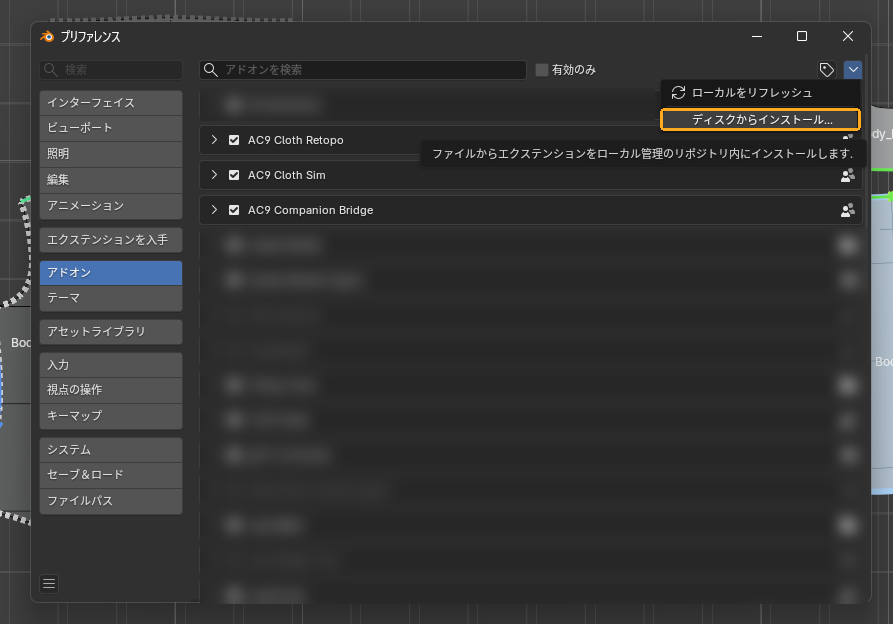

# インストールと前提

## インストール

1. Blender **5.2** を使います（配布版は 5.2 より前の Blender には入りません）。
2. 配布されたアドオンの ZIP をダウンロードします（**解凍しません**）。
3. Blender の上のメニューの「Edit」→「Preferences」（編集 → プリファレンス）を開き、左の列の「Add-ons」（アドオン）を選びます。
4. 右上の **∨** のメニューから「Install from Disk…」（ディスクからインストール…）を押し、ZIP を選んで、右下の青いボタンを押します。
5. 一覧に出た **AC9 Cloth Sim** のチェックがオンになっていることを確かめます。
6. 日本語で使うときは、同じ Preferences の「Interface」（インターフェイス）→「Translation」（翻訳）で「Language」（言語）を「日本語 (Japanese)」にします。
7. Preferences の窓を閉じ、**Blender を一度終了して起動し直します**。アドオンを入れ替えたあとも同じです（古いモジュールが読み込まれたまま残ることがあるため）。F3 の Reload Scripts で止まるときも、再起動してください。

**入ったかの確かめ方**: 3D ビューポートの上にマウスを置いて **N** を押し、右端の縦のタブに「AC9 Cloth Sim」があれば入っています（[Blender の基本](blender-basics.md)の「作業画面にたどり着くまで」）。

## 計算の前提

- シミュレーションは、NVIDIA の Newton という別のプログラムで計算します。Preferences の Add-ons で **AC9 Cloth Sim** を開き、配布版では同梱のものが使われるので、「**Newton の Python**」（Newton Python）の欄は空のままで構いません。開発環境では、この欄に Newton が入った Python を指定します。
- 指定が足りないと、「**ライブシム**」（Live Sim）を押したときに「Set the Newton Python in the add-on preferences」と出て始まりません。
- 同じ Preferences の「**ソルバーを待機させておく**」（Keep the Solver Ready）（既定でオン）: 計算の準備を先に済ませて待たせておき、次の実行を 3〜5 秒早く始めます。待っている間は GPU のメモリを約 200 MB 使い、15 分使わないと終わります。オフにすると、その場で終わり、毎回準備から始めます。
- Windows と NVIDIA の GPU が要ります（入れ方の資料のとおり）。- 同じ設定でも、計算のたびに仕上がりが数 cm 単位で揺れることがあります。1 回の結果だけで良し悪しを決めないでください。

## 最初にしておくこと

- テスト用の .blend は、開いたらまず別名で保存してください。シミュレーションの経過（タイムラインのコマ）は、保存した .blend の隣の `AC9_ClothSim_jobs` フォルダに作られます（保存していないと一時フォルダになり、経過の再生が後で使えなくなります）。
- 着た服の最後の形は .blend の中に残ります。.blend だけを別の PC に渡しても、開けば最後の形が見え、「**ライブシム**」（Live Sim）でそこから続けられます（経過の再生だけはできません）。
- アバターは、まっすぐ立って −Y 方向（正面）を向いている前提です。
