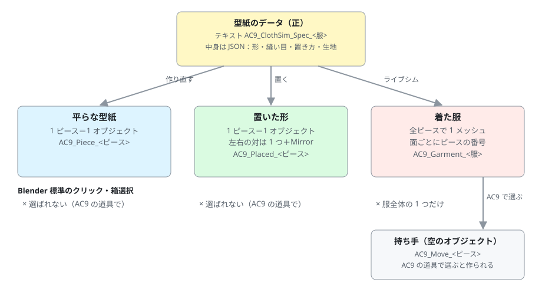

# データの持ち方

## 正は 1 つ、画面の物は作り直される表示

服 1 着ぶんの情報（型紙の形、縫い目、置き方、折り、ピースの役割、生地）は、Blender のテキスト `AC9_ClothSim_Spec_<服の名前>` に JSON で入っています。これが**正**です。

画面に見えるピースは、この正から作られる**オブジェクト**です。同じ 1 枚のピースが、作業の段階によって 3 種類のオブジェクトになります。

| 段階 | オブジェクト | 1 つのオブジェクトに入っているもの | 置き場（コレクション） |
|---|---|---|---|
| 平らな型紙 | `AC9_Piece_<ピース>` | ピース 1 枚 | `AC9_ClothSim_Pattern` |
| 置いた形 | `AC9_Placed_<ピース>` | ピース 1 枚。左右の対は、片側にミラー（Mirror）モディファイアを付けた 1 つ | `AC9_ClothSim_Placed` |
| 着た服 | `AC9_Garment_<服>` | **服の全ピース**。面ごとに、どのピースの面かを持つ | 結果のコレクション |

## Blender の普通の操作で触れるもの、触れないもの

オブジェクトの分け方が段階ごとに違うので、Blender 標準の選択や G／R の効き方も変わります。

| 段階 | Blender 標準のクリック・箱選択 | G（移動）・R（回転） | 直しの行き先 |
|---|---|---|---|
| 平らな型紙 | 選ばれない（ピースを選ぶのは AC9 の道具） | Blender 標準の G／R では動かない（オブジェクトに鍵が掛かっている）。AC9 の道具の中で押す G／R が、型紙のデータを書き換えて動かす | 型紙のデータ |
| 置いた形 | 選ばれない（同上） | ピースが動く。シミュレーションはこの形から始まる | 置いた形のオブジェクト |
| 着た服 | **服全体の 1 つしか選べない** | 服が丸ごと動く | — |

平らな型紙に鍵が掛かっているのは、オブジェクトだけが動いて型紙のデータが変わらない（見た目だけ動いて、次に作り直したら元の場所へ戻る）のを防ぐためです。「**ピース全体**」（Whole Pieces）などの AC9 の道具の中では、G／R のキーが AC9 の操作に置き換わっていて、型紙のデータそのものを動かします。

着た服は、全ピースで 1 つのメッシュです。Blender から見ると「服」という 1 つのオブジェクトしかなく、その中のどこが袖でどこが身頃かを Blender は知りません。そのため、着た服のピースを 1 枚だけ選ぶには、AC9 の道具が要ります。平らな型紙と置いた形も、ピースを選ぶのは AC9 の道具です（Blender 標準の選択の道具は、ピースのオブジェクトを選びません。アウトライナーは選べます）。仕組みは「[選択とギズモ](selection.md)」にあります。

### 型紙の形を Blender の編集モードで直さない理由

平らな型紙のオブジェクトは、型紙のデータから作られる表示です。編集モードで頂点を動かしても、次に作り直されたときに型紙のデータの形へ戻ります。形を直すときは「**ピース編集**」（Edit Pieces）を使います。こちらは型紙のデータそのものを書き換えます。

置いた形は違います。置いた形のオブジェクトは、編集モードで頂点を動かしても、G／R で動かしてもかまいません。シミュレーションは、そのとき画面にある置いた形から始まります。

## 原点（ギズモの中心）

Blender の移動・回転のギズモは、オブジェクトの原点に出ます。原点の位置も段階ごとに違います。

| 段階 | 原点の位置 |
|---|---|
| 平らな型紙 | どのピースも同じ一点（型紙を並べる台の位置）。ピースの上ではない |
| 置いた形 | そのピースの真ん中。左右の対は、元の側の真ん中（鏡で作られる側の上ではない） |
| 着た服 | 服の原点。AC9 の道具でピースを選ぶと、そのピースの真ん中に「持ち手」が出る |

平らな型紙のオブジェクトの原点がピースの上にないため、平らな型紙と置いた形を一緒に選んでいると、ギズモが両者の間の何もない所に出ることがあります。避け方は「[選択とギズモ](selection.md)」にあります。

## 左右の対

左右対称のピース（ペア）は、置いた形では普通 1 つのオブジェクトです。元の側のメッシュにミラー（Mirror）モディファイアが付き、反対側はモディファイアが作る鏡像です。片側を動かすと、反対側は鏡の位置へ付いていきます。

鏡の面の位置は、置き方で変わります。

- 体のまわりに置いた対: 体の中心
- 平らに置いた対（バッグなど）: 服ごとの中心の空のオブジェクト `AC9 Center: <服>`。これを動かすと、対の鏡の面がそこへ移ります

前後に並べた対など、2 つのオブジェクトのままの対もあります。そのときは、片方がもう片方の鏡の位置を追いかけます。

## 消えるもの、残るもの

- 平らな型紙・置いた形のオブジェクトは、型紙のデータから作り直せます。オブジェクトを Blender の X で消しても、型紙のデータは残ります（「ピース」の一覧から戻せます）。
- 置いた形を手で動かした分と、置いた形の頂点の直しは、置いた形のオブジェクトの中にあります。「**ガイドに戻す**」（Back to Guide）や「**平面に戻す**」（Back to Flat）は、これを捨てて作り直します。
- 着た服の最後の形は、`AC9_Garment_<服>` のメッシュそのものです。
