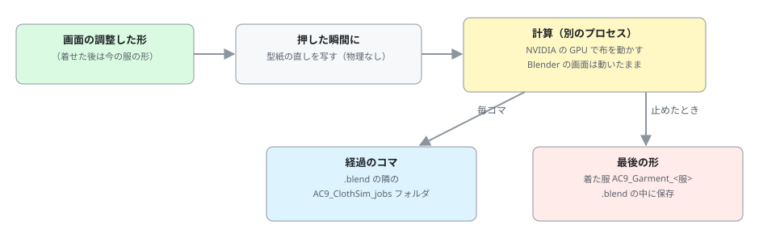

# 計算の流れと保存

## 押した瞬間

1. **始まりの形を決める。** 1 回目は、画面に見えている調整した形から始まります。着せた後の 2 回目からは、今の服の形（経過を再生しているときは、画面に出ているコマ）から続けます。
2. **型紙の直しを写す。** 「編集を 3D に写す」（3D Follows Edits）がオフのとき、型紙を直しても調整した形と着た服はすぐには変わりません。押した瞬間に、直した分をまとめて調整した形と着た服へ写します。写すときは物理の計算をしません（形を当てはめるだけです）。
3. **計算の準備をする。** 型紙から布の網目（細かい三角形）を作り、縫い目・生地の硬さ・体の形と一緒に計算のプログラムへ渡します。

## 計算は Blender の外で回る

布の計算は、Blender とは別のプロセス（別に起動する Python）で、NVIDIA の GPU を使って回ります。計算のライブラリは NVIDIA Newton です。

- 計算の間も Blender の画面は動いたままです。シミュレートの間に Ctrl＋ドラッグで布をつまめるのは、このためです。
- そのパソコンで初めて回すとき（アドオンを入れ替えた後の初回も）は、GPU 用のプログラムを作るので、始まるまで少し待ちます。2 回目からは速く始まります。
- 同じ設定でも、回すたびに仕上がりが少し変わります。1 回の結果だけで良し悪しを決めないでください。

## 何がどこに残るか

| もの | 場所 | 消えるとき |
|---|---|---|
| 型紙のデータ（形・縫い目・置き方・生地・設定） | .blend の中（テキスト `AC9_ClothSim_Spec_<服>`） | — |
| 調整した形 | .blend の中（`AC9_Placed_<ピース>`） | 置き直したとき、「配置した形に戻す」「平面に戻す」 |
| 着た服の最後の形 | .blend の中（`AC9_Garment_<服>` のメッシュ） | 次に回したとき（上書き）、「調整した形に戻す」 |
| 経過のコマ | 保存した .blend の隣の `AC9_ClothSim_jobs` フォルダ | 「キャッシュを削除」、ほかの服を着せたとき |
| 計算のログ | テキスト `AC9_ClothSim_Log` | — |

- .blend を保存する前に回すと、経過のコマは一時フォルダに作られます。あとで再生できないので、先に保存します。
- .blend だけを別のパソコンに渡しても、最後の形は .blend の中にあるので見えて、そこから続けられます。経過の再生だけができません。

## 重ね着

着せ終わった服は、ほかの服を着せるとき「動かない障害物」として計算に入ります。内側の服から順に着せるのはこのためです。ほかの服を着せると、前の服の経過のコマは消え、最後の形だけが残ります。
