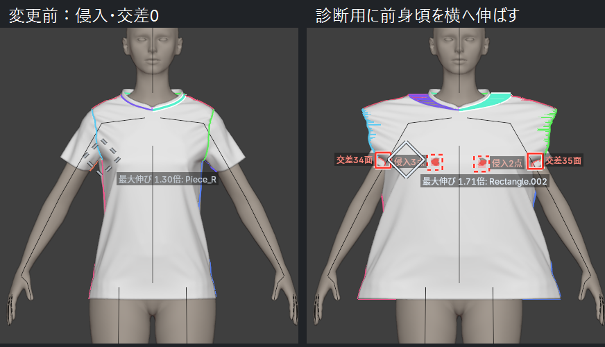

# 困ったとき

## まずここを見る（よくあるつまずき）

| 困っていること | 原因と直し方 |
|---|---|
| サイドバーに「AC9 Cloth Sim」のタブが無い | Preferences の Add-ons で **AC9 Cloth Sim** がオンか。マウスを 3D ビューポートの上に置いて **N** を押したか。入れた直後なら Blender を起動し直す。 |
| 「シミュレート」を押しても何も動かない | 最初は計算の準備で、しばらく動かないように見えます。進み具合の文が出ていれば、もう一度押さずに待ちます（もう一度押すと止まります）。 |
| 実行のボタン（「**シミュレート**」（Simulate）など）が見つからない | サイドバーではなく、右下の Properties エディタの **Tool** タブにあります。Properties が Render など別のタブになっていないかを見ます。 |
| キーボードのショートカットが効かない | 日本語入力（IME）がオンになっていないか。カーソルが操作したいエリアの上にあるか。 |
| AC9 のツールがツールの列から消えた | 編集モードに入っていないか（**Tab** でオブジェクトモードに戻す）。「**セットアップ**」（Setup）の「**型紙のツール**」（Pattern Tools）がオフになっていないか。 |
| 型紙のピースが **G**／**R**／**S** で動かない | ピースには鍵が掛かっています。「**ピース全体**」（Whole Pieces）のツールで動かします。 |
| ボタンが灰色で押せない | ボタンにカーソルを置くと、押せない理由が出ます。 |
| 真ん中の型紙のビューが回らない | 型紙のビューは、真上から見るだけで回りません。回すのは左の 3D ビューポートです。 |
| 視点を回せない（中ボタンが無い） | 「Edit」→「Preferences」の「Input」で「Emulate 3 Button Mouse」をオンにすると、**Alt**＋左ドラッグで回せます。 |
| ピースが見えない・薄い | 灰色の半透明は「**オフ**」（Off）のピース。赤い輪郭と警告は、Blender の **X** でオブジェクトだけが消えたピース（一覧の「**ピース**」（Pieces）タブから戻せます）。**H** で隠したなら **Alt＋H**。3D ビューポートの右上のオーバーレイが切れていると、AC9 の描く線や色も消えます。 |
| 「**シミュレート**」（Simulate）で布をつまめない | 押してから少しの間は布が動きません（パソコンによって変わります）。動き始めてからつまみます。「**フリーズ**」（Freeze）や「オフ」のピースはつかめません。 |
| 結果の「Result」の欄に `folder gone` と出る | 保存した後に .blend を移動したか、名前を変えました。最後の形は残っていますが、経過の再生はできません。 |
| 新しい版を入れたら「cannot import name …」と出る、画面が説明と違う | Blender をいったん閉じて、起動し直します。 |

## 戻せない操作と注意

- 「**調整した形に戻す**」（Back to Adjusted Shape）（何も選ばずに）: 服全体の結果を外します。確認が出ます。Ctrl+Z で戻せます。
- 「**シミュレート**」（Simulate）:「**停止**」（Stop）か **Esc** を押すまで止まりません。経過の保存範囲は[記録設定](features/run.md#recording-progress)によります。
- 「**キャッシュを削除**」（Delete Cache）: 消した経過のコマは戻せません。
- 「**シミュレート**」（Simulate）（2 回目から）、「**AC9 Cloth Retopo へ渡す**」（To AC9 Cloth Retopo）、「**服を採寸**」（Measure Garment）: 経過を再生しているときは、どれも画面に出ているコマを使います。タイムラインの位置を確かめてから押します。
- 「**手で直す**」（Fix by Hand）: 経過の再生が止まります。戻すには Ctrl+Z。
- 現在の形を調べるには「診断」を実行し、形を直したら再診断します。実行前の監視スイッチを必須としません。
- テスト用の .blend は、別名で保存してから使い、上書きしないでください。
- 現在形の診断では、赤は確認済みの交差など、黄は縫合を照合できない交差候補です。対象・件数・未検査も読み、色だけで教材や作品の合否を決めないでください。過去の実行時の記録とは分けます。

下は、診断用に前身頃を横へ伸ばす前後です。赤い四角と最大伸びの菱形は、[配置の診断の表示例](features/placement.md)で型紙側と照合できます。

## うまく動かないとき

| 症状 | まず確かめること | 次の手 |
|---|---|---|
| 「**シミュレート**」（Simulate）が始まらず「Set the Newton Python in the add-on preferences」と出る | Preferences の「**Newton の Python**」（Newton Python）の指定 | 指定を直して再度押す。 |
| 「**シミュレート**」（Simulate）が灰色 | 「**体**」（Body）が選ばれているか。「**ガイド検出**」（Detect Guides）をしたか。 | 体を選び、「**ガイド検出**」（Detect Guides）。 |
| 「未配置 ○ 枚は計算から除外」と出る | 3Dに未配置のピースがある。 | 配置済みのピースだけで計算できます。未配置のピースも計算に加えるときは「**配置**」（Place）で置きます。 |
| 「**ガイド検出**」（Detect Guides）で「upright, facing -Y?」と出る | アバターの向きと姿勢 | まっすぐ立って −Y を向いた体にする。 |
| 「**メッシュから**」（From Mesh）のボタンが押せない | 体が「**体**」（Body）に選ばれているか。服のメッシュが「**メッシュ**」（Mesh）の欄にあるか（空ならアクティブか）。 | 体を選び、服のメッシュをスポイトで「**メッシュ**」の欄に入れる。 |
| 「**手で直す**」（Fix by Hand）が出ない | 経過を再生しているか。 | 経過を再生していないときは、押さずにそのままスカルプトで直せる。結果が無いなら「**シミュレート**」（Simulate）で着せる。 |
| BOM の縫い目が自分自身や別の服のピースに付いている | BOM の番号を何枚ものピースが共有している（何着も集めた服、ほかのファイルから持ってきた部品）。「**セットアップ**」（Setup）の服のまとまりの行（オレンジは確かでない分け方）。 | BOM と一緒に服を FBX で書き出し、「**着せ上がりの FBX から縫い目を決める**」（Seams from 3D Drape (FBX)）で読む。FBX が無いときは、おかしい縫い目を「**縫い目編集**」（Edit Seams）で消すかオフにして、「**縫い目を追加**」（Add Seam）で縫う。 |
| BOM の縫い目が、真向かいでなく対角の相手（左右が入れ違い）に付いている | 書き出す前に、3D の服のソフトでそのピースの表裏を反転していないか。 | 表裏を元に戻して BOM を書き出し直す。戻せないときは「**縫い目編集**」（Edit Seams）で入れ違った縫い目を消し、「**縫い目を追加**」（Add Seam）で縫い直す。 |
| 「**縫い目へ寄せる**」（Part to Seam）、「**帯を縁に載せる**」（Band on Edge）、「**整える**」（Settle）が灰色 | ピースを選んでいるか。置いてあるか。着た服の一部ではないか。 | 置いてから押す。着た服のピースは「**調整した形に戻す**」（Back to Adjusted Shape）してから押す。 |
| 布が布を突き抜けたまま戻らない | 「**シミュレート**」（Simulate）中か。 | 「**シミュレート**」（Simulate）で Ctrl＋ドラッグの間に**Alt**を押してすり抜けさせ、正しい側へ戻す。 |
| 赤が出ない | 現在形を「診断」したか。対象・件数・未検査と診断箇所の表示を確認。 | 必要なら再診断。赤がないだけで安全とは判断しない（[診断](features/placement.md)）。 |
| 型紙を直したら「changed outside the drafting tools」のようなエラー | 型紙データを JSON で直接変えると、服へ写せません。 | 型紙のツールで直すか、「**調整した形に戻す**」（Back to Adjusted Shape）して着せ直す。 |
| 縫い目を付け替えたら布が引き寄せられた | 付け替えた所は新しく縫う扱いになります。 | 正常です。続けて「**シミュレート**」（Simulate）。 |
| 衿が裏返る、つなぎ目がねじれる | 置き方、「**AC9 ピース**」（AC9 Piece）の欄（「**両端**」（Ends）など） | 置き方と欄を確かめる。手で直すなら「**手で直す**」（Fix by Hand）を押してからスカルプトで。 |
| 服が最初から崩れる（腰まで落ちる） | **Esc** で止めて、どの段か確かめる | 縫い目の向き（「**向きを反転:**」（Flip the direction of））と置き方を確かめる。 |
| 結果が回ごとに違う | 同じ設定でも揺れます。 | 1 回で決めず、何度か回して見る。 |
| 結果の形が保存されていない | 「**AC9 服**」（AC9 Garment）の「**結果**」（Result）の `Shape:` の行 | .blend を保存する（Ctrl+S）。 |
| 「**ピース編集**」（Edit Pieces）でピースの内側を引いても、ピースが動かない | ピースごと動かすのは別のツール。 | 「**ピース全体**」（Whole Pieces）に持ち替える（「**型紙**」（Pattern）パネルの「**変形**」（Transform））。 |
| 型紙を直したのに、着た服や調整した形が変わらない。「**3D を更新**」（Update 3D）が赤い | 「**AC9 実行**」（AC9 Run）の「**編集を 3D に写す**」（3D Follows Edits）が外れている。 | 「**3D を更新**」（Update 3D）を押すか、「**編集を 3D に写す**」（3D Follows Edits）を押し直す。 |
| 図形を穴にできない（「**穴に変換**」（Convert to Hole）が断られる） | 図形が閉じているか。外周に触れていないか。ほかの穴と重なっていないか。折り・ゴムが付いていないか。 | 図形を外周から離す、折り・ゴムを外す。 |
| 画面の表記が、この資料と違う | アドオンが古いまま読み込まれている。 | Blender を再起動する。 |

## 報告用の診断情報をコピーする

「**診断情報をコピー**」（Copy Diagnostics）は一時的に非表示です。「AC9 実行」→「設定」、ヘルプメニュー、**F3** 検索からは利用できません。

診断に必要な情報と報告の受付方法を検討しています。準備が整うまで、この機能からの報告やファイルの提出をお願いすることはありません。

不具合が起きたら、「どんな操作をしたか」「どうなると思ったか」「実際にどうなったか」と、画面に表示されたエラーを控えてください。

経過が再生できないときは、[記録設定と保存範囲](features/run.md#recording-progress)を確認してください。シミュレートをしたかどうかだけでは判断しません。

## 不具合を報告するとき

[Issues](https://github.com/openfashion-labs/ac9_cloth_sim/issues)へ、アドオンの版、GPU名、再現する操作（押したボタン）、期待した結果と実際の表示、エラー文字の読めるスクリーンショットを添えてください。版はPreferencesのAdd-onsでAC9 Cloth Simを開くと確認できます。

テンキーがない場合はPreferences → Inputの **Emulate Numpad**、中ボタンがない場合は **Emulate 3 Button Mouse** を使えます。
